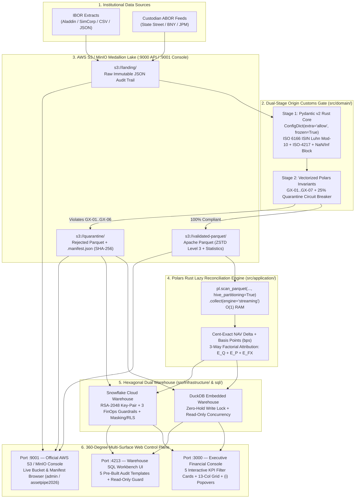

# ASSET-PIPE — Automated Financial & Asset Reconciliation Pipeline

**High-Performance Open-Source Alternative to Commercial SaaS Platforms (Duco / AutoRek): Rust-Vectorized Polars Engine, AWS S3 / MinIO Apache Parquet Data Lake (`:9001`), Pydantic v2 & Great Expectations Contracts, and Dual DuckDB / Snowflake FinOps Warehouse (`:4213`) with Executive Console (`:3000`).**

| Metadata | Specification |
| :--- | :--- |
| **Author** | **Darwin Miguel Abarca Vargas** — *Senior Data & Analytics Engineer \| Quantitative Economist* |
| **Companion Theoretical Treatise** | [**`Financial-BigData-Polars-and-Contracts`**](https://github.com/darwinabarca64/Financial-BigData-Polars-and-Contracts) *(5-Module Quantitative & Architectural Reference)* |
| **Architecture Pattern** | Hexagonal / Clean Architecture (`Domain` -> `Application` -> `Infrastructure` -> `Interfaces`) |
| **Compute & Contracts** | Python 3.11+ \| Polars (Rust Lazy Engine) \| PyArrow (`ZSTD` Parquet) \| Pydantic v2 (Rust Core) |
| **Storage & Dual Warehouse** | AWS S3 / MinIO (`:9000` API / `:9001` Console) \| DuckDB (`:4213` Zero-Lock) \| Snowflake Cloud (RSA-2048 + FinOps) |
| **Executive Control Plane** | Node.js 22 / TypeScript / Express (`:3000`) — *Shadcn UI + Financial Power BI Clarity* |
| **Engineering Governance** | Asymmetric `<= 250 LOC` Modularity Ceiling \| Zero Emojis (`[OK]`, `[NAV-BREAK]`, `[CRITICAL]`) \| Honest Zero (`$0.00`) |

---

## 1. Executive Summary & Architectural Positioning

Institutional asset managers, hedge funds, and global custodians reconcile hundreds of thousands of daily multi-currency positions between their **Investment Book of Record (IBOR)** (e.g., BlackRock Aladdin, SimCorp Dimension, Charles River) and their **Custodian Accounting Book of Record (ABOR)** (e.g., BNY Mellon, State Street, J.P. Morgan, Northern Trust).

Commercial enterprise reconciliation SaaS platforms such as **Duco** and **AutoRek** charge six-figure annual licensing fees while operating as opaque black boxes. Conversely, legacy in-house Python scripts built on single-threaded `pandas` and row-by-row loops suffer from Out-Of-Memory (`OOM`) crashes, silent IEEE 754 `NaN`/`Inf` propagation, and uncontrolled cloud warehouse compute bills.

**`asset-pipe`** solves these institutional challenges through five architectural pillars:

1. **Dual-Stage Origin Customs Gate (`Pydantic v2` + Vectorized `GX-01..GX-07`):** Enforces ISO 6166 Luhn Mod-10 Base-36 `ISIN` checksums, ISO-4217 currencies, IEEE 754 `NaN`/`Inf` sanitization, and compound primary-key uniqueness (`portfolio_id`, `isin`, `valuation_date`) before a single byte enters analytical storage.
2. **3-Bucket S3 / MinIO Medallion Data Lake (`landing/`, `validated-parquet/`, `quarantine/`):** Stores validated positions in columnar Apache Parquet compressed with **Zstandard (`ZSTD`, level 3)** and isolates rejected records in `quarantine/` alongside cryptographic `.manifest.json` sidecars (`SHA-256`).
3. **Out-of-Core `Polars` Rust Lazy Reconciliation & 3-Way Factorial Attribution:** Evaluates Net Asset Value (`NAV`) discrepancies in basis points ($\delta_{\text{bps}}$) and decomposes every break into exact **Quantity ($E_Q$)**, **Price ($E_P$)**, and **FX ($E_{FX}$)** dollar contributions with zero Python row loops.
4. **Dual Warehouse (`DuckDB` Local / `Snowflake` Cloud) with 3 Mandatory FinOps Guardrails:** Switches seamlessly via `WAREHOUSE_ENGINE=duckdb|snowflake` while enforcing aggressive Snowflake cost controls (`AUTO_SUSPEND = 60`, `STATEMENT_TIMEOUT_IN_SECONDS = 300`, and `RESOURCE MONITOR` hard suspension at `100%`).
5. **360-Degree Multi-Surface Observability (`:3000` + `:9001` + `:4213`) & Honest Zero Baseline (`$0.00`):** Starts and resets deterministically at `$0.00` exposure across three synchronized web interfaces with zero file-lock contention.

> [!IMPORTANT]
> **Companion Theoretical Treatise Repository:** The complete mathematical proofs, memory-complexity derivations, and architectural deep dives backing this production monorepo are published in the companion repository: [**`Financial-BigData-Polars-and-Contracts`**](https://github.com/darwinabarca64/Financial-BigData-Polars-and-Contracts).

---

## 2. The 360-Degree Live Architecture & 3-Screen Port Matrix



### The 3 Simultaneous Live Interfaces (`:3000`, `:9001`, `:4213`)

| Port / URL | Surface Name | Primary Purpose & Key Capabilities | Credentials / Access Mode |
| :--- | :--- | :--- | :--- |
| **`http://localhost:3000`** | **Executive Financial Reconciliation Console** | *Shadcn UI + Financial Power BI* control center: 4 real pipeline action buttons (`Ingest Valid Batch`, `Inject Corrupt & NAV Breaks`, `Reconcile Lake (Polars)`, `Reset to 0`), 5 interactive server-side filter KPI cards, `(i)` mathematical formula popovers, S3/FinOps telemetry bar, global search, and 13-column server-paginated attribution table. | Direct Browser Access (`Honest Zero Baseline: $0.00` on start) |
| **`http://localhost:9001`** | **AWS S3 / MinIO Object Storage Console** | Inspect physical object storage across the 3 Medallion buckets (`landing`, `validated-parquet`, `quarantine`), download `ZSTD` Parquet partitions, and verify `.manifest.json` forensic sidecars (`SHA-256`). | **Username:** `admin`<br/>**Password:** `assetpipe2026` |
| **`http://localhost:4213`** | **Warehouse SQL Workbench UI** | Dedicated SQL query explorer connected to the active warehouse (`DuckDB` or `Snowflake`) with 5 one-click institutional audit presets (`v_executive_reconciliation_kpis`, `v_nav_and_schema_breaks_triage`, `v_portfolio_aum_rollup`, `fact_quarantine_audit_log`, `fact_reconciled_positions`). | Read-Only Enforced (`SELECT` / `WITH` / `DESCRIBE` / `EXPLAIN`) |

---

## 3. 60-Second Quickstart (Docker Compose & Local CLI)

### Option A: Full 3-Screen Stack via Docker Compose (Recommended)

Launch the entire 3-container topology (`minio`, `asset-pipe-console`, `asset-pipe-sql-ui`) with a single command:

```bash
# 1. Build and start all 3 services in the background
docker compose up -d --build

# 2. Verify all 3 containers are running
docker compose ps
```

Once started, open the 3 interfaces in your browser:
- **Executive Console (`:3000`):** `http://localhost:3000`
- **MinIO S3 Console (`:9001`):** `http://localhost:9001` (`admin` / `assetpipe2026`)
- **Warehouse SQL Workbench (`:4213`):** `http://localhost:4213`

### Option B: Local Developer Workflow (Node.js 22 + Python 3.11+)

```bash
# 1. Install Python and Node.js dependencies
python -m pip install -e ".[dev]"
npm install

# 2. Terminal 1: Start the Executive Financial Console on http://localhost:3000
npm start

# 3. Terminal 2: Start the Zero-Lock SQL Workbench on http://localhost:4213
python -m src.interfaces.web.sql_workbench_server

# 4. Or drive the entire reconciliation lifecycle directly from the CLI:
python -m src.interfaces.cli.pipeline_cli --action status
python -m src.interfaces.cli.pipeline_cli --action ingest-valid --count 45 --seq 1
python -m src.interfaces.cli.pipeline_cli --action inject-corrupt --breaks-count 12 --corrupt-count 6 --seq 2
python -m src.interfaces.cli.pipeline_cli --action reconcile
python -m src.interfaces.cli.pipeline_cli --action positions --status-filter BREAKS_ONLY --sort-by nav_break_abs_desc
python -m src.interfaces.cli.pipeline_cli --action reset
```

### Running the 4 Automated Quality Gates Locally

Every commit is validated by `.github/workflows/quality_gates.yml` (`FORCE_JAVASCRIPT_ACTIONS_TO_NODE24: "true"`):

```bash
# Gate 1: Architectural, OPSEC ("Zero-Kilometer Car"), Zero-Emoji, and <= 250 LOC Audit
python -m pytest tests/python/test_architecture_and_opsec.py -v

# Gate 2: Ruff Linter & Format Check (0 warnings / 0 errors)
python -m ruff check .

# Gate 3: Full Python Domain, Contracts, S3 Parquet, Polars NAV, and Dual Warehouse Suite (80 tests)
python -m pytest -v

# Gate 4: TypeScript Strict Compiler & Vitest SSR / V8 Browser Script Compilation Suite
npm run typecheck
npm test
```

---

## 4. Mathematical Core: NAV Reconciliation & 3-Way Factorial Attribution

All valuation and attribution equations in `src/application/reconciliation_engine.py` execute as vectorized **Polars Rust expressions (`pl.Expr`)** over lazy `pl.LazyFrame` plans (`scan_parquet` -> `.collect(engine="streaming")`):

### 4.1. Cent-Exact Valuation & Basis-Point Discrepancy ($\delta_{\text{bps}}$)

For each position $i$ on valuation date $t$, the engine computes the IBOR valuation in USD ($\text{NAV}_{\text{IBOR}, i}$), the signed dollar break ($\Delta \text{NAV}_i$), and the relative severity in basis points ($\delta_{\text{bps}, i}$, where $1\text{ bps} = 0.01\% = 10^{-4}$):

$$\text{NAV}_{\text{IBOR}, i} = \operatorname{round}\!\left(Q_{\text{IBOR}, i} \times P_{\text{IBOR}, i} \times FX_{\text{IBOR}, i},\; 2\right)$$

$$\Delta \text{NAV}_i = \operatorname{round}\!\left(\text{NAV}_{\text{IBOR}, i} - \text{NAV}_{\text{ABOR}, i},\; 2\right)$$

$$\delta_{\text{bps}, i} = \operatorname{round}\!\left(\frac{|\Delta \text{NAV}_i|}{\max\!\left(|\text{NAV}_{\text{IBOR}, i}|,\; 0.01\right)} \times 10{,}000,\; 4\right)$$

### 4.2. Exact 3-Way Factorial Attribution ($E_Q + E_P + E_{FX} = \Delta \text{NAV}$)

When a position breaches the institutional materiality threshold ($\delta_{\text{bps}, i} > 5.0\text{ bps}$), operations teams must immediately know whether the break was caused by an **unsettled trade (`QUANTITY_BREAK`)**, a **stale market price (`PRICE_BREAK`)**, or an **FX fixing discrepancy (`FX_BREAK`)**. The engine decomposes $\Delta \text{NAV}_i$ into three exact orthogonal drivers:

$$E_{Q, i} = \operatorname{round}\!\left((Q_{\text{IBOR}, i} - Q_{\text{ABOR}, i}) \times P_{\text{ABOR}, i} \times FX_{\text{ABOR}, i},\; 2\right)$$

$$E_{P, i} = \operatorname{round}\!\left(Q_{\text{IBOR}, i} \times (P_{\text{IBOR}, i} - P_{\text{ABOR}, i}) \times FX_{\text{ABOR}, i},\; 2\right)$$

$$E_{FX, i} = \operatorname{round}\!\left(\Delta \text{NAV}_i - E_{Q, i} - E_{P, i},\; 2\right)$$

The dominant root cause (`primary_driver`) is assigned via $\arg\max(|E_{Q,i}|, |E_{P,i}|, |E_{FX,i}|)$, and both the `:3000` console and `:4213` SQL views expose the full dollar breakdown (`Q:$... | P:$... | FX:$...`).

### 4.3. Preventing Error Masking: `Gross_Fund_Break` vs. `Net_Fund_Break`

If Position A has a `+$500,000.00` break and Position B has a `-$500,000.00` break in the same portfolio, their signed sum (`Net_Fund_Break`) is `$0.00`, hiding `$1,000,000.00` of operational risk. Both `compute_portfolio_nav_rollup()` and `v_portfolio_aum_rollup` compute:

$$\text{Gross\_Fund\_Break}_p = \sum_{i \in p} |\Delta \text{NAV}_i| \qquad \text{vs.} \qquad \text{Net\_Fund\_Break}_p = \sum_{i \in p} \Delta \text{NAV}_i$$

### 4.4. Vectorized Declarative Quality Invariants (`GX-01` through `GX-07`)

Before any batch reaches the reconciliation engine, `evaluate_batch_invariants()` in [`src/domain/invariants.py`](src/domain/invariants.py) executes 7 vectorized Polars rules simultaneously:

| Rule ID | Invariant Name | Vectorized Polars Predicate | Action on Failure |
| :--- | :--- | :--- | :--- |
| **`GX-01`** | Compound Primary Key Uniqueness | `pl.struct(["portfolio_id", "isin", "valuation_date"]).is_duplicated()` | Isolate all duplicate instances to `s3://quarantine/` |
| **`GX-02`** | ISO 6166 `ISIN` Format & Checksum | 12-char regex + Luhn Mod-10 Base-36 check digit | Reject to `s3://quarantine/` with `.manifest.json` |
| **`GX-03`** | Non-Negative Market Price & Units | `(price >= 0.0) & (units.abs() > 0.0)` | Reject to `s3://quarantine/` |
| **`GX-04`** | Positive FX Rate (`> 0.0`) | `fx_rate > 0.0` (and `fx_rate == 1.0` when `currency == "USD"`) | Reject to `s3://quarantine/` |
| **`GX-05`** | ISO-4217 Currency Whitelist | `currency.is_in(ISO_4217_CURRENCIES)` | Reject to `s3://quarantine/` |
| **`GX-06`** | IEEE 754 Finite Float Sanitization | `is_finite() & is_not_null() & is_not_nan()` across all floats | Reject to `s3://quarantine/` |
| **`GX-07`** | Material NAV Discrepancy Flag | `nav_break_bps > 5.0` (`0.05%` institutional tolerance) | Retain in `validated-parquet/` and flag `[NAV-BREAK]` |

---

## 5. Client Custom Schema Onboarding & Dual Warehouse Switching

### 5.1. Polymorphic Client Schema Onboarding (`ConfigDict(extra="allow")` & Alias Mapping)

External custodians and fund administrators rarely deliver files with identical column names, and frequently attach proprietary columns (`internal_desk_code`, `bloomberg_figi`, `settlement_location`, `tax_lot_id`). `InstitutionalPositionContract` in [`src/domain/contracts.py`](src/domain/contracts.py) handles this natively without modifying core pipeline logic:

1. **Automatic Header Normalization (`CLIENT_COLUMN_ALIASES`):** Maps diverse client headers (`qty`, `Quantity`, `SHARE_COUNT` -> `units`; `dirty_price`, `MarketPrice` -> `price`; `custodian_nav`, `ABOR_NAV_USD` -> `custodian_reported_nav`; `security_isin` -> `isin`) in `mode="before"`.
2. **Polymorphic Extra Column Preservation (`extra="allow"`):** Extra client columns are retained in `model_extra`, audited against IEEE 754 `NaN`/`Inf` poisoning, and serialized into `extra_metadata_json` so zero client context is lost.

| Client / Custodian Source | Raw Incoming Column Header | Canonical `Asset-Pipe` Field | Validation & Storage Behavior |
| :--- | :--- | :--- | :--- |
| **BlackRock Aladdin / SimCorp** | `fund_code`, `account_id`, `PORTFOLIO` | `portfolio_id` | Non-empty uppercase normalized string (`GX-05`). |
| **BNY Mellon / State Street** | `security_isin`, `instrument_isin`, `ISIN_CODE` | `isin` | ISO 6166 12-char Luhn Mod-10 Base-36 check digit (`GX-01`). |
| **J.P. Morgan / Northern Trust** | `qty`, `quantity`, `shares`, `position_units` | `units` | Finite IEEE 754 `Float64`, `abs(units) > 0` (`GX-04`). |
| **WM/Reuters / Bloomberg** | `dirty_price`, `market_price`, `clean_price` | `price` | Finite IEEE 754 `Float64`, strictly `>= 0.0` (`GX-03`). |
| **Custodian ABOR Valuation** | `custodian_nav`, `abor_nav`, `reported_nav_usd` | `custodian_reported_nav` | Finite IEEE 754 `Float64`, compared against IBOR NAV (`GX-07`). |
| **Custom Client Attributes** | `desk_strategy`, `tax_lot_id`, `prime_broker` | `extra_metadata_json` | Preserved via `ConfigDict(extra="allow")`, scanned for `NaN`/`Inf`. |

### 5.2. 1-Line Switching Between `DuckDB` Local and `Snowflake` Cloud (`FinOps` + `Zero-Trust`)

The Hexagonal `WarehousePort` ([`src/application/ports.py`](src/application/ports.py)) decouples analytical persistence from the underlying SQL engine:

```bash
# Default: Zero-Configuration Embedded DuckDB (Zero-Hold Write Lock + Read-Only :4213)
WAREHOUSE_ENGINE=duckdb

# Production Cloud Switch: Enterprise Snowflake Data Cloud with RSA-2048 Key-Pair Auth
WAREHOUSE_ENGINE=snowflake
SNOWFLAKE_ACCOUNT=xy12345.us-east-1
SNOWFLAKE_USER=ASSET_PIPE_SVC_USER
SNOWFLAKE_ROLE=ASSET_PIPE_SVC_ROLE
SNOWFLAKE_WAREHOUSE=ASSET_PIPE_WH
SNOWFLAKE_DATABASE=ASSET_PIPE_DB
SNOWFLAKE_SCHEMA=RECONCILIATION
SNOWFLAKE_PRIVATE_KEY_PATH=/secrets/rsa_key.p8
```

When deploying to Snowflake, execute the governance DDL scripts in [`sql/`](sql):
- [`sql/00_finops_guardrails.sql`](sql/00_finops_guardrails.sql): Configures `AUTO_SUSPEND = 60`, `STATEMENT_TIMEOUT_IN_SECONDS = 300`, and the `ASSET_PIPE_MONTHLY_BUDGET_GUARD` resource monitor (`ON 100 PERCENT DO SUSPEND_IMMEDIATELY`).
- [`sql/01_security_rbac.sql`](sql/01_security_rbac.sql): Enforces `RSA_PUBLIC_KEY` service authentication (`PASSWORD = NULL`), Dynamic Data Masking (`MASK_NAV_USD_AMOUNT`, `MASK_PORTFOLIO_CODE`), and Row-Level Security (`RLS_PORTFOLIO_ENTITLEMENT_POLICY`).
- [`sql/02_analytical_views.sql`](sql/02_analytical_views.sql): Creates `v_executive_reconciliation_kpis`, `v_nav_and_schema_breaks_triage`, and `v_portfolio_aum_rollup`.

| Governance Dimension | `DuckDB` Embedded Engine (`WAREHOUSE_ENGINE=duckdb`) | `Snowflake` Cloud Engine (`WAREHOUSE_ENGINE=snowflake`) |
| :--- | :--- | :--- |
| **Authentication** | Local OS file permissions (`data/asset_pipe.duckdb`) | Zero-Trust **RSA-2048 Key-Pair** (`PKCS#8`, `PASSWORD = NULL`) |
| **Concurrency Model** | Ephemeral **Zero-Hold Write Lock** + `read_only=True` readers | Multi-Cluster Virtual Warehouse (`MIN=1, MAX=2, ECONOMY`) |
| **FinOps Cost Controls** | `$0.00` local compute | `AUTO_SUSPEND=60`, `STATEMENT_TIMEOUT=300`, `RESOURCE MONITOR` 100% |
| **Data Privacy & RBAC** | Local schema isolation | Dynamic Data Masking (`MASK_NAV_USD_AMOUNT`) + Row-Level Security (`RLS`) |
| **Honest Zero Baseline** | `COALESCE(SUM(...), 0.0)` returns `$0.00` on empty tables | Identical `COALESCE(SUM(...), 0.0)` SQL views (`02_analytical_views.sql`) |

---

## 6. Repository Directory Structure & Asymmetric LOC Governance

Every production Python, TypeScript, SQL, and test file strictly obeys the **Asymmetric `<= 250 LOC` Ceiling** enforced by [`tests/python/test_architecture_and_opsec.py`](tests/python/test_architecture_and_opsec.py):

```text
asset-pipe/
├── .github/workflows/
│   └── quality_gates.yml                  # 4-Gate CI/CD Pipeline (Node 24 + Pytest + Ruff + Vitest)
├── docker/
│   ├── Dockerfile.console                 # Node 22 + Python 3.12/Polars Bridge Image (:3000)
│   └── Dockerfile.sql-ui                  # Python 3.12 Read-Only SQL Workbench Image (:4213)
├── docs/
│   ├── adr/                               # 9 Michael Nygard Architecture Decision Records (0001..0009)
│   └── runbooks/                          # 9 Encyclopedic Operational Runbooks (01..09)
├── sql/
│   ├── 00_finops_guardrails.sql           # Snowflake FinOps: AUTO_SUSPEND=60, TIMEOUT=300, RM 100%
│   ├── 01_security_rbac.sql               # RSA-2048 Key-Pair, Dynamic Data Masking & Row Access Policy
│   └── 02_analytical_views.sql            # Cross-Engine Views (COALESCE Honest Zero Baseline)
├── src/
│   ├── domain/
│   │   ├── entities.py                    # ISO 6166 Luhn Mod-10 ISIN, ISO-4217 & Immutable Entities
│   │   ├── exceptions.py                  # Structured Forensic Domain Exception Taxonomy
│   │   ├── contracts.py                   # Pydantic v2 Customs Gate (extra='allow', NaN/Inf block)
│   │   └── invariants.py                  # Vectorized Polars GX-01..GX-07 & 25% Circuit Breaker
│   ├── application/
│   │   ├── ports.py                       # Hexagonal Protocols (DataLakePort & WarehousePort)
│   │   ├── reconciliation_engine.py       # Polars Lazy NAV Engine & 3-Way Attribution (Q/P/FX)
│   │   ├── synthetic_generator.py         # Deterministic Multi-Currency Clean & Break Generator
│   │   └── ingestion_service.py           # End-to-End Orchestrator & Deterministic Reset to Zero
│   ├── infrastructure/
│   │   ├── config.py                      # Typed Immutable Environment Configuration
│   │   ├── s3_parquet_adapter.py          # AWS S3 / MinIO 3-Bucket ZSTD Parquet & SHA-256 Manifests
│   │   ├── duckdb_adapter.py              # Zero-Hold Write Lock & Read-Only DuckDB Adapter
│   │   ├── snowflake_adapter.py           # RSA-2048 Key-Pair & FinOps Session Snowflake Adapter
│   │   └── warehouse_factory.py           # Runtime Dual Warehouse Selector (duckdb | snowflake)
│   └── interfaces/
│       ├── cli/
│       │   └── pipeline_cli.py            # Unified JSON CLI (status, ingest, corrupt, reconcile, reset)
│       └── web/
│           ├── server.ts                  # Express / TypeScript Control Plane & REST API (:3000)
│           ├── dashboard_view.ts          # SSR Shadcn UI + Power BI Executive Console (:3000)
│           └── sql_workbench_server.py    # Zero-Lock Read-Only Warehouse SQL Explorer (:4213)
├── tests/
│   ├── python/                            # 80 Pytest Unit, Integration, FinOps & OPSEC Tests
│   └── web/                               # Vitest SSR, V8 Browser JS Syntax & API Integration Suite
├── docker-compose.yml                     # 3-Container Topology (:3000 + :9001 + :4213)
├── package.json                           # Node 22 / TypeScript / Express / Vitest Configuration
└── pyproject.toml                         # PEP 621 Metadata, Ruff & Pytest Configuration
```

---

## 7. Complete Index of Living Architecture Decision Records (`docs/adr/`) and Operational Runbooks (`docs/runbooks/`)

### 7.1. Architecture Decision Records (`docs/adr/0001..0009` — Michael Nygard Standard)

| ADR ID | Document Link | Architectural Decision Summary |
| :--- | :--- | :--- |
| **ADR-0001** | [`0001-clean-architecture-and-asymmetric-loc-governance.md`](docs/adr/0001-clean-architecture-and-asymmetric-loc-governance.md) | Hexagonal Clean Architecture boundaries, Asymmetric `<= 250 LOC` modularity rule, Zero-Emoji policy, and OPSEC hygiene. |
| **ADR-0002** | [`0002-dual-contract-pydantic-rust-and-vectorized-gx-invariants.md`](docs/adr/0002-dual-contract-pydantic-rust-and-vectorized-gx-invariants.md) | Two-stage Origin Customs Gate combining Pydantic v2 (`extra="allow"`, ISO 6166 Luhn Mod-10) and vectorized Polars `GX-01..GX-07` invariants. |
| **ADR-0003** | [`0003-s3-minio-parquet-zstd-and-forensic-quarantine-lake.md`](docs/adr/0003-s3-minio-parquet-zstd-and-forensic-quarantine-lake.md) | 3-Bucket S3/MinIO Medallion Lake (`landing`, `validated-parquet`, `quarantine`) with `ZSTD` level-3 Parquet and `.manifest.json` (`SHA-256`). |
| **ADR-0004** | [`0004-polars-rust-lazy-streaming-and-factorial-nav-attribution.md`](docs/adr/0004-polars-rust-lazy-streaming-and-factorial-nav-attribution.md) | Out-of-Core `Polars` Rust lazy streaming (`scan_parquet`) and exact 3-way factorial NAV attribution ($E_Q, E_P, E_{FX}$). |
| **ADR-0005** | [`0005-snowflake-finops-guardrails-and-zero-trust-rsa2048-rbac.md`](docs/adr/0005-snowflake-finops-guardrails-and-zero-trust-rsa2048-rbac.md) | Snowflake FinOps guardrails (`AUTO_SUSPEND=60`, `STATEMENT_TIMEOUT=300`, `RESOURCE MONITOR` 100%) and Zero-Trust RSA-2048 + Masking/RLS. |
| **ADR-0006** | [`0006-dual-warehouse-duckdb-zerolock-and-snowflake-adapter.md`](docs/adr/0006-dual-warehouse-duckdb-zerolock-and-snowflake-adapter.md) | Dual Warehouse implementation (`DuckDBWarehouseAdapter` Zero-Hold Write Lock + `SnowflakeWarehouseAdapter` RSA-2048) and unified CLI. |
| **ADR-0007** | [`0007-unified-web-control-plane-and-zerolock-sql-workbench.md`](docs/adr/0007-unified-web-control-plane-and-zerolock-sql-workbench.md) | Unified Express/TypeScript Web Control Plane (`:3000`) and Zero-Lock Read-Only SQL Workbench (`:4213`). |
| **ADR-0008** | [`0008-executive-financial-console-shadcn-powerbi-and-honest-zero.md`](docs/adr/0008-executive-financial-console-shadcn-powerbi-and-honest-zero.md) | Institutional Executive Console (`:3000`) with Shadcn UI + Power BI clarity, Honest Zero Baseline (`$0.00`), 5 KPI filter cards, and V8 JS gate. |
| **ADR-0009** | [`0009-docker-compose-360-multi-surface-observability-topology.md`](docs/adr/0009-docker-compose-360-multi-surface-observability-topology.md) | 3-Container Docker Compose topology (`:3000` + `:9001` + `:4213`) with shared lock-free volume and unified Node 22 + Python/Polars runtime. |

### 7.2. Operational Runbooks (`docs/runbooks/01..09` — Incident Triage & SRE Guides)

| Runbook ID | Document Link | Operational Scope & Triage Procedures |
| :--- | :--- | :--- |
| **Runbook-01** | [`01-origin-data-contracts-isin-and-client-schema-onboarding.md`](docs/runbooks/01-origin-data-contracts-isin-and-client-schema-onboarding.md) | Triaging ISO 6166 ISIN Luhn Mod-10 failures, IEEE 754 `NaN`/`Inf` rejections, and onboarding new client schemas (`CLIENT_COLUMN_ALIASES`). |
| **Runbook-02** | [`02-declarative-gx-invariants-and-circuit-breaker-triage.md`](docs/runbooks/02-declarative-gx-invariants-and-circuit-breaker-triage.md) | Diagnosing `GX-01..GX-07` batch invariant violations and recovering from `QuarantineCircuitBreakerError` (`> 25%` rejection rate). |
| **Runbook-03** | [`03-s3-quarantine-forensics-and-parquet-recovery.md`](docs/runbooks/03-s3-quarantine-forensics-and-parquet-recovery.md) | Inspecting `s3://quarantine/` `.manifest.json` (`SHA-256`) sidecars, replaying remediated batches, and auditing `ZSTD` Parquet statistics. |
| **Runbook-04** | [`04-polars-nav-break-triage-and-factorial-attribution.md`](docs/runbooks/04-polars-nav-break-triage-and-factorial-attribution.md) | Financial operations playbook for resolving `QUANTITY_BREAK` ($E_Q$), `PRICE_BREAK` ($E_P$), and `FX_BREAK` ($E_{FX}$) discrepancies. |
| **Runbook-05** | [`05-snowflake-finops-circuit-breaker-and-rsa2048-key-rotation.md`](docs/runbooks/05-snowflake-finops-circuit-breaker-and-rsa2048-key-rotation.md) | Responding to Snowflake `RESOURCE MONITOR` budget suspensions, query timeouts (`300s`), and zero-downtime RSA-2048 key-pair rotation. |
| **Runbook-06** | [`06-dual-warehouse-operations-and-zerolock-sql-workbench.md`](docs/runbooks/06-dual-warehouse-operations-and-zerolock-sql-workbench.md) | Operating `pipeline_cli.py`, switching `WAREHOUSE_ENGINE`, and preventing DuckDB file lock contention across processes. |
| **Runbook-07** | [`07-web-api-bridge-and-sql-workbench-operations.md`](docs/runbooks/07-web-api-bridge-and-sql-workbench-operations.md) | Managing the `:3000` REST API endpoints and operating the `:4213` Read-Only SQL Workbench with its 5 audit query templates. |
| **Runbook-08** | [`08-executive-console-360-triage-and-ui-verification.md`](docs/runbooks/08-executive-console-360-triage-and-ui-verification.md) | 10-second break isolation using the 5 KPI cards on `:3000`, `(i)` formula popovers, and frontend V8 verification (`Vitest`). |
| **Runbook-09** | [`09-docker-compose-360-deployment-and-container-troubleshooting.md`](docs/runbooks/09-docker-compose-360-deployment-and-container-troubleshooting.md) | Deploying and troubleshooting the 3-container Docker Compose stack (`:3000`, `:9001`, `:4213`), network bridge, and volume lifecycle. |

---

## 8. License

Released under the **MIT License**. Designed and engineered by **Darwin Miguel Abarca Vargas**.
