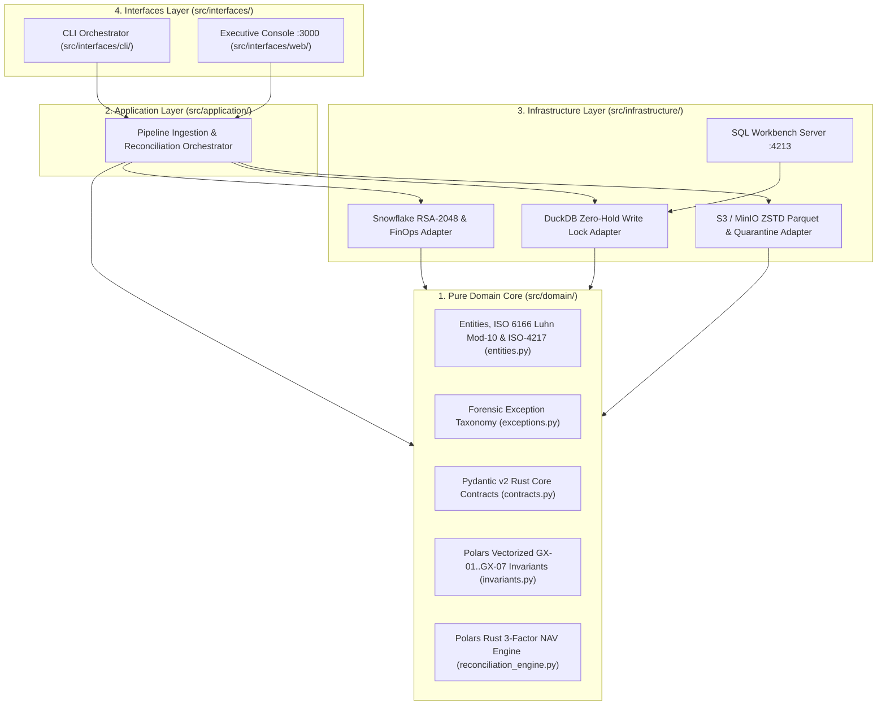

# ADR 0001: Clean Architecture Concentric Isolation, OPSEC Zero-Leak Hygiene, and Asymmetric LOC Governance

## Status

`ACCEPTED` — Date: 2026-11-10

---

## Context

Institutional asset managers, hedge funds, and global custodian operations spend between $50,000 and $250,000 USD annually on closed-source SaaS reconciliation platforms (such as Duco, AutoRek, or legacy SmartStream TLM deployments). While those platforms provide out-of-the-box workflows, they suffer from three structural engineering limitations when applied to modern quantitative investment book of record (IBOR) vs. accounting book of record (ABOR) pipelines:

1. **Tightly Coupled Monolithic Logic:** Business invariants (such as ISO 6166 Luhn Mod-10 ISIN validation, ISO-4217 currency enforcement, and 3-factor Net Asset Value attribution) are frequently entangled with proprietary database drivers, cloud storage SDKs, or UI presentation layers. A change in the analytical persistence engine (e.g., migrating from local DuckDB to cloud Snowflake) risks breaking core mathematical reconciliation logic.
2. **Operational Security (`[OPSEC]`) Exposure in Financial Repositories:** Quantitative engineering teams developing locally on heterogeneous workstations risk leaking workstation hostnames, OS usernames, absolute local filesystem paths, or cloud credentials into tracked source code, telemetry artifacts, or configuration templates.
3. **The Modularity vs. Cohesion Paradox in Line-of-Code (LOC) Limits:** Enforcing a uniform, rigid ceiling (e.g., `<= 250 LOC` across every single file in a repository) ensures high modularity and single-responsibility discipline in domain, application, infrastructure, and test modules. However, applying that same ceiling blindly to self-contained full-stack UI views (`dashboard_view.ts`, `server.ts`, `sql_workbench_server.py`) or encyclopedic operational documentation (`README.md`, `docs/adr/*.md`, `docs/runbooks/*.md`) forces artificial fragmentation that degrades readability and operational incident response.

---

## Decision

We adopt a four-pillar architectural governance model enforced automatically via pytest static analysis and GitHub Actions CI/CD (`quality_gates.yml` running on Node 24):

### 1. Four-Layer Concentric Clean Architecture

All source code is organized into four strict concentric rings following the Dependency Inversion Principle (dependencies point strictly inward toward `src/domain`):



### 2. Asymmetric LOC Governance Ceiling (`MAX_STANDARD_LOC = 250`)

We enforce an asymmetric modularity policy verified on every test run by `test_asymmetric_loc_limit()`:

| Artifact Category | Target Path Pattern | LOC Ceiling | Rationale |
| :--- | :--- | :--- | :--- |
| **Pure Domain Core** | `src/domain/*.py` | `<= 250 LOC` | Guarantees atomic, testable financial mathematics and contracts. |
| **Application Services** | `src/application/*.py` | `<= 250 LOC` | Prevents god-object orchestrators and enforces clean port boundaries. |
| **Infrastructure Adapters** | `src/infrastructure/**/*.py` | `<= 250 LOC` | Isolates S3, DuckDB, and Snowflake drivers into focused adapters. |
| **Automated Test Suites** | `tests/python/*.py` | `<= 250 LOC` | Keeps unit and integration suites focused and fast to diagnose. |
| **SQL DDL/DML Scripts** | `sql/*.sql` | `<= 250 LOC` | Separates analytical schemas from FinOps and RBAC governance scripts. |
| **Cohesive UI & Docs (`DOC_EXEMPT_NAMES`)** | `dashboard_view.ts`, `server.ts`, `sql_workbench_server.py`, `README.md`, `docs/adr/*.md`, `docs/runbooks/*.md` | **Exempt (`Unbounded`)** | Preserves monolithic UI coherence and encyclopedic operational runbooks. |

### 3. Strict Zero-Emoji and Zero-Leak `[OPSEC]` Enforcement

- **Zero-Emoji Policy:** Unicode emojis (`[\U0001F300-\U0001FAFF\u2600-\u27BF]`) are strictly prohibited across all code, SQL, TypeScript, and documentation files. Only formal ASCII institutional tags (`[OK]`, `[WARN]`, `[CRITICAL]`, `[NAV-BREAK]`, `[FINOPS]`, `[OPSEC]`) are permitted.
- **Zero Workstation Identity Leaks:** Static scanners inspect all tracked text files to block any accidental inclusion of workstation usernames, machine hostnames, or absolute OS paths.

### 4. Four-Gate GitHub Actions CI/CD Pipeline on Node 24

The workflow `.github/workflows/quality_gates.yml` sets `FORCE_JAVASCRIPT_ACTIONS_TO_NODE24: "true"` globally and blocks merges unless all four quality gates succeed:
- **Gate 1:** Architectural, `[OPSEC]`, Zero-Emoji, and Asymmetric `250-LOC` Audit.
- **Gate 2:** Ruff Static Linting (`E`, `F`, `I`, `W`, `UP`, `B` with `line-length = 100`).
- **Gate 3:** Domain Math, Pydantic v2 Rust Contracts, and Polars Vectorized GX Suite.
- **Gate 4:** End-to-End Integration, S3 Parquet ZSTD, and Dual Warehouse FinOps Tests.

---

## Consequences

### Positive

- **Zero Vendor Lock-In:** Core financial entities, ISIN Luhn Mod-10 checksums, Pydantic v2 contracts, and Polars NAV reconciliation operate with zero dependency on cloud SDKs or database drivers.
- **Guaranteed Codebase Maintainability:** No functional Python module or test file can silently bloat beyond `250 LOC`, forcing clean Single Responsibility Principle (SRP) decomposition.
- **Uncompromised Operational Documentation:** By explicitly exempting `docs/adr/*.md` and `docs/runbooks/*.md` in `_is_loc_exempt()`, engineering and custody operations teams receive exhaustive, production-grade runbooks without artificial truncation.
- **Institutional `[OPSEC]` Posture:** Repository clones remain 100% sanitized ("Zero-Kilometer Car" standard) with `.antigravity/`, `.env`, and runtime `.duckdb` artifacts isolated via `.gitignore`.

### Negative and Mitigations

- **Strict Refactoring Discipline Required:** Adding features to an existing domain module near `240 LOC` requires extracting helper functions or splitting responsibilities across cohesive domain modules. *Mitigation:* The Self-Healing Loop (Law 6) checks line counts continuously after every edit.
- **ASCII-Only Logging Discipline:** Developers accustomed to decorative icons in markdown or CLI logs must use `[OK]`, `[WARN]`, and `[CRITICAL]`. *Mitigation:* `test_zero_emojis_policy()` fails immediately during local pytest runs if any emoji is introduced.

---

## Compliance Verification

### Static Guardian Assertions (`tests/python/test_architecture_and_opsec.py`)

| Guardian Function | Invariant Enforced | Failure Tag |
| :--- | :--- | :--- |
| `test_clean_architecture_directories_exist()` | Verifies physical presence of `src/domain`, `src/application`, `src/infrastructure`, `src/interfaces/cli`, `src/interfaces/web`, `sql`, `docs/adr`, and `docs/runbooks`. | `[CRITICAL]` |
| `test_gitignore_opsec_rules()` | Verifies `.gitignore` blocks `.env`, `*.duckdb`, `.antigravity/`, and local hardware reports. | `[OPSEC]` |
| `test_zero_opsec_leaks_in_tracked_files()` | Scans all repository text files for forbidden local paths and workstation identifiers. | `[OPSEC]` |
| `test_zero_emojis_policy()` | Rejects any Unicode emoji character across `.py`, `.ts`, `.sql`, `.md`, `.yml`, and `.json`. | `[CRITICAL]` |
| `test_asymmetric_loc_limit()` | Enforces `<= 250 LOC` on all non-exempt code, test, and SQL files. | `[CRITICAL]` |
| `test_github_actions_workflow_and_node24_configured()` | Confirms `FORCE_JAVASCRIPT_ACTIONS_TO_NODE24: "true"` and all 4 CI/CD gates. | `[OPSEC]` |
| `test_living_adrs_and_runbooks_integrity()` | Verifies ADRs (`>= 100 LOC`) and Runbooks (`>= 160 LOC`) include Mermaid diagrams and tables. | `[CRITICAL]` |

### Verification Commands

Compliance with ADR 0001 is verified automatically by executing:

```bash
python -m pytest tests/python/test_architecture_and_opsec.py -v
python -m ruff check .
```

