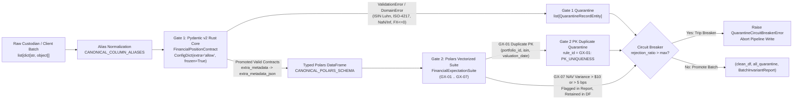

# ADR 0002: Hybrid Dual-Gate Ingestion Customs — Pydantic v2 Rust Core Contracts and Polars Vectorized GX-01..GX-07 Invariants

## Status

`ACCEPTED` — Date: 2026-11-10

---

## Context

In institutional investment operations, daily position extracts arriving from global custodians (State Street, BNY Mellon, J.P. Morgan, BNP Paribas) and internal Investment Book of Record (IBOR) engines exhibit four recurrent failure modes that compromise downstream Net Asset Value (NAV) calculations:

1. **Row-Level vs. Set-Level Blind Spots:** Row-by-row schema validation can verify data types and field constraints on an individual record, but is structurally blind to batch-level anomalies such as duplicate compound primary keys `(portfolio_id, isin, valuation_date)` or systemic batch corruption exceeding safety thresholds.
2. **Custodian Schema Drift and Proprietary Client Columns:** Custodian feeds frequently rename standard columns (`fund_id`, `abor_nav`, `ccy`, `qty`, `market_price`) and append bespoke desk-level attributes (`desk_code`, `bloomberg_figi`, `seniority_tranche`, `custom_beta`). Rejecting unknown columns breaks client onboarding, while accepting them blindly without floating-point sanitization allows corrupt metadata to infiltrate analytical storage.
3. **IEEE 754 `NaN` and `Infinity` Poisoning:** Upstream pricing engines or illiquid fixed-income feeds occasionally emit IEEE 754 `NaN`, `Infinity`, or `-Infinity` floats. If a single `NaN` enters a vectorized column sum, it silently poisons the entire portfolio AUM calculation (`sum() -> NaN`) or crashes SQL serialization.
4. **Legacy `great-expectations` Library Overhead and Python 3.13/3.14 Incompatibility:** The legacy open-source `great-expectations` Python package pulls over 80 transitive dependencies, relies on heavy Pandas object-dtype introspection, and suffers from C-extension and typing incompatibilities on modern Python 3.12–3.14 runtimes.

---

## Decision

We implement a **Two-Stage Hybrid Customs Gate** entirely within the pure domain layer (`src/domain/contracts.py` and `src/domain/invariants.py`), combining `Pydantic v2` (`pydantic-core` compiled in Rust) for record-level structural polymorphism with vectorized `Polars` Rust expressions for batch-level declarative accounting expectations (`GX-01` through `GX-07`):



### Stage 1: Record-Level Polymorphic Contract (`src/domain/contracts.py`)

- **Alias Normalization (`CANONICAL_COLUMN_ALIASES`):** Automatically maps common custodian column headers (`pos_id`, `fund_id`, `security_isin`, `as_of_date`, `ccy`, `qty`, `market_price`, `spot_fx`, `abor_nav`) to the 9 canonical attributes before validation if the canonical key is not already present.
- **Polymorphic Retention (`ConfigDict(extra="allow", frozen=True, str_strip_whitespace=True)`):** Validates the 9 core fields strictly while preserving arbitrary client columns in `model_extra`, exported via `to_canonical_dict()["extra_metadata"]` and serialized into `extra_metadata_json`.
- **Algorithmic ISO 6166 Luhn Mod-10 & ISO-4217 Enforcement:** Invokes `validate_isin_iso6166` (verifying 12-character format, authorized country prefix, and Base-36 Luhn Mod-10 check digit) and `validate_iso4217_currency`.
- **Total IEEE 754 `NaN`/`Inf` Blockade:** Enforces `allow_inf_nan=False` on all four core float fields (`units`, `price`, `fx_rate`, `custodian_reported_nav`) AND inspects every float inside `self.model_extra` during `@model_validator(mode="after")`, rejecting any non-finite float infiltrated via custom client columns.
- **Base Currency FX Identity:** Enforces `currency == "USD" => abs(fx_rate - 1.0) <= 1e-6`.

### Stage 2: Set-Level Vectorized Polars GX Suite (`src/domain/invariants.py`)

Promoted contracts are materialized into a strictly typed `pl.DataFrame` (`CANONICAL_POLARS_SCHEMA`) and evaluated by `FinancialExpectationSuite` without Python row loops:

| Rule ID | Expectation Name | Vectorized Polars Invariant | Routing Action on Failure |
| :--- | :--- | :--- | :--- |
| **`GX-01: PK_UNIQUENESS`** | `expect_compound_columns_to_be_unique` | `pl.struct(["portfolio_id", "isin", "valuation_date"]).is_duplicated()` | Remove colliding rows from `clean_df` and append to quarantine (`COMPOUND_KEY_DUPLICATE_DETECTED`). |
| **`GX-02: CORE_NOT_NULL`** | `expect_column_values_to_not_be_null` | `pl.any_horizontal(pl.col(c).is_null() ...)` | Quarantined at Gate 1 (`CONTRACT_VIOLATION` / `IEEE754_NON_FINITE_NUMBER`). |
| **`GX-03: ISIN_ISO6166_REGEX`** | `expect_column_values_to_match_regex` | `pl.col("isin").str.contains(r"^[A-Z]{2}[A-Z0-9]{9}[0-9]$")` | Quarantined at Gate 1 (`INVALID_ISIN_ISO6166`). |
| **`GX-04: CURRENCY_ISO4217`** | `expect_column_values_to_be_in_set` | `pl.col("currency").is_in(ISO_4217_CURRENCIES)` | Quarantined at Gate 1 (`UNSUPPORTED_ISO4217_CURRENCY`). |
| **`GX-05: PRICE_NON_NEGATIVE`** | `expect_column_values_to_be_between` | `(pl.col("price") >= 0.0) & pl.col("price").is_finite()` | Quarantined at Gate 1 (`CONTRACT_VIOLATION` / `IEEE754_NON_FINITE_NUMBER`). |
| **`GX-06: FX_STRICT_POSITIVE`** | `expect_column_values_to_be_between` | `(pl.col("fx_rate") > 0.0) & pl.col("fx_rate").is_finite()` | Quarantined at Gate 1 (`CONTRACT_VIOLATION` / `IEEE754_NON_FINITE_NUMBER`). |
| **`GX-07: NAV_EQUATION_MATCH`** | `expect_column_pair_nav_discrepancy_within_tolerance` | `(nav_break_abs <= 10.0) & (nav_break_bps <= 5.0)` | Counted in `nav_break_detected_count`; **retained in `clean_df`** for 3-factor attribution and `:3000` dashboard display. |

### Architectural Comparison: Legacy Great Expectations vs. Asset-Pipe Dual Gate

| Dimension | Legacy `great-expectations` Package | Asset-Pipe Pydantic v2 + Polars `GX-01..GX-07` |
| :--- | :--- | :--- |
| **Execution Engine** | Pandas / Python object loops | Rust (`pydantic-core` + `polars` SIMD lazy expressions) |
| **Python 3.12–3.14 Support** | Fragile transitive dependency tree | 100% native compatibility (`0` deprecation warnings) |
| **Row-by-Row Quarantine Bifurcation** | Requires custom post-processing hooks | Native atomic split (`clean_df`, `quarantine_list`, `report`) |
| **Polymorphic Client Metadata** | Schema rigidness or unvalidated passthrough | `ConfigDict(extra="allow")` + `NaN`/`Inf` extra-field sanitization |
| **Batch Circuit Breaker** | External orchestration required | Built-in `QuarantineCircuitBreakerError` with forensic context |

---

## Consequences

### Positive

- **Sub-Millisecond Customs Latency:** Validating and bifurcating thousands of positions executes in milliseconds using compiled Rust kernels in `pydantic-core` and `polars`.
- **Zero Silent Data Loss or Poisoning:** Every rejected record is preserved in `QuarantineRecordEntity` with a safe JSON serialization (`allow_nan=False`, converting `NaN`/`Inf` to strings) and deterministic `rule_id` (`GX-01`..`GX-06`).
- **Clear Separation Between Schema Corruption and Accounting Breaks:** Schema violations (`GX-01`..`GX-06`) are isolated to the quarantine bucket before touching analytical calculations, whereas valid positions with valuation discrepancies (`GX-07`) flow into the reconciliation engine to be decomposed into Quantity, Price, and FX drivers.

### Negative and Mitigations

- **Strict Compound Key Quarantine (`GX-01`):** When two records share `(portfolio_id, isin, valuation_date)`, `.is_duplicated()` marks all colliding instances for quarantine rather than arbitrarily guessing which duplicate is authoritative. *Mitigation:* Custody operations receive both colliding payloads in the quarantine manifest so the upstream trade aggregation feed can be corrected deterministically.

---

## Compliance Verification

### Mathematical Formulation of ISO 6166 Luhn Mod-10 and GX-07 Basis Points

1. **ISO 6166 Luhn Mod-10 Base-36 Expansion (`compute_isin_check_digit`):**
   - Given an 11-character stem $S = c_1 c_2 \dots c_{11}$ where $c_1, c_2 \in \text{VALID\_ISIN\_COUNTRY\_PREFIXES}$:
   - Each alphabetic character $c_i \in [\text{'A'}, \text{'Z'}]$ is mapped to its two-digit decimal representation $\text{ord}(c_i) - 55 \in [10, 35]$.
   - Traversing the resulting digit string from right to left (index $k = 0, 1, \dots$), digits at even indices ($k \bmod 2 = 0$) are doubled ($d' = 2d$, summing tens and units digits $\lfloor d'/10 \rfloor + (d' \bmod 10)$).
   - The authoritative 12th check digit is:
     $$C_{12} = (10 - (\Sigma \bmod 10)) \bmod 10$$

2. **GX-07 Vectorized NAV Equation Tolerance (`FinancialExpectationSuite.evaluate`):**
   - For every promoted record in `clean_df`:
     $$\text{NAV}_{\text{IBOR}} = \text{units} \times \text{price} \times \text{fx\_rate}$$
     $$\Delta_{\text{abs}} = |\text{NAV}_{\text{IBOR}} - \text{custodian\_reported\_nav}|$$
     $$\delta_{\text{bps}} = \frac{\Delta_{\text{abs}}}{\max(|\text{custodian\_reported\_nav}|, |\text{NAV}_{\text{IBOR}}|)} \times 10{,}000$$
   - A position triggers `GX-07: NAV_EQUATION_MATCH` (`nav_break_detected_count += 1`) if $\Delta_{\text{abs}} > \$10.00$ or $\delta_{\text{bps}} > 5.0\text{ bps}$.

### Automated Test Coverage Matrix

| Test Suite | Module Under Test | Key Invariants Verified |
| :--- | :--- | :--- |
| `tests/python/test_domain_entities_and_isin.py` | `src/domain/entities.py`, `src/domain/exceptions.py` | Real institutional ISINs (`US0378331005`, `ES0113900J37`, `DE000BAY0017`), check-digit corruption, character transposition, `ISO_4217_CURRENCIES`, frozen entities, Honest Zero Baseline. |
| `tests/python/test_contracts_pydantic_v2.py` | `src/domain/contracts.py` | `ConfigDict(extra="allow", frozen=True)`, `CANONICAL_COLUMN_ALIASES`, IEEE 754 `NaN`/`Inf`/`-Inf` rejection in core and extra fields, USD FX identity, batch quarantine routing. |
| `tests/python/test_contracts_invariants_gx.py` | `src/domain/invariants.py` | Vectorized `GX-01..GX-07`, compound PK duplicate isolation, declarative NAV break counting, `QuarantineCircuitBreakerError`, empty DataFrame schema safety. |

### Verification Commands

Compliance with ADR 0002 is verified automatically by executing:

```bash
python -m pytest tests/python/test_domain_entities_and_isin.py tests/python/test_contracts_pydantic_v2.py tests/python/test_contracts_invariants_gx.py -v
python -m ruff check src/domain/
```

