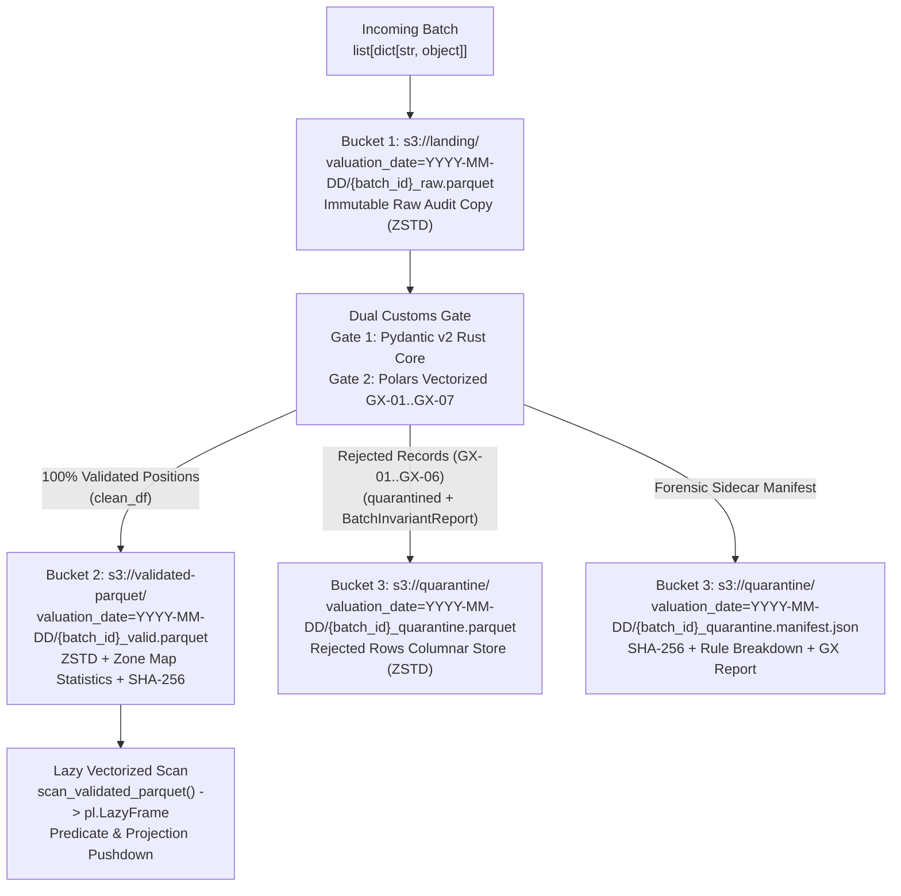

# ADR 0003: Medallion S3 / MinIO Data Lake Topology, Zstandard (`ZSTD`) Columnar Parquet, and Cryptographic SHA-256 Quarantine Manifests

## Status

`ACCEPTED` — Date: 2026-11-10

---

## Context

Institutional financial reconciliation pipelines ingesting daily position extracts from multiple global custodians and internal IBOR engines must satisfy four storage and regulatory audit requirements:

1. **Physical Isolation Between Raw, Validated, and Corrupted Data:** Storing raw custodian files in the same bucket or directory prefix as validated analytical tables risks accidental inclusion of corrupted rows (`NaN` prices, broken Luhn Mod-10 ISINs, or duplicate primary keys) in downstream Net Asset Value (NAV) calculations.
2. **Columnar Compression Efficiency and Predicate Pushdown Performance:** Traditional CSV/JSON extracts or GZIP-compressed flat files require full-file scans, lack embedded column data types, and suffer from slow decompression speeds. High-throughput vectorized engines (`Polars` Rust and `DuckDB`) require a columnar format with page-level `min`/`max` statistics (*Zone Maps*) and dictionary encoding.
3. **Cryptographic Non-Repudiation for Regulatory Audit Trails (SOC 2 / MiFID II):** When positions are rejected into quarantine (`GX-01` through `GX-06`), financial auditors require an immutable sidecar manifest (`.manifest.json`) proving the exact `SHA-256` digest of the quarantined Parquet payload, the originating landing object URI, the rule violation breakdown, and the complete `BatchInvariantReport`.
4. **Seamless Hybrid Execution Across Cloud (`AWS S3`), Local Container (`MinIO :9000/:9001`), and Offline CI Runners:** Developers and operations teams need visual object inspection in the MinIO Web Console (`http://localhost:9001`) while automated CI/CD test suites (`quality_gates.yml`) must execute deterministically in sub-second runtimes even when no container daemon is running.

---

## Decision

We implement the hexagonal `DataLakePort` (`src/application/ports.py`) via `S3ParquetAdapter` (`src/infrastructure/s3_parquet_adapter.py`) backed by typed configuration (`AssetPipeConfig` in `src/infrastructure/config.py`):

### 1. Three-Bucket Medallion Lake Topology

All data lake storage is segregated into three isolated buckets partitioned by `valuation_date=YYYY-MM-DD`:



### 2. Selection of Apache Parquet with Zstandard (`ZSTD`) and Zone Map Statistics

Every Parquet artifact across `landing`, `validated-parquet`, and `quarantine` is written with `compression="zstd", statistics=True`:

| Storage Format & Codec | Compression Ratio (Financial Tabular) | Decompression Speed (MB/s) | Column Projection Pushdown | Row-Group Zone Map Statistics (`min`/`max`) | IEEE 754 Type Safety |
| :--- | :--- | :--- | :--- | :--- | :--- |
| **Raw CSV / JSON** | `1.0x` (Baseline) | Slow (Text Parsing) | No (Full Row Scan) | None | Fragile (String Ambiguity) |
| **CSV + GZIP (`DEFLATE`)** | `~3.8x` | `~180 MB/s` | No (Stream Decompress) | None | Fragile |
| **Parquet + Snappy** | `~3.2x` | `~1,100 MB/s` | Yes | Optional | Strict Arrow Schema |
| **Parquet + Zstandard (`ZSTD`, Chosen)** | **`~5.4x`** | **`~1,050 MB/s`** | **Yes (Native SIMD)** | **Enabled (`statistics=True`)** | **Strict (`CANONICAL_POLARS_SCHEMA`)** |

### 3. Dual S3 `boto3` Synchronization and Local Columnar Mirror

`S3ParquetAdapter` performs a fast non-blocking TCP probe (`_is_s3_endpoint_reachable`, `timeout=0.15s`) against `S3_ENDPOINT_URL` (`http://localhost:9000`):
- **Local Columnar Mirror (`config.local_lake_root`):** Every object write is persisted atomically to the local mirror directory (`data/s3_lake/<bucket>/valuation_date=...`) enabling direct zero-copy `pl.scan_parquet(...)` and instant offline CI execution.
- **Live S3 / MinIO Synchronization:** When MinIO (`:9000`) or AWS S3 is reachable, `S3ParquetAdapter` uses `boto3` (`connect_timeout=1, read_timeout=2`) to ensure all three buckets exist and mirrors every `put_object` and `reset_lake_to_zero` operation in real time so objects are immediately browsable in the MinIO Console (`http://localhost:9001`).

### 4. Cryptographic `.manifest.json` Quarantine Contract

Whenever `write_quarantine_artifacts` persists rejected records, it computes `hashlib.sha256(pq_bytes).hexdigest()` on the exact binary Parquet buffer and writes a deterministic JSON manifest containing:
- `batch_id`, `valuation_date`, `created_at_utc`, and `source_uri` (`s3://landing/...`).
- `quarantine_parquet_uri` and `sha256` cryptographic digest.
- `rule_violation_summary`: Histogram of violated rules (`GX-01: PK_UNIQUENESS`, `GX-03: ISIN_ISO6166_REGEX`, etc.).
- `invariant_report`: Complete serialized `BatchInvariantReport` (`GX-01`..`GX-07`).

---

## Consequences

### Positive

- **Zero Corrupt Rows in `validated-parquet`:** Analytical consumers (`Polars` reconciliation engine, `DuckDB`, `Snowflake`) scan `validated-parquet` knowing every file conforms to `CANONICAL_POLARS_SCHEMA` with zero `NaN`/`Inf` floats and zero duplicate compound keys.
- **Tamper-Evident Forensics:** Any post-incident modification to a quarantined `.parquet` file invalidates its companion `.manifest.json` `sha256` hash.
- **Instant Honest Zero Reset (`reset_lake_to_zero`):** Both the local columnar mirror and the live MinIO buckets (`:9001`) can be purged back to `0 objects / 0 bytes` in a single atomic call.

### Negative and Mitigations

- **Dual Write Footprint in Local Development:** When MinIO is running locally via Docker, objects exist both in the local mirror and inside the MinIO container volume. *Mitigation:* Financial position batches are highly compressed via `ZSTD` (tens of kilobytes per batch), making the dual footprint negligible while guaranteeing 100% resilience if Docker is stopped.

---

## Compliance Verification

### Hexagonal `DataLakePort` Contract Verification Matrix

| Method Signature on `DataLakePort` | Target S3 Bucket | Physical Format & Codec | Cryptographic / Schema Guarantee |
| :--- | :--- | :--- | :--- |
| `ensure_buckets_exist()` | `landing`, `validated-parquet`, `quarantine` | S3 Bucket + Local Mirror | Idempotent creation on startup (`head_bucket` / `create_bucket`). |
| `write_landing_batch(batch_id, raw_records, valuation_date)` | `s3://landing/` | `ZSTD` Parquet (`_raw.parquet`) | Sanitized JSON strings (`allow_nan=False`) preserving exact arrival order. |
| `write_validated_parquet(batch_id, clean_df, valuation_date)` | `s3://validated-parquet/` | `ZSTD` Parquet (`_valid.parquet`) | `CANONICAL_POLARS_SCHEMA`, `statistics=True`, and `SHA-256` digest. |
| `write_quarantine_artifacts(batch_id, quarantined, report, valuation_date, source_uri)` | `s3://quarantine/` | `ZSTD` Parquet + `.manifest.json` | `QUARANTINE_POLARS_SCHEMA` + tamper-evident `SHA-256` sidecar manifest. |
| `scan_validated_parquet(valuation_date)` | `s3://validated-parquet/` | `pl.LazyFrame` (`pl.scan_parquet`) | Zero-copy lazy scan or typed empty `pl.LazyFrame` on zero baseline. |
| `get_lake_storage_metrics()` | All 3 Buckets | Structured Telemetry Dict | Real-time object count and byte footprint per bucket. |
| `reset_lake_to_zero()` | All 3 Buckets | Atomic Purge | Removes all local mirror files and MinIO S3 objects back to `0`. |

### JSON Schema of the Quarantine Forensic Sidecar (`.manifest.json`)

```json
{
  "batch_id": "BATCH-Q-02",
  "compression": "ZSTD",
  "created_at_utc": "2026-11-10T16:40:00Z",
  "invariant_report": {
    "batch_id": "BATCH-Q-02",
    "nav_break_detected_count": 0,
    "quarantined_count": 1,
    "rejection_rate_bps": 2500.0,
    "total_received": 4,
    "valid_promoted_count": 3
  },
  "quarantine_parquet_uri": "s3://quarantine/valuation_date=2026-11-10/BATCH-Q-02_quarantine.parquet",
  "quarantined_records_count": 1,
  "rule_violation_summary": {
    "GX-03: ISIN_ISO6166_REGEX": 1
  },
  "sha256": "e3b0c44298fc1c149afbf4c8996fb92427ae41e4649b934ca495991b7852b855",
  "source_uri": "s3://landing/valuation_date=2026-11-10/BATCH-Q-02_raw.parquet",
  "valuation_date": "2026-11-10"
}
```

### Verification Commands

Compliance with ADR 0003 is verified automatically by executing:

```bash
python -m pytest tests/python/test_s3_parquet_adapter.py tests/python/test_architecture_and_opsec.py -v
python -m ruff check src/application/ports.py src/infrastructure/config.py src/infrastructure/s3_parquet_adapter.py
```

