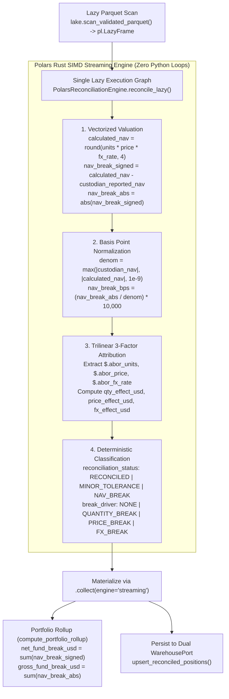

# ADR 0004: Polars Rust Lazy Streaming Reconciliation Engine, Trilinear 3-Factor NAV Attribution, and Gross vs. Net Break Accounting

## Status

`ACCEPTED` — Date: 2026-11-10

---

## Context

Once institutional position records pass the Dual Customs Gate (`Pydantic v2` + `Polars GX-01..GX-07`) and are persisted as Zstandard Parquet partitions in `s3://validated-parquet/`, the reconciliation application layer (`src/application/reconciliation_engine.py` and `src/application/ingestion_service.py`) must solve three quantitative and systems engineering challenges:

1. **High-Throughput Execution Without Memory Spikes or Python Interpreter Loops:** Iterating over financial positions using Python `for` loops, `.iterrows()`, or `.map_elements()` triggers Python Global Interpreter Lock (GIL) contention and box/unbox overhead. Conversely, distributed JVM clusters (`PySpark`) introduce 15–45 seconds of JVM cold-start latency and high cloud compute costs (`[FINOPS]`) for daily position batches of $10^4$ to $10^7$ rows.
2. **Root-Cause Attribution of Net Asset Value (`[NAV-BREAK]`) Discrepancies:** Detecting that internal valuation ($\text{NAV}_{\text{IBOR}} = Q_{\text{IBOR}} \times P_{\text{IBOR}} \times FX_{\text{IBOR}}$) differs from the custodian's reported valuation ($\text{NAV}_{\text{ABOR}}$) by $\$50,000$ is insufficient for operational resolution. Fund controllers must know immediately whether the break was caused by an unsettled trade lot (`QUANTITY_BREAK`), a stale mark-to-market price (`PRICE_BREAK`), or an FX fixing cutoff discrepancy (`FX_BREAK`).
3. **The Compensating Error Masking Hazard (`Net_Fund_Break` vs. `Gross_Fund_Break`):** If Position A has a $+\$5,000$ valuation overstatement and Position B in the same portfolio has a $-\$5,000$ valuation understatement, a naive signed sum reports $\sum \Delta \text{NAV}_i = \$0.00$, masking $\$10,000$ of gross accounting error from executive oversight.

---

## Decision

We implement `PolarsReconciliationEngine` (`src/application/reconciliation_engine.py`) and `ReconciliationPipelineService` (`src/application/ingestion_service.py`) using 100% lazy vectorized Polars Rust expressions (`pl.LazyFrame` + `.collect(engine="streaming")`):



### 1. Mathematical Formulation of 3-Factor Variance Attribution

For each position, optional custodian reference components (`abor_units`, `abor_price`, `abor_fx_rate`) are extracted vectorially from `extra_metadata_json` via `pl.col("extra_metadata_json").str.json_path_match(...)` (falling back to the base values if omitted):

$$
E_Q = \text{round}\left((Q_{\text{IBOR}} - Q_{\text{ABOR}}) \times P_{\text{ABOR}} \times FX_{\text{ABOR}},\, 4\right)
$$

$$
E_P = \text{round}\left(Q_{\text{ABOR}} \times (P_{\text{IBOR}} - P_{\text{ABOR}}) \times FX_{\text{ABOR}},\, 4\right)
$$

$$
E_{FX} = \text{round}\left(Q_{\text{ABOR}} \times P_{\text{ABOR}} \times (FX_{\text{IBOR}} - FX_{\text{ABOR}}),\, 4\right)
$$

When no explicit ABOR factor breakdown is provided ($E_Q = E_P = E_{FX} = 0$) on a position with $|\Delta \text{NAV}| > \$0.01$, the engine deterministically assigns $\Delta \text{NAV}$ to `price_effect_usd` (`PRICE_BREAK`) as the default valuation discrepancy driver.

### 2. Institutional Tolerance Thresholds (`ReconciliationStatus` & `BreakDriver`)

| Status Classification | Mathematical Condition | Assigned `BreakDriver` | Operational Meaning |
| :--- | :--- | :--- | :--- |
| **`RECONCILED`** | `nav_break_abs <= $0.01` OR `nav_break_bps <= 0.1 bps` | `NONE` | Exact cent-level and basis-point match between IBOR and Custodian. |
| **`MINOR_TOLERANCE`** | `nav_break_abs <= $10.00` AND `nav_break_bps <= 5.0 bps` | `NONE` | Sub-material floating-point or 5th-decimal FX rounding difference. |
| **`NAV_BREAK`** | `nav_break_abs > $10.00` OR `nav_break_bps > 5.0 bps` | Dominant factor (`QUANTITY_BREAK`, `FX_BREAK`, or `PRICE_BREAK`) | Material accounting break requiring operational desk escalation. |

### 3. Dual Net vs. Gross Portfolio Rollup (`compute_portfolio_rollup`)

For every `(portfolio_id, valuation_date)` group, `compute_portfolio_rollup` computes both:
- **Net Fund Break (`net_fund_break_usd`):** $\sum (\text{calculated\_nav}_i - \text{custodian\_reported\_nav}_i)$, measuring net directional equity impact on the fund's striking NAV.
- **Gross Fund Break (`gross_fund_break_usd`):** $\sum |\text{calculated\_nav}_i - \text{custodian\_reported\_nav}_i|$, guaranteeing that two equal-and-opposite breaks ($+\$5,000$ and $-\$5,000$) produce `gross_fund_break_usd == $10,000.00` instead of hiding behind `net_fund_break_usd == $0.00`.

### 4. Engine Benchmark Comparison

| Engine Architecture | Cold-Start Overhead | Execution Model | Memory Profile | Row-Loop Safety |
| :--- | :--- | :--- | :--- | :--- |
| **Python Loops / Pandas `.apply()`** | `< 0.1s` | Single-threaded Python GIL | High object overhead | Violates Law 4 (Slow) |
| **Apache Spark (`PySpark`)** | `15s – 45s` JVM init | Distributed JVM shuffle | Heavy heap footprint | High FinOps cost |
| **Polars Rust `LazyFrame` Streaming (Chosen)** | **`< 0.01s`** | **Compiled Rust SIMD multithreaded** | **Bounded streaming $O(1)$ chunks** | **100% Vectorized** |

---

## Consequences

### Positive

- **Deterministic Millisecond Latency:** Reconciling and attributing 50 to 50,000 positions executes in single-digit milliseconds in native Rust.
- **Zero Compensating Error Blind Spots:** Both `gross_nav_variance_usd` and `net_nav_variance_usd` are surfaced in `ReconciliationPipelineService` and executive KPIs.
- **Reproducible Synthetic Stress Testing:** `SyntheticPortfolioGenerator` (`src/application/synthetic_generator.py`) deterministically generates both 100% clean institutional batches and mixed forensic batches (`QUANTITY_BREAK`, `PRICE_BREAK`, `FX_BREAK`, plus `GX-01..GX-06` corruptions).

### Negative and Mitigations

- **JSON Path Extraction Dependency on `extra_metadata_json`:** Extracting `$.abor_units`, `$.abor_price`, and `$.abor_fx_rate` requires `extra_metadata_json` to contain valid JSON strings. *Mitigation:* Gate 2 (`audit_and_bifurcate_batch`) guarantees that `extra_metadata_json` is always serialized via `json.dumps(..., sort_keys=True, default=str)` before reaching `PolarsReconciliationEngine`.

---

## Compliance Verification

### Output Schema Specification (`RECONCILED_POLARS_SCHEMA` & `PORTFOLIO_ROLLUP_SCHEMA`)

| Output Column (`RECONCILED_POLARS_SCHEMA`) | Polars Type | Mathematical Definition / Source |
| :--- | :--- | :--- |
| `position_id` .. `extra_metadata_json` | `CANONICAL_POLARS_SCHEMA` | Preserved 10 canonical columns from `s3://validated-parquet/`. |
| `calculated_nav` | `pl.Float64` | `round(units * price * fx_rate, 4)` |
| `nav_break_signed` | `pl.Float64` | `round(calculated_nav - custodian_reported_nav, 4)` |
| `nav_break_abs` | `pl.Float64` | `round(abs(nav_break_signed), 4)` |
| `nav_break_bps` | `pl.Float64` | `round((nav_break_abs / max(|custodian_nav|, |calculated_nav|, 1e-9)) * 10000.0, 4)` |
| `qty_effect_usd` | `pl.Float64` | `round((units - abor_units) * abor_price * abor_fx, 4)` |
| `price_effect_usd` | `pl.Float64` | `round(abor_units * (price - abor_price) * abor_fx, 4)` (or `nav_break_signed` fallback) |
| `fx_effect_usd` | `pl.Float64` | `round(abor_units * abor_price * (fx_rate - abor_fx), 4)` |
| `reconciliation_status` | `pl.String` | `RECONCILED` \| `MINOR_TOLERANCE` \| `NAV_BREAK` |
| `break_driver` | `pl.String` | `NONE` \| `QUANTITY_BREAK` \| `PRICE_BREAK` \| `FX_BREAK` |

### Verification Commands

Compliance with ADR 0004 is verified automatically by executing:

```bash
python -m pytest tests/python/test_polars_reconciliation_engine.py tests/python/test_architecture_and_opsec.py -v
python -m ruff check src/application/
```

