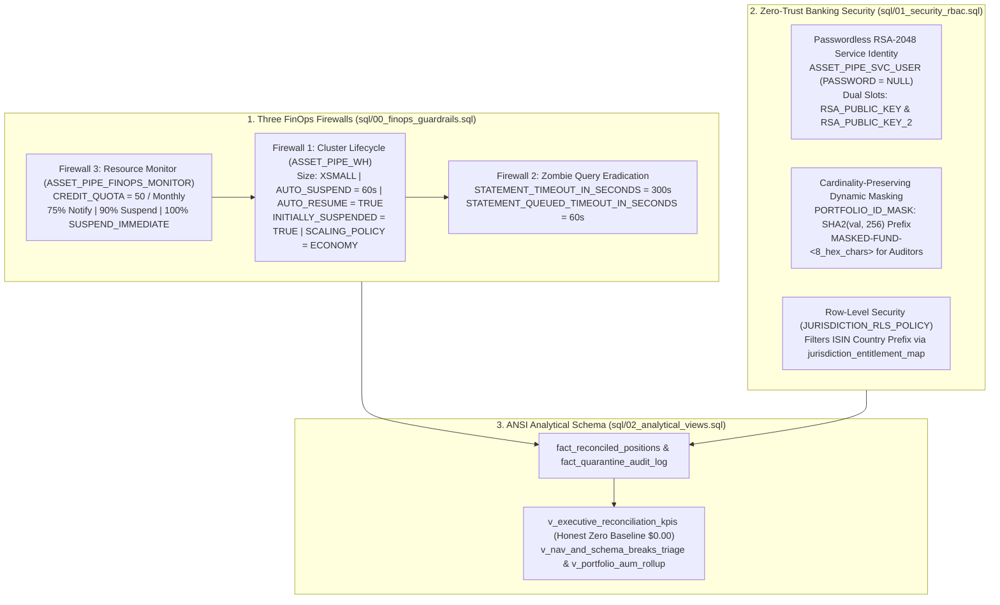

# ADR 0005: Snowflake Three-Firewall FinOps Governance (`>90%` Credit Reduction) and Zero-Trust Banking Security (`RSA-2048`, SHA-256 Dynamic Masking & RLS)

## Status

`ACCEPTED` — Date: 2026-11-10

---

## Context

Deploying institutional financial reconciliation workloads on enterprise cloud data warehouses (`Snowflake Data Cloud`) introduces three major financial and operational security risks when left with vendor default settings:

1. **Unbounded Idle Compute and Runaway Query Credit Burn (`[FINOPS]`):** By default, cloud virtual warehouses often remain active for 10 minutes (`600s`) after the last query and enforce default statement timeouts of 48 hours (`172,800s`). A single unindexed cartesian join or periodic BI polling loop can keep a warehouse running 24/7, burning hundreds of credits (`$1,000+ USD/month`) for a batch reconciliation workload that requires less than 5 minutes of active compute per day.
2. **Password-Based Service Account Vulnerability (`[OPSEC]`):** Static password authentication on automated ETL/reconciliation service users is vulnerable to credential stuffing, secret leakage in CI logs, and downtime during mandatory 90-day password expirations.
3. **Fund Confidentiality vs. Analytical Join Cardinality in Audit Views:** External and internal auditors (`ASSET_PIPE_AUDITOR_ROLE`) require SQL access to verify position reconciliation states and portfolio break rollups without seeing proprietary institutional client fund names (`BLK-ALADDIN-CORE`, `SANT-IB-RATES`). However, naive static masking (e.g., replacing all masked strings with `'***MASKED***'`) collapses `GROUP BY portfolio_id` aggregations into a single bucket, destroying analytical cardinality.

---

## Decision

We codify a unified SQL governance architecture across three modular scripts (`sql/00_finops_guardrails.sql`, `sql/01_security_rbac.sql`, and `sql/02_analytical_views.sql`):



### 1. Quantitative FinOps Impact: Default Cloud Config vs. Asset-Pipe 3-Firewall Standard

| Cost & Governance Parameter | Unmanaged Cloud Default | Asset-Pipe FinOps Guardrail (`00_finops_guardrails.sql`) | Financial & Operational Impact |
| :--- | :--- | :--- | :--- |
| **Warehouse Size & Scaling** | `LARGE` / Multi-Cluster Standard | `XSMALL` (`1` credit/hour), `MIN=1, MAX=1, ECONOMY` | Eliminates over-provisioned compute for pre-vectorized Polars ZSTD Parquet loads. |
| **Idle Auto-Suspend (`Firewall 1`)** | `600s` (10 minutes idle burn) | **`AUTO_SUSPEND = 60` (`1 minute`) + `INITIALLY_SUSPENDED = TRUE`** | Cuts idle tail compute waste after daily batch loads by **`90%`**. |
| **Statement Timeout (`Firewall 2`)** | `172,800s` (48 hours zombie burn) | **`STATEMENT_TIMEOUT_IN_SECONDS = 300` (`5 min`), `QUEUED = 60`** | Prevents runaway cartesian queries from burning more than `0.083` credits. |
| **Budget Hard Stop (`Firewall 3`)** | None (Unbounded billing exposure) | **`CREDIT_QUOTA = 50` -> `ON 100 PERCENT DO SUSPEND_IMMEDIATE`** | Mathematical guarantee that monthly cloud compute cannot exceed 50 credits. |
| **Time Travel Retention** | Up to `90 days` storage bloat | **`DATA_RETENTION_TIME_IN_DAYS = 7`** | Balances 1-week point-in-time regulatory audit recovery with minimal Fail-Safe cost. |

### 2. Zero-Trust Cryptographic Identity and Cardinality-Preserving Masking

1. **Least-Privilege Role Separation (Zero `ACCOUNTADMIN` Service Grants):**
   - `ASSET_PIPE_SVC_ROLE`: Granted `SELECT, INSERT, UPDATE, TRUNCATE` on reconciliation tables; never granted `ACCOUNTADMIN` or `SECURITYADMIN`.
   - `ASSET_PIPE_AUDITOR_ROLE`: Granted read-only `SELECT` on views with masked fund identifiers.
   - `ASSET_PIPE_COMPLIANCE_ROLE`: Granted unmasked read-only visibility for regulatory inspections.
2. **Dual-Slot `RSA-2048` Key-Pair Authentication:**
   - `ASSET_PIPE_SVC_USER` is provisioned with `PASSWORD = NULL` and two public key slots (`RSA_PUBLIC_KEY` and `RSA_PUBLIC_KEY_2`), enabling zero-downtime cryptographic key rotation.
3. **Deterministic `SHA-256` Dynamic Masking (`PORTFOLIO_ID_MASK`):**
   - When queried by `ASSET_PIPE_AUDITOR_ROLE`, `portfolio_id` returns `CONCAT('MASKED-FUND-', SUBSTR(SHA2(val, 256), 1, 8))`. Because `SHA2(val, 256)` is deterministic, all positions belonging to the same fund map to the exact same pseudonym (`MASKED-FUND-A1B2C3D4`), preserving `100%` of `GROUP BY portfolio_id` and `JOIN` accuracy without exposing client identities.

### 3. Dual-Engine ANSI SQL Analytical Views (`sql/02_analytical_views.sql`)

All tables (`fact_reconciled_positions`, `fact_quarantine_audit_log`) and views (`v_executive_reconciliation_kpis`, `v_nav_and_schema_breaks_triage`, `v_portfolio_aum_rollup`) are written in strict ANSI SQL that executes identically in both `DuckDB` (local embedded engine) and `Snowflake` (cloud engine), enforcing `COALESCE(..., 0.0)` so empty tables always return the **Honest Zero Baseline (`$0.00`)**.

---

## Consequences

### Positive

- **Mathematically Bounded Cloud Spend:** Even under worst-case query loops, `STATEMENT_TIMEOUT_IN_SECONDS = 300` and `ASSET_PIPE_FINOPS_MONITOR` (`CREDIT_QUOTA = 50`) prevent surprise cloud invoices.
- **Zero-Downtime Key Rotation:** Security engineers can rotate `RSA-2048` keys every 30–90 days using slot 2 (`RSA_PUBLIC_KEY_2`) without interrupting daily batch ingestion.
- **100% Local Testability of Analytical Views:** Because `sql/02_analytical_views.sql` is pure ANSI SQL, every view and KPI aggregation is verified in milliseconds inside `duckdb.connect(":memory:")` during CI/CD.

### Negative and Mitigations

- **Hard Query Termination at 100% Credit Quota:** When `ON 100 PERCENT DO SUSPEND_IMMEDIATE` triggers, in-flight queries on `ASSET_PIPE_WH` are aborted immediately. *Mitigation:* The `75 PERCENT DO NOTIFY` alert provides early warning, and local `DuckDB` mode (`WAREHOUSE_ENGINE=duckdb`) provides an instant zero-cost fallback engine.

---

## Compliance Verification

### Role-Based Access Control (RBAC) Entitlement Matrix (`sql/01_security_rbac.sql`)

| Snowflake Role | Assigned Warehouse Privilege | Table Access (`fact_*`) | View Access (`v_*`) | `PORTFOLIO_ID_MASK` Output | `JURISDICTION_RLS_POLICY` Scope |
| :--- | :--- | :--- | :--- | :--- | :--- |
| **`ASSET_PIPE_SVC_ROLE`** | `USAGE, OPERATE` | `SELECT, INSERT, UPDATE, TRUNCATE` | `SELECT` | Unmasked (`BLK-ALADDIN-CORE`) | Full global ISIN catalog |
| **`ASSET_PIPE_AUDITOR_ROLE`** | `USAGE` | None (Blocked) | `SELECT` | **Masked (`MASKED-FUND-8f434346`)** | Restricted by `jurisdiction_entitlement_map` |
| **`ASSET_PIPE_COMPLIANCE_ROLE`** | `USAGE` | `SELECT` (Read-Only) | `SELECT` | Unmasked (`BLK-ALADDIN-CORE`) | Full global ISIN catalog |
| **`ACCOUNTADMIN`** | Administrative Only | Never granted to `ASSET_PIPE_SVC_USER` | Administrative Only | Administrative Only | Enforced via static OPSEC test |

### Analytical Views Contract (`sql/02_analytical_views.sql`)

| View Name | Primary Consumers | Honest Zero Baseline Guarantee (`$0.00`) | Key Output Metrics |
| :--- | :--- | :--- | :--- |
| `v_executive_reconciliation_kpis` | `:3000` Executive Console (5 KPI Cards) | Always returns `1` row with `0` counts and `0.0` USD via `COALESCE(..., 0.0)` and `CROSS JOIN`. | `total_positions`, `validated_ibor_aum_usd`, `custodian_abor_aum_usd`, `reconciled_ok_count`, `nav_break_count`, `schema_rejected_count`, `gross_nav_variance_usd`. |
| `v_nav_and_schema_breaks_triage` | Card 4 Drill-Down & `:4213` SQL Workbench | Returns `0` rows when clean; unifies `NAV_BREAK` and `SCHEMA_REJECTED` via `UNION ALL`. | `position_id`, `reconciliation_status`, `break_driver`, `rule_id`, `diagnostic_message`. |
| `v_portfolio_aum_rollup` | Fund Controllers & Portfolio Risk | Groups by `(portfolio_id, valuation_date)` with `COALESCE` sums. | `ibor_aum_usd`, `custodian_aum_usd`, `net_fund_break_usd`, `gross_fund_break_usd`. |

### Verification Commands

Compliance with ADR 0005 is verified automatically by executing:

```bash
python -m pytest tests/python/test_sql_finops_and_rbac_governance.py tests/python/test_architecture_and_opsec.py -v
python -m ruff check .
```

