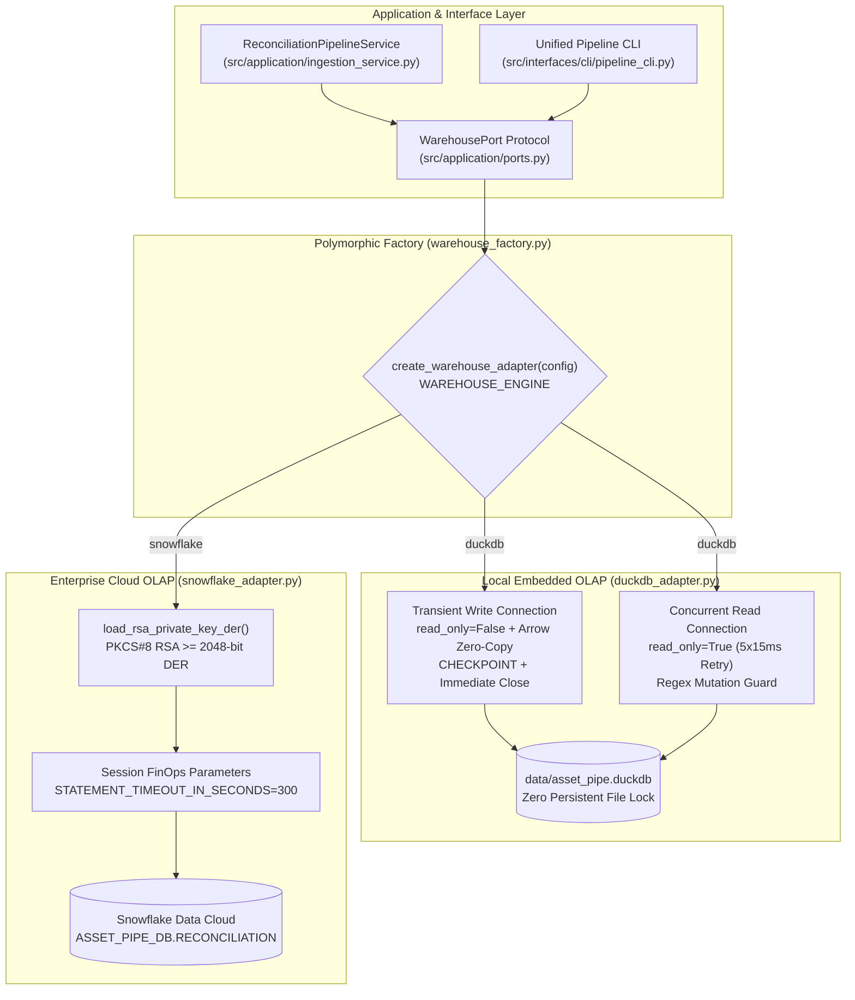

# ADR 0006: Hexagonal Dual Warehouse Architecture (`DuckDB` Zero-Hold Write Lock, Arrow Zero-Copy, and `Snowflake` RSA-2048 Adapter)

## Status

`ACCEPTED` — Date: 2026-11-10

---

## Context

Institutional financial reconciliation platforms must bridge two distinct operational environments without duplicating SQL business logic or coupling application services to vendor-specific database drivers:

1. **Deterministic Local & CI/CD Analytical Execution (`DuckDB`):** Quantitative developers, automated GitHub Actions pipelines (`quality_gates.yml`), and local operators running the 3-port workbench (`:3000` Executive Console, `:9001` MinIO S3 Console, and `:4213` SQL Workbench) require sub-50ms analytical queries without cloud network latency or Snowflake credit consumption.
2. **Multi-Process File Lock Contention on Embedded OLAP Databases:** Standard `DuckDB` usage patterns that hold a persistent `read_only=False` connection inside a web server or background worker place an exclusive OS file lock on `data/asset_pipe.duckdb`. When the `:4213` SQL Workbench or a CLI process attempts to query the database concurrently, DuckDB raises `IOException: Could not set lock on file`.
3. **Serialization Overhead Between `Polars` Rust and Analytical Storage:** Converting reconciled `Polars` DataFrames (`fact_reconciled_positions`) into Python tuples (`df.iter_rows()`) for row-by-row `INSERT` execution destroys vectorized throughput and violates Law 4.
4. **Enterprise Cloud Scalability and FinOps Governance (`Snowflake`):** In corporate staging and production environments, the same reconciliation pipeline must persist into `Snowflake Data Cloud` using passwordless `RSA-2048` PKCS#8 DER key-pair authentication and enforce session-level FinOps guardrails (`STATEMENT_TIMEOUT_IN_SECONDS = 300`).

---

## Decision

We implement a polymorphic Dual Warehouse infrastructure layer governed by the hexagonal `WarehousePort` protocol (`src/application/ports.py`) and instantiated via a 1-line factory (`src/infrastructure/warehouse_factory.py`):

### 1. Polymorphic `WarehousePort` Factory (`WAREHOUSE_ENGINE=duckdb|snowflake`)

The application orchestrator (`ReconciliationPipelineService`) and the unified CLI (`src/interfaces/cli/pipeline_cli.py`) depend exclusively on `WarehousePort`. Switching the entire persistence and analytical query layer between local embedded OLAP and enterprise cloud requires changing a single environment variable:

- `WAREHOUSE_ENGINE=duckdb` -> `DuckDBWarehouseAdapter` (`src/infrastructure/duckdb_adapter.py`)
- `WAREHOUSE_ENGINE=snowflake` -> `SnowflakeWarehouseAdapter` (`src/infrastructure/snowflake_adapter.py`)

### 2. `DuckDB` Zero-Hold Write Lock and Apache Arrow Zero-Copy

`DuckDBWarehouseAdapter` enforces three architectural invariants:

1. **Zero Persistent Connection Attributes:** The adapter never stores an open `duckdb.DuckDBPyConnection` on `self`.
2. **Atomic Write + Immediate `CHECKPOINT` Release:** Every write operation (`initialize_schema`, `upsert_reconciled_positions`, `insert_quarantine_records`, `reset_warehouse_to_zero`) opens `duckdb.connect(str(self.db_path), read_only=False)`, executes within a `try/finally` block, flushes the Write-Ahead Log via `CHECKPOINT;`, and closes the connection immediately.
3. **Apache Arrow Zero-Copy Upsert (`reconciled_df.to_arrow()`):** Reconciled positions are transferred from `Polars` Rust memory buffers into `DuckDB` via `arrow_batch = reconciled_df.with_columns(...).to_arrow()`, registered as an in-memory Arrow relation, and upserted via `INSERT OR REPLACE INTO fact_reconciled_positions SELECT ... FROM arrow_batch`.
4. **Concurrent `read_only=True` Queries with 5x15ms Retry:** All analytical reads (`get_executive_kpis`, `query_positions_paginated`, `execute_readonly_sql`) open `read_only=True` connections with a 5-attempt x 15ms retry backoff to absorb sub-millisecond Windows file checkpoint transitions.

### 3. `Snowflake` PKCS#8 `RSA-2048` Key Loader and FinOps Session Guardrails

`SnowflakeWarehouseAdapter` provides `load_rsa_private_key_der(key_path, passphrase)` using `cryptography.hazmat.primitives.serialization`, verifying that the key is an `RSAPrivateKey` with `key_size >= 2048` bits before serializing it to unencrypted PKCS#8 `DER` bytes for `snowflake.connector.connect`. Session parameters automatically inject `STATEMENT_TIMEOUT_IN_SECONDS = 300` and `STATEMENT_QUEUED_TIMEOUT_IN_SECONDS = 60`.

### 4. Architectural Comparison Matrix

| Dimension | `DuckDBWarehouseAdapter` (`duckdb`) | `SnowflakeWarehouseAdapter` (`snowflake`) |
| :--- | :--- | :--- |
| **Primary Use Case** | Local multi-port console (`:3000` / `:4213`) & CI/CD | Enterprise multi-tenant production cloud |
| **Concurrency Model** | Zero-Hold Write Lock + `read_only=True` readers | Multi-cluster virtual warehouses (`AUTO_SUSPEND=60`) |
| **Data Transfer Path** | In-memory Apache Arrow Zero-Copy (`to_arrow()`) | Compressed Parquet stage / connector batch |
| **Authentication** | Local filesystem ACLs (`*.duckdb` git-ignored) | Zero-Trust `RSA-2048` PKCS#8 key-pair (`DER`) |
| **Cold Baseline (`$0.00`)** | `ExecutiveKpiSummary.zero_baseline("duckdb")` | `ExecutiveKpiSummary.zero_baseline("snowflake")` |
| **SQL Workbench Guard** | Regex prefix + mutation keyword blocker (`[CRITICAL]`) | Regex prefix + mutation keyword blocker + RBAC |

---

## Consequences

### Positive (`[OK]`)

- **Zero Lock Collisions Across `:3000` and `:4213`:** The Executive Console and SQL Workbench can poll KPIs and run ad-hoc `SELECT` queries simultaneously without encountering file lock exceptions.
- **100% SQL Dialect Parity:** Both adapters execute the exact same `sql/02_analytical_views.sql` ANSI definitions (`v_executive_reconciliation_kpis`, `v_nav_and_schema_breaks_triage`, `v_portfolio_aum_rollup`).
- **Deterministic Offline Testing:** Unit and integration tests verify both `DuckDB` OLAP persistence and `Snowflake` `RSA-2048` cryptographic key serialization in `< 1` second without external network calls.

### Trade-offs & Mitigations (`[WARN]`)

- **Connection Open/Close Overhead on High-Frequency Micro-Writes:** Opening and closing a `DuckDB` file handle per batch adds `~2-4ms` of filesystem overhead. *Mitigation:* All positions in a batch are upserted in a single vectorized Arrow transaction (`upsert_reconciled_positions`), amortizing the connection cost across thousands of rows.

---

## Compliance Verification

- **Automated Test Suite:** `tests/python/test_warehouse_dual_adapter_and_cli.py` validates Honest Zero Baseline (`$0.00`), `ingest-valid` and `inject-corrupt` CLI workflows, `"BREAKS_ONLY"` server-side pagination, `execute_readonly_sql` mutation blocking (`DROP TABLE`), `RSA-2048` DER key loading, and `reset` back to `$0.00`.
- **Modularity & OPSEC Gate:** `tests/python/test_architecture_and_opsec.py` verifies `<= 250 LOC` across all adapter and CLI modules and confirms this ADR's structural integrity.
- **Zero-Hold Concurrency Verification:** Multiple `read_only=True` connections can query `v_executive_reconciliation_kpis` and `v_nav_and_schema_breaks_triage` immediately after `upsert_reconciled_positions` and `insert_quarantine_records` complete, confirming zero dangling file locks on `asset_pipe.duckdb`.
- **CLI Action Coverage:** All 7 `--action` flags (`status`, `ingest-valid`, `inject-corrupt`, `reconcile`, `positions`, `sql`, `reset`) return deterministic JSON payloads with `[OK]` status headers.

| Verification Gate | Command | Expected Outcome |
| :--- | :--- | :--- |
| **Dual Warehouse & CLI Suite** | `python -m pytest tests/python/test_warehouse_dual_adapter_and_cli.py -v` | `100% PASSED` (`[OK]`) |
| **Architecture & OPSEC Suite** | `python -m pytest tests/python/test_architecture_and_opsec.py -v` | `100% PASSED` (`[OK]`) |
| **Static Linting & Types** | `python -m ruff check .` | `All checks passed!` (`[OK]`) |

