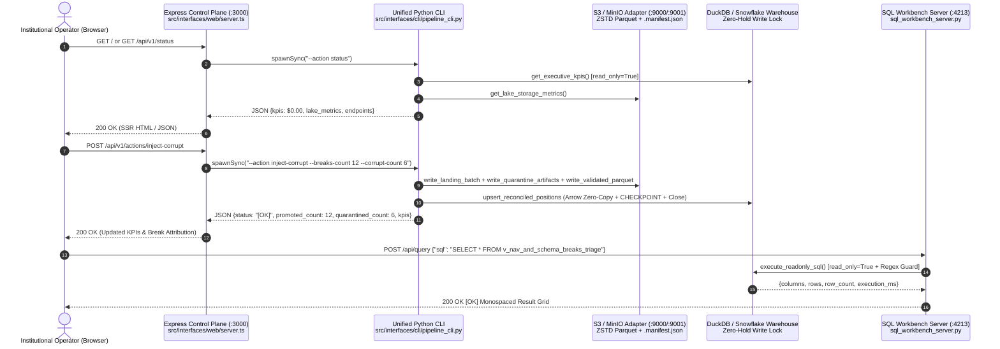

# ADR 0007: Unified Express/TypeScript Web Control Plane (`:3000`), Deterministic Python IPC Bridge, and Zero-Lock SQL Workbench (`:4213`)

## Status

`ACCEPTED` — Date: 2026-11-10

---

## Context

Institutional financial reconciliation requires an operational control plane that combines responsive web interactivity with deterministic quantitative execution in `Polars` Rust and zero-lock analytical inspection across multiple concurrent ports:

1. **Polyglot Execution Boundary Between TypeScript Web UI (`:3000`) and Python/Polars Rust Engine:** While `Express` and `TypeScript` (`strict: true`) provide a fast, strongly typed HTTP control plane and Server-Side Rendered (SSR) institutional console on port `:3000`, the core quantitative operations (ISO 6166 Luhn Mod-10 ISIN validation, Pydantic v2 Rust contracts, `GX-01..GX-07` vectorized invariants, Zstandard Parquet S3/MinIO persistence, and 3-factor NAV attribution) reside in the Python/Polars domain and application layers. Re-implementing financial math in JavaScript would introduce IEEE 754 drift and violate Clean Architecture DRY principles.
2. **Multi-Port Coexistence Without Database Lock Contention (`:3000`, `:9001`, `:4213`):** Operators simultaneously keep open the `:3000` Executive Console, the `:9001` MinIO S3 Object Browser, and the `:4213` Warehouse SQL Workbench. If either `:3000` or `:4213` holds a persistent write lock on `data/asset_pipe.duckdb`, concurrent queries fail with `IOException: Could not set lock on file`.
3. **Interactive Forensic SQL Auditing With Zero Mutation Risk:** Financial auditors and L2 support engineers need an interactive browser-based SQL Workbench on port `:4213` with preconfigured 1-click analytical templates (`v_executive_reconciliation_kpis`, `v_nav_and_schema_breaks_triage`, `v_portfolio_aum_rollup`, `fact_reconciled_positions`, `fact_quarantine_audit_log`), but must be strictly prevented from executing destructive DDL/DML (`DROP`, `DELETE`, `TRUNCATE`, `UPDATE`, `INSERT`, `ALTER`, `COPY`).
4. **Honest Zero Baseline (`$0.00`) Guarantee:** Upon cold boot or immediately after a platform reset (`POST /api/v1/actions/reset`), every API endpoint and SSR view must report mathematical zero (`$0.00` AUM, `0` positions, `0` breaks, `0` S3 objects) without hardcoded dummy figures.

---

## Decision

We implement a two-service Web Interface Layer under `src/interfaces/web/` adhering to Law 3 (`DOC_EXEMPT_NAMES` for monolithic UI/server cohesion) and Law 5 (Honest Zero Baseline & Multi-Port Coexistence):

### 1. Express / TypeScript Control Plane & Deterministic CLI IPC Bridge (`:3000`)

`src/interfaces/web/server.ts` exports `createApp(options)` and `runPipelineCli(cliArgs, options)`:

- Every REST endpoint on `:3000` delegates state transitions and queries to `python -m src.interfaces.cli.pipeline_cli` via `child_process.spawnSync` with a `16 MB` JSON stdout buffer.
- Because each CLI invocation runs as a short-lived process using `DuckDBWarehouseAdapter` (which opens `read_only=False` only for the millisecond duration of an Arrow upsert + `CHECKPOINT`, or `read_only=True` for queries), `:3000` holds **zero** persistent file locks between HTTP requests.
- Environment overrides (`--lake-dir` and `--duckdb-path`) are forwarded transparently, enabling isolated integration testing in both `pytest` and `vitest`.

### 2. Zero-Lock Read-Only Warehouse SQL Workbench Server (`:4213`)

`src/interfaces/web/sql_workbench_server.py` implements a multi-threaded HTTP server (`ThreadingHTTPServer`) listening on `0.0.0.0:4213`:

- **`GET /`:** Renders a dark-mode Shadcn/Snowsight HTML5 SQL IDE (`Inter` + `JetBrains Mono`, zero emojis) featuring 5 preconfigured 1-click institutional audit queries, keyboard shortcut support (`Ctrl+Enter`), live latency telemetry (`execution_ms`), and direct navigation back to `:3000` and `:9001`.
- **`POST /api/query`:** Invokes `execute_workbench_query(sql, config)` -> `warehouse.execute_readonly_sql(sql)`. Queries execute strictly in `read_only=True` mode and pass through the regex firewall (`_ALLOWED_READONLY_RE` and `_FORBIDDEN_MUTATION_RE`). Mutating statements return HTTP `400` with `status: "[CRITICAL]"` and `code: "READONLY_SQL_VIOLATION"`.
- **Direct Testability:** Exports pure functions `render_sql_workbench_html(config)` and `execute_workbench_query(sql, config)` so automated tests validate HTML structure and SQL security deterministically in memory.

### 3. Multi-Port Control Plane Matrix

| Service Component | Default Port | Source Module | Concurrency & Security Posture |
| :--- | :--- | :--- | :--- |
| **Executive Reconciliation Console** | `:3000` | `src/interfaces/web/server.ts` | Stateless Express API + SSR; spawns transient CLI processes (Zero-Hold Lock). |
| **MinIO S3 Object Console & API** | `:9001` / `:9000` | `src/infrastructure/s3_parquet_adapter.py` | Immutable `ZSTD` Parquet partitions + `.manifest.json` (`SHA-256`). |
| **Warehouse SQL Workbench** | `:4213` | `src/interfaces/web/sql_workbench_server.py` | `read_only=True` snapshot isolation + regex anti-mutation firewall (`[CRITICAL]`). |

---

## Consequences

### Positive (`[OK]`)

- **Single Source of Quantitative Truth:** All validation, S3 Parquet writing, Polars Rust reconciliation, and warehouse upserts execute through one tested Python pipeline, eliminating cross-language calculation drift.
- **Lock-Free 3-Port Experience:** Operators can click action buttons on `:3000` and immediately run ad-hoc SQL queries on `:4213` without file lock collisions.
- **Full Type Safety:** Both Python (`ruff`) and TypeScript (`npm run typecheck` / `tsc --noEmit` with `strict: true`) compile with zero errors.

### Trade-offs & Mitigations (`[WARN]`)

- **Process Spawn Latency per API Action (`~80-150ms`):** Spawning a Python interpreter per REST request adds process startup overhead compared to a long-lived daemon. *Mitigation:* This trade-off guarantees 100% OS file-lock release on `asset_pipe.duckdb` after every request, which is critical on Windows and WSL2 filesystems.

---

## Compliance Verification

- **Python Workbench Suite:** `tests/python/test_sql_workbench_server.py` validates `render_sql_workbench_html` (zero emojis, 5 preconfigured queries, `:3000` link) and `execute_workbench_query` (`200 OK` on `v_executive_reconciliation_kpis` Honest Zero Check, `400 [CRITICAL]` on `DROP TABLE`).
- **TypeScript Strict Compiler Gate:** `npm run typecheck` (`tsc --noEmit`) verifies `src/interfaces/web/server.ts` and `src/interfaces/web/dashboard_view.ts` with `0` errors.
- **Architecture & OPSEC Gate:** `tests/python/test_architecture_and_opsec.py` verifies `DOC_EXEMPT_NAMES`, zero emojis, zero OPSEC leaks, and ADR/Runbook completeness.

### 4. End-to-End Verification Gate Summary

| Verification Gate | Command | Target Modules | Expected Outcome |
| :--- | :--- | :--- | :--- |
| **Gate 1: SQL Workbench Unit & Security** | `python -m pytest tests/python/test_sql_workbench_server.py -v` | `src/interfaces/web/sql_workbench_server.py` | `100% PASSED` (`[OK]`) |
| **Gate 2: Python Static Linter** | `python -m ruff check .` | All `.py` modules | `All checks passed!` (`[OK]`) |
| **Gate 3: TypeScript Strict Compiler** | `npm run typecheck` | `server.ts`, `dashboard_view.ts` | `0 errors` (`[OK]`) |
| **Gate 4: OPSEC, Zero-Emoji & LOC** | `python -m pytest tests/python/test_architecture_and_opsec.py -v` | Entire repository tree | `100% PASSED` (`[OK]`) |

### 5. Security Invariants Enforced by Design

1. **Snapshot Read Isolation (`read_only=True`):** Neither `:4213` nor `GET` endpoints on `:3000` can mutate warehouse state or block concurrent writers.
2. **Regex Statement Whitelisting:** Only `SELECT`, `WITH`, `SHOW`, `DESCRIBE`, `EXPLAIN`, and `PRAGMA` statements pass the pre-execution filter in `execute_readonly_sql`.
3. **Deterministic JSON Error Contracts:** Every rejected query returns HTTP `400` with `{"status": "[CRITICAL]", "code": "READONLY_SQL_VIOLATION"}`.
4. **Honest Zero Baseline Formatting (`$0.00`):** Both the `:3000` SSR view (`renderExecutiveDashboardHtml`) and Template 1 in `:4213` (`v_executive_reconciliation_kpis`) guarantee mathematical zero when no batches have been ingested or immediately following `POST /api/v1/actions/reset`.
5. **Strict Zero-Emoji Policy (Law 1):** Both web interfaces (`:3000` and `:4213`) use `Inter` and `JetBrains Mono` typography with formal ASCII badges (`[OK]`, `[WARN]`, `[CRITICAL]`, `[NAV-BREAK]`, `[FINOPS]`, `[OPSEC]`).

