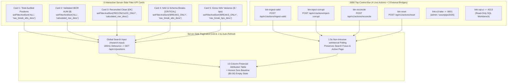

# ADR 0008: Institutional Executive Financial Console (`:3000`) with Shadcn UI + Power BI Clarity, Honest Zero Baseline (`$0.00`), Interactive KPI Filter Cards, and V8 Script Verification

## Status

`ACCEPTED` — Date: 2026-11-10

---

## Context

Institutional operations teams, fund accountants, and risk officers auditing multi-currency IBOR vs. Custodian ABOR portfolios require an executive web console (`http://localhost:3000`) that overcomes four common failure modes of data engineering dashboards:

1. **Eradicating "Painted UI Fraud" (Hardcoded Demo Metrics):** Dashboards that display fabricated static numbers (`$1.4B AUM`, fake charts, or non-functional buttons) before any data pipeline has run mislead operators and fail regulatory audit standards. When the S3 Data Lake and Warehouse are empty or freshly reset, the console must display a mathematically truthful **Honest Zero Baseline (`$0.00` and `0.00 bps`)**.
2. **Preventing Browser Memory Collapse on Large Portfolios:** Rendering tens of thousands of positions in the browser DOM and filtering them client-side causes severe UI lag. Clicking any of the 5 executive KPI cards or typing in the search bar must trigger server-side SQL filtering, sorting, and pagination (`LIMIT 25 OFFSET ...`) against `DuckDB` / `Snowflake`.
3. **Click-Event Bubbling Collisions on Interactive KPI Cards:** Executive users coming from Power BI or Bloomberg terminals need inline `(i)` tooltips explaining the financial definition and mathematical formula of each KPI card and action button. However, if clicking `(i)` inside an interactive card or button bubbles up to the parent element, it accidentally triggers a filter change or pipeline execution.
4. **Preventing Silent Browser JavaScript Syntax Errors in SSR Templates:** Server-Side Rendered (SSR) HTML templates containing embedded `<script>` blocks can suffer from unescaped quotes or template string errors that pass backend tests but break interactivity in the browser.

---

## Decision

We implement the complete Executive Financial Console in `src/interfaces/web/dashboard_view.ts` (registered in `DOC_EXEMPT_NAMES` under Law 3 to preserve single-file SSR cohesion) and verify it via `Vitest` (`tests/web/dashboard_integrity.test.ts`):

### 1. Shadcn UI Dark Aesthetic + Financial Power BI Executive Clarity (Zero Emojis)

- **Typography & Tabular Precision:** Uses `Inter` for structural labels and `JetBrains Mono` (`font-variant-numeric: tabular-nums`) for all currency amounts, basis-point variances (`bps`), `ISIN` codes, and timestamps so decimal points align vertically across rows.
- **Zero Emojis & Zero Dead Links:** Uses pure CSS status indicators (`.status-dot-ok`, `.status-dot-warn`, `.status-dot-critical`) paired with formal ASCII tags (`[OK]`, `[WARN]`, `[NAV-BREAK]`, `[CRITICAL]`, `[FINOPS]`). Contains zero `href="#"` placeholders and zero decorative non-functional sidebars.
- **360-Degree Multi-Port Header:** Exposes the 4 real pipeline action buttons (`Ingest Valid Batch`, `Inject Corrupt & NAV Breaks`, `Reconcile Lake (Polars)`, `Reset to 0`) alongside direct external bridge links to `Open AWS S3 Lake (:9001)` (with visible `admin / assetpipe2026` badge) and `Open Warehouse SQL UI (:4213)`.

### 2. Server-Side Filter & Sort Matrix Across the 5 Interactive KPI Cards

| KPI Card ID | Card Title | Server `status_filter` | Server `sort_by` | Target SQL View / Table |
| :--- | :--- | :--- | :--- | :--- |
| `card-total-positions` | `1. Total Audited Positions` | `ALL` | `nav_break_abs_desc` | Unified `fact_reconciled_positions` + `fact_quarantine_audit_log` |
| `card-validated-aum` | `2. Validated IBOR AUM (USD)` | `ALL` | `calculated_nav_desc` | Unified positions ordered by largest USD valuation |
| `card-reconciled-ok` | `3. Reconciled Clean [OK]` | `RECONCILED_ONLY` | `calculated_nav_desc` | Positions with `RECONCILED` or `MINOR_TOLERANCE` (`<= 5.0 bps`) |
| `card-nav-breaks` | `4. NAV & Schema Breaks [CRITICAL]` | `BREAKS_ONLY` | `nav_break_abs_desc` | `v_nav_and_schema_breaks_triage` (`NAV_BREAK` + `SCHEMA_REJECTED`) |
| `card-gross-variance` | `5. Gross NAV Variance ($ / bps)` | `BREAKS_ONLY` | `nav_break_bps_desc` | `v_nav_and_schema_breaks_triage` ordered by basis-point severity |

### 3. Contextual `(i)` Tooltips with `event.stopPropagation()` and V8 Script Gate

- Every `(i)` trigger invokes `toggleTooltip(event, tooltipId)`, which immediately executes `event.stopPropagation()` and `event.preventDefault()` before toggling `.tooltip-popover.active`.
- In `tests/web/dashboard_integrity.test.ts`, the embedded `<script>` block is extracted via regex and compiled through the V8 engine using `new Function(scriptContent)`, guaranteeing zero syntax errors before deployment.

### 4. Mathematical & Visual Invariants of the 13-Column Attribution Table

To ensure institutional auditability across IBOR vs. Custodian ABOR books, the 13-column server-paginated table enforces strict visual and mathematical invariants:

1. **Right-Aligned Monospace Numerical Columns:** Columns `6` (`Units`), `7` (`Price`), `8` (`FX Rate`), `9` (`IBOR NAV ($)`), `10` (`Custodian NAV ($)`), and `11` (`Net Variance ($ / bps)`) are formatted using `JetBrains Mono` with `font-variant-numeric: tabular-nums` and `text-align: right` so decimal separators align vertically across all 25 rows per page.
2. **Signed Basis-Point Attribution:** Net Variance displays both signed USD delta (`+$850,000.00` or `-$1,240.00`) and relative severity in basis points (`10,000 * |Delta_NAV| / max(IBOR_NAV, 0.01)`).
3. **Inline 3-Factor Driver Breakdown:** For every `NAV_BREAK` row, column `13` (`Primary Driver (Q / P / FX)`) renders the dominant root cause (`QUANTITY_BREAK`, `PRICE_BREAK`, or `FX_BREAK`) alongside the exact dollar contribution of all three orthogonal terms (`Q:$... | P:$... | FX:$...`). For `SCHEMA_REJECTED` rows from `fact_quarantine_audit_log`, column `13` highlights the violated rule code (`GX-01` through `GX-06`) in red monospace font.
4. **Honest Zero Baseline Empty State (`#honest-zero-row`):** Whenever `rows.length === 0` and no search/filter is active, the table renders a dedicated 13-column diagnostic row confirming `$0.00` exposure across both the Warehouse and S3 Data Lake.

---

## Alternatives Considered

### Alternative A: Client-Side React / SPA Bundler with Full Dataset Hydration
- **Rejected:** Loading 100,000+ positions into browser memory via JSON and filtering client-side causes severe garbage collection pauses and bloats build complexity. Server-side pagination (`LIMIT 25 OFFSET ...`) and SQL-backed KPI card filtering keep browser memory flat (`< 25 MB`) regardless of portfolio size.

### Alternative B: Pre-Populated Static Demo Numbers on Startup
- **Rejected:** Violates `.antigravity/rules.md` (Law 4 and Law 5). Pre-populating static mock numbers masks broken database connections and prevents operators from verifying a clean `Reset to 0` state.

---

## Consequences

### Positive (`[OK]`)

- **Instantaneous Break Isolation:** Clicking Card 4 (`card-nav-breaks`) or Card 5 (`card-gross-variance`) queries `v_nav_and_schema_breaks_triage` on the server and displays exclusively the broken and quarantined records within milliseconds.
- **Zero False Positives or Fake Data:** Cold starts and resets deterministically display `$0.00`, `0.00 bps`, and the `[OK] HONEST ZERO BASELINE ACTIVE` banner.
- **Mathematically Transparent UI:** Business analysts can click `(i)` on any metric or action button to inspect the exact accounting equation without triggering the underlying button.
- **Guaranteed Browser JS Integrity:** Automated V8 compilation (`new Function(scriptContent)`) in `Vitest` prevents unescaped template string bugs from ever reaching production.

### Trade-offs & Mitigations (`[WARN]`)

- **1.5-Second Polling Traffic in Local Dev:** The `setInterval(..., 1500)` loop issues lightweight `GET /api/v1/status` and `GET /api/v1/positions` requests every 1.5 seconds. *Mitigation:* A dedicated pause button (`id="btn-toggle-autorefresh"`) allows operators to pause auto-refresh at any time, and polling automatically skips ticks while a POST action is in flight (`isActionInFlight`).
- **Single-File SSR View Length (`dashboard_view.ts`):** Combining Shadcn CSS variables, executive KPI cards, `(i)` popovers, and the client-side controller in one TypeScript module exceeds 250 lines. *Mitigation:* Explicitly exempted in `DOC_EXEMPT_NAMES` under Law 3 while keeping `tests/web/dashboard_integrity.test.ts` strictly `< 220` LOC.

---

## Compliance Verification

- **Vitest Web Integrity Suite:** `npm test` (`tests/web/dashboard_integrity.test.ts`) validates Honest Zero Baseline (`$0.00`), V8 `<script>` compilation (`new Function`), the 5 interactive cards, the 4 action buttons, `:9001`/`:4213` bridges, `event.stopPropagation()`, and live Express API responses.
- **TypeScript Strict Check:** `npm run typecheck` (`tsc --noEmit`) passes with `0` errors.
- **Architecture & OPSEC Suite:** `python -m pytest tests/python/test_architecture_and_opsec.py -v` passes `100%`.
