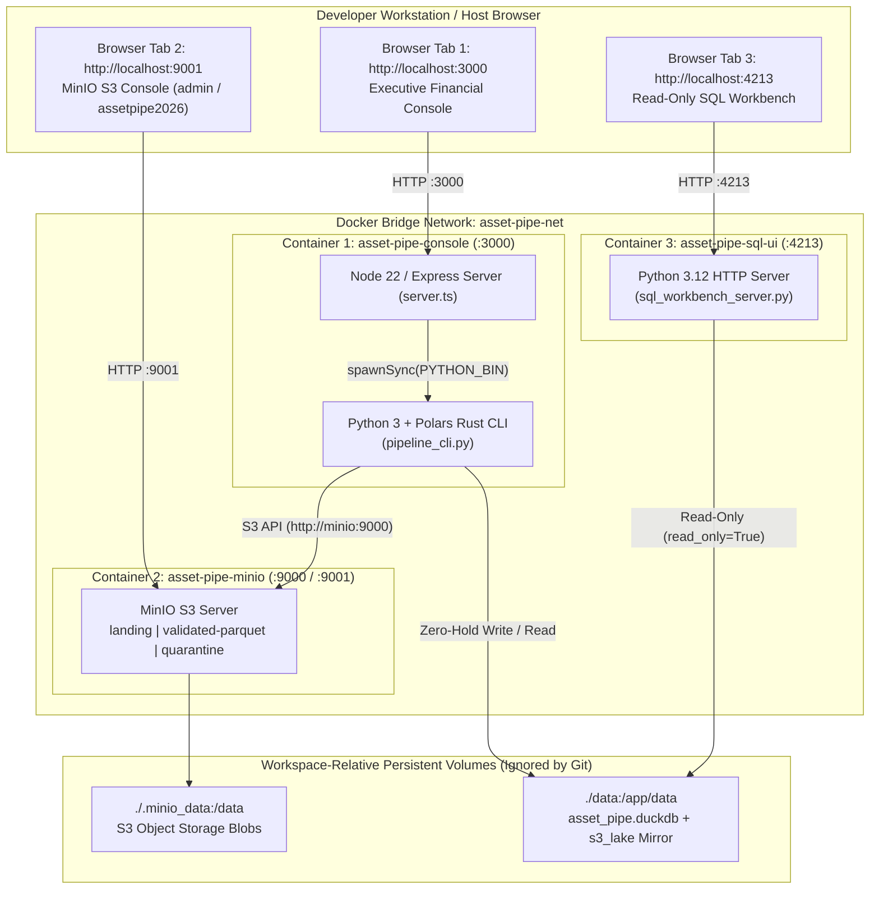

# ADR 0009: 3-Container Docker Compose 360-Degree Observability Topology (`:3000`, `:9001`, `:4213`) and Lock-Free Shared Storage

## Status

`ACCEPTED` — Date: 2026-11-10

---

## Context

To evaluate and operate an institutional financial reconciliation platform end-to-end, engineers, quantitative analysts, and risk auditors must inspect three distinct architectural layers simultaneously:

1. **The Executive Financial Control Plane (`:3000`):** Triggers clean/corrupt batch ingestion, Polars lazy reconciliation, and deterministic reset to `$0.00` while filtering the 13-column attribution grid via the 5 interactive KPI cards.
2. **The Physical AWS S3 / MinIO Object Storage Lake (`:9001` Console / `:9000` API):** Provides verifiable proof that raw extracts land in `landing/`, clean records are written as `ZSTD`-compressed Apache Parquet in `validated-parquet/`, and rejected rows are isolated in `quarantine/` with cryptographic `.manifest.json` (`SHA-256`) sidecars.
3. **The Warehouse SQL Workbench (`:4213`):** Allows auditors to run ad-hoc `SELECT` queries and 5 pre-built institutional SQL audit templates directly against `fact_reconciled_positions`, `fact_quarantine_audit_log`, and the analytical views (`02_analytical_views.sql`).

Packaging this 3-surface architecture into containers presents three engineering challenges:
- **Cross-Language Bridge Execution (`Node.js 22` + `Python 3.12 / Polars Rust`):** The `:3000` Express control plane invokes the Python/Polars reconciliation CLI (`python3 -m src.interfaces.cli.pipeline_cli`). Running them in separate containers over a custom RPC protocol adds unnecessary network serialization overhead and deployment fragility.
- **Cross-Container DuckDB File Locking on Shared Volumes:** Both `asset-pipe-console` (`:3000`) and `asset-pipe-sql-ui` (`:4213`) mount `./data:/app/data` to access `/app/data/asset_pipe.duckdb`. If either container holds a persistent write lock on the `.duckdb` file, the other container will fail with `duckdb.IOException: Could not set lock on file`.
- **Disk Space Preservation on Developer Workstations:** Heavy Docker images or uncleaned `apt`/`pip` caches can exhaust system drive capacity. Container images must use `-slim` Debian Bookworm bases and precompiled Rust binary wheels (`--no-cache-dir`).

---

## Decision

We implement a deterministic 3-container orchestration topology defined in `docker-compose.yml`, `docker/Dockerfile.console`, and `docker/Dockerfile.sql-ui`:

### 1. Unified Node.js 22 + Python/Polars Runtime in `docker/Dockerfile.console`

- Base image: `node:22-bookworm-slim` with `python3` and `python3-pip` installed via `apt-get --no-install-recommends` (cleaning `/var/lib/apt/lists/*` in the same layer).
- Installs precompiled Linux `manylinux` binary wheels (`polars`, `pyarrow`, `pydantic`, `duckdb`, `boto3`, `cryptography`, `snowflake-connector-python`) via `pip3 install --no-cache-dir --break-system-packages`.
- Cross-platform binary resolution in `src/interfaces/web/server.ts`:
  `process.env.PYTHON_BIN || (process.platform === "win32" ? "python" : "python3")` ensures seamless execution both on native Windows workstations (`python`) and inside Debian Linux containers (`python3`).

### 2. Dedicated Read-Only SQL Workbench Container (`docker/Dockerfile.sql-ui`)

- Base image: `python:3.12-slim-bookworm` exposing port `4213` and running `python3 -m src.interfaces.web.sql_workbench_server`.
- Shares `./data:/app/data` with `asset-pipe-console` and connects to `/app/data/asset_pipe.duckdb` using ephemeral `read_only=True` connections (`DuckDBWarehouseAdapter._connect_read()`), guaranteeing zero file lock collisions.

### 3. Container Service Specification Matrix

| Service Name | Container Name | Dockerfile / Image | Exposed Host Ports | Internal Network DNS | Mounted Volume |
| :--- | :--- | :--- | :--- | :--- | :--- |
| `minio` | `asset-pipe-minio` | `minio/minio:latest` | `9000:9000` (API) `9001:9001` (UI) | `http://minio:9000` | `./.minio_data:/data` |
| `asset-pipe-console` | `asset-pipe-console` | `docker/Dockerfile.console` (`node:22-bookworm-slim`) | `3000:3000` | `http://asset-pipe-console:3000` | `./data:/app/data` |
| `asset-pipe-sql-ui` | `asset-pipe-sql-ui` | `docker/Dockerfile.sql-ui` (`python:3.12-slim-bookworm`) | `4213:4213` | `http://asset-pipe-sql-ui:4213` | `./data:/app/data` |

---

## Alternatives Considered

### Alternative A: Single Monolithic Container Running Supervisord (MinIO + Node + SQL UI)
- **Rejected:** Bundling an object storage server (`MinIO`) and two web servers inside a single container violates container isolation principles and obscures per-service health checks and logs.

### Alternative B: Separate Microservice Container for the Python CLI via gRPC
- **Rejected:** Adding a persistent Python gRPC daemon between Express (`:3000`) and Polars increases memory footprint and introduces network serialization overhead for local DataFrames. Packaging Node 22 and the Python/Polars binary wheels inside `Dockerfile.console` keeps execution fast, atomic, and stateless.

---

## Consequences

### Positive (`[OK]`)

- **60-Second Reproducible Onboarding:** Any engineer or hiring manager can clone the repository and run `docker compose up -d --build` to inspect `:3000`, `:9001`, and `:4213` simultaneously.
- **Zero C-Drive Bloat:** Both `./.minio_data` and `./data` reside inside the project workspace directory (and are ignored by `.gitignore`), preventing runaway volume growth on the OS boot partition.
- **Internal vs. External URL Separation:** `S3_ENDPOINT_URL=http://minio:9000` routes container-to-container S3 traffic over `asset-pipe-net`, while `S3_PUBLIC_CONSOLE_URL=http://localhost:9001` and `SQL_WORKBENCH_PUBLIC_URL=http://localhost:4213` ensure browser bridge buttons on `:3000` resolve cleanly on the host machine.

### Trade-offs & Mitigations (`[WARN]`)

- **Dual Python Layer Installation Across `Dockerfile.console` and `Dockerfile.sql-ui`:** Both Dockerfiles install Python wheels. *Mitigation:* Both use `--no-cache-dir` and `-slim` Bookworm base images, keeping build times short and layers compact.

---

## Compliance Verification

- **Architecture & OPSEC Suite (`tests/python/test_architecture_and_opsec.py`):** Verifies the existence and `<= 250 LOC` modularity of `docker-compose.yml`, `docker/Dockerfile.console`, and `docker/Dockerfile.sql-ui`, plus `README.md` (`>= 240 LOC`), `ADR-0009` (`>= 100 LOC`), and `Runbook-09` (`>= 160 LOC`).
- **Cross-Platform Binary Resolution:** Verified via `npm test` (`Vitest`) and `python -m pytest -v`.
