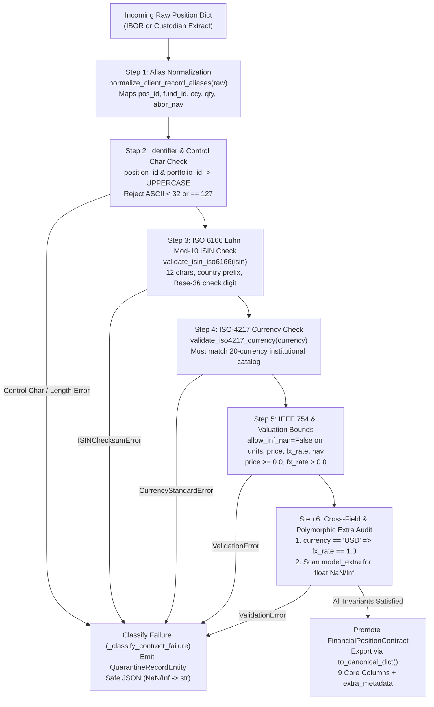

# Runbook 01: Origin Data Contracts, ISO 6166 ISIN Checksum Diagnostics, and Institutional Client Schema Onboarding

## 1. Purpose and Target Audience

- **Operational Scope:** First-stage ingestion customs gate (`src/domain/entities.py`, `src/domain/exceptions.py`, and `src/domain/contracts.py`).
- **Target Audience:**
  - **Data Platform Engineers:** Responsible for onboarding new custodian extracts, maintaining `CANONICAL_COLUMN_ALIASES`, and ensuring zero schema corruption reaches S3 Parquet or the Data Warehouse.
  - **Custody Operations Specialists:** Responsible for triaging quarantined position records rejected due to invalid ISIN check digits, non-ISO-4217 currency tickers, or corrupted pricing feeds.
  - **Quantitative Controllers:** Responsible for verifying base-currency FX identity (`USD -> fx_rate == 1.0`) and auditing custom desk metadata preserved in `extra_metadata_json`.

---

## 2. Architecture and Validation Flow (`entities.py` & `contracts.py`)

Every raw record arriving from an IBOR extract or custodian feed passes through a deterministic 6-step validation pipeline inside `FinancialPositionContract` and `validate_position_records_batch`:



---

## 3. Forensic Contract Error Triage Matrix

When `validate_position_records_batch` intercepts an invalid position, it classifies the error deterministically into a `QuarantineRecordEntity`. Use the table below to diagnose the root cause and execute remediation:

| Rule ID | Violation Code | Diagnostic Trigger Pattern | Financial Root Cause | Operational Remediation |
| :--- | :--- | :--- | :--- | :--- |
| **`GX-03: ISIN_ISO6166_REGEX`** | `INVALID_ISIN_ISO6166` | `ISIN '...' failed Luhn Mod-10 check (expected X)` or `fails 12-character ISO 6166 structural format` or `unsupported country prefix` | Upstream custodian transmitted a sedol/cusip instead of a 12-char ISIN, transposed two characters, or used an unauthorized country prefix. | Run Diagnostic Procedure 4.1 to compute the expected Luhn Mod-10 check digit and request an updated security master mapping from the custodian. |
| **`GX-04: CURRENCY_ISO4217`** | `UNSUPPORTED_ISO4217_CURRENCY` | `Unsupported or non-canonical ISO-4217 currency` or string length `!= 3` | Feed sent lowercase currency (`usd`), subunit (`GBp` pence), symbol (`$`), or non-standard ticker (`EURO`, `USDT`). | Normalize subunit pricing (divide `GBp` price by 100 to `GBP`) or map non-standard currency labels before ingestion. |
| **`GX-05: PRICE_NON_NEGATIVE`** | `IEEE754_NON_FINITE_NUMBER` | `Input should be a finite number` on `loc=('price',)` | Unpriced illiquid security or failed Bloomberg/Reuters pricing feed emitted `NaN` or `Infinity` for `price`. | Isolate position in quarantine; obtain official fair-value committee price override before re-submitting batch. |
| **`GX-05: PRICE_NON_NEGATIVE`** | `CONTRACT_VIOLATION` | `Input should be greater than or equal to 0` on `loc=('price',)` | Negative clean market price (`price < 0.0`) on position extract. | Verify if instrument is a short position where sign was mistakenly applied to `price` instead of `units`. |
| **`GX-06: FX_STRICT_POSITIVE`** | `CONTRACT_VIOLATION` | `Input should be greater than 0` on `loc=('fx_rate',)` | Zero or negative spot exchange rate (`fx_rate <= 0.0`). | Restore valid WM/Reuters 4pm London spot FX rate (`fx_rate > 0.0`). |
| **`GX-06: FX_STRICT_POSITIVE`** | `CONTRACT_VIOLATION` | `[CRITICAL] Base currency USD requires fx_rate == 1.0` | A USD-denominated asset was submitted with a non-unity FX rate (e.g., `fx_rate = 1.15`). | Fix upstream currency tag (if asset is actually `EUR`/`GBP`) or reset `fx_rate = 1.0` for `USD` positions. |
| **`GX-02: CORE_NOT_NULL`** | `IEEE754_NON_FINITE_NUMBER` | `[CRITICAL] IEEE 754 NaN/Inf detected in extra field '...'` or non-finite `units` / `custodian_reported_nav` | `NaN` or `Inf` infiltrated `units`, `custodian_reported_nav`, or a custom client column (`custom_beta`, `convexity`). | Sanitize upstream risk analytics calculation or null out missing optional extra metrics instead of emitting IEEE 754 `NaN`. |
| **`GX-02: CORE_NOT_NULL`** | `CONTRACT_VIOLATION` | Missing required canonical field, null value, or ASCII control characters in `position_id` / `portfolio_id` | Truncated CSV/JSON row or unmapped proprietary column header. | Check if client used a new column alias and register it in `CANONICAL_COLUMN_ALIASES` (Procedure 4.2). |

---

## 4. Step-by-Step Operational Procedures

### 4.1. Procedure: Diagnosing and Recalculating a Rejected ISIN (ISO 6166 Luhn Mod-10)

When a position is quarantined under `GX-03: ISIN_ISO6166_REGEX` (`INVALID_ISIN_ISO6166`), the ISO 6166 algorithm converts letters `A..Z` to `10..35` (`ord(ch) - 55`), doubles every second digit from the right of the 11-character stem, sums individual decimal digits, and computes `(10 - (total % 10)) % 10`.

#### Step 1: Inspect the Failed ISIN and Compute the Authoritative Check Digit

Execute the following one-liner from the repository root to inspect the failure context and calculate the valid 12th digit:

```bash
python -c "
from src.domain.entities import compute_isin_check_digit, validate_isin_iso6166
from src.domain.exceptions import ISINChecksumError

suspect_isin = 'US0378331009'
try:
    validate_isin_iso6166(suspect_isin)
except ISINChecksumError as err:
    print('[CRITICAL] Quarantine Reason:', err)
    print('[OK] Forensic Context:', err.context)
    correct_digit = compute_isin_check_digit(suspect_isin[:11])
    print(f'[OK] Authoritative Corrected ISIN: {suspect_isin[:11]}{correct_digit}')
"
```

#### Expected Diagnostic Output

```text
[CRITICAL] Quarantine Reason: [INVALID_ISIN_ISO6166] [CRITICAL] ISIN 'US0378331009' failed Luhn Mod-10 check (expected 5)
[OK] Forensic Context: {'raw_isin': 'US0378331009', 'expected_check_digit': '5', 'actual_check_digit': '9'}
[OK] Authoritative Corrected ISIN: US0378331005
```

---

### 4.2. Procedure: Onboarding a New Institutional Client Schema (`CANONICAL_COLUMN_ALIASES` & `extra="allow"`)

Institutional clients frequently deliver position extracts using proprietary column names alongside custom risk or desk metadata. `Asset-Pipe` handles this without breaking core schemas through two mechanisms:
1. **Known Alias Mapping (`CANONICAL_COLUMN_ALIASES`):** Translates custodian headers to the 9 canonical fields.
2. **Polymorphic Extra Preservation (`ConfigDict(extra="allow")`):** Retains all non-canonical client columns in `model_extra`, sanitizes them against `NaN`/`Inf`, and serializes them into `extra_metadata_json`.

#### Canonical Alias Mapping Reference Table

| Canonical Field | Supported Custodian & Client Aliases (`CANONICAL_COLUMN_ALIASES`) | Type & Constraint |
| :--- | :--- | :--- |
| `position_id` | `pos_id`, `id`, `trade_id` | `str` (`2..64` chars, uppercase, no control chars) |
| `portfolio_id` | `fund_id`, `portfolio`, `account_id` | `str` (`2..48` chars, uppercase, no control chars) |
| `isin` | `security_isin`, `isin_code` | `str` (`12` chars, ISO 6166 Luhn Mod-10) |
| `valuation_date` | `val_date`, `as_of_date`, `nav_date` | `date` (ISO 8601 `YYYY-MM-DD`) |
| `currency` | `ccy`, `curr`, `local_currency` | `str` (`3` chars, `ISO_4217_CURRENCIES`) |
| `units` | `quantity`, `qty`, `shares`, `par_value` | `float` (finite, positive/zero/negative supported) |
| `price` | `market_price`, `clean_price`, `unit_price` | `float` (`>= 0.0`, finite) |
| `fx_rate` | `fx`, `spot_fx`, `exchange_rate` | `float` (`> 0.0`, finite; `1.0` if `USD`) |
| `custodian_reported_nav` | `abor_nav`, `reported_nav`, `custodian_nav`, `bank_nav` | `float` (finite) |

#### Step 1: Test Client Payload Normalization and Polymorphic Metadata Retention

Run the following command to verify how a customized custodian payload is normalized and promoted:

```bash
python -c "
from src.domain.contracts import FinancialPositionContract

client_payload = {
    'trade_id': 'trd-zurich-881',
    'account_id': 'pf-swiss-rates',
    'isin_code': 'ES0113900J37',
    'nav_date': '2026-11-10',
    'local_currency': 'EUR',
    'par_value': 10000.0,
    'clean_price': 4.62,
    'exchange_rate': 1.085,
    'bank_nav': 50127.0,
    'desk_code': 'MADRID-RATES',
    'bloomberg_figi': 'BBG000B9XRY4',
    'seniority_tranche': 'SENIOR_SECURED',
}

contract = FinancialPositionContract.model_validate(client_payload)
canonical = contract.to_canonical_dict()
print('[OK] Normalized Position ID:', canonical['position_id'])
print('[OK] Normalized Portfolio ID:', canonical['portfolio_id'])
print('[OK] Preserved Client Extra Metadata:', canonical['extra_metadata'])
"
```

#### Step 2: Verify Safe Batch Quarantine Serialization When `NaN` Infiltrates Client Data

Run the following verification command to confirm that corrupt records are isolated without aborting valid records in the same batch:

```bash
python -c "
from src.domain.contracts import validate_position_records_batch

batch = [
    {
        'pos_id': 'POS-OK-01', 'fund_id': 'PF-01', 'isin': 'US0378331005',
        'val_date': '2026-11-10', 'ccy': 'USD', 'qty': 100.0,
        'market_price': 220.0, 'fx': 1.0, 'abor_nav': 22000.0,
        'desk_code': 'NY-CORE'
    },
    {
        'pos_id': 'POS-NAN-02', 'fund_id': 'PF-01', 'isin': 'US0378331005',
        'val_date': '2026-11-10', 'ccy': 'USD', 'qty': 100.0,
        'market_price': 220.0, 'fx': 1.0, 'abor_nav': 22000.0,
        'custom_beta': float('nan')
    }
]

valid, quarantined = validate_position_records_batch(batch, batch_id='RUNBOOK-TEST-01')
print(f'[OK] Promoted: {len(valid)} | Quarantined: {len(quarantined)}')
print('[WARN] Quarantine Record Rule:', quarantined[0].rule_id, '| Code:', quarantined[0].violation_code)
print('[OK] Safe Quarantine JSON:', quarantined[0].raw_payload_json)
"
```

---

## 5. Authorized Geographic Country Prefixes and ISO-4217 Catalog Reference

### 5.1. Authorized ISO 6166 Country & Supranational Prefixes (`VALID_ISIN_COUNTRY_PREFIXES`)

| Region / Classification | Authorized 2-Letter Prefixes | Notes |
| :--- | :--- | :--- |
| **Supranational & Euroclear** | `XS`, `EU` | International Eurobonds cleared through Euroclear / Clearstream. |
| **North America** | `US`, `CA`, `MX` | United States (CUSIP-backed), Canada, Mexico. |
| **European Union & EEA** | `ES`, `DE`, `FR`, `IT`, `NL`, `LU`, `IE`, `BE`, `AT`, `FI`, `PT`, `SE`, `DK`, `NO`, `PL` | Major European sovereign, corporate, and UCITS fund domiciles (`LU`, `IE`). |
| **United Kingdom & Crown Dependencies** | `GB`, `JE`, `GG` | United Kingdom, Jersey, Guernsey. |
| **Switzerland** | `CH` | SIX Swiss Exchange securities. |
| **Asia-Pacific** | `JP`, `HK`, `SG`, `AU`, `NZ`, `CN`, `KR`, `IN` | Institutional APAC equity and sovereign debt markets. |
| **Offshore Institutional Fund Domiciles** | `KY`, `BM`, `VG` | Cayman Islands, Bermuda, British Virgin Islands hedge fund vehicles. |
| **Emerging Markets** | `BR`, `ZA` | Brazil and South Africa institutional instruments. |

### 5.2. Institutional Currency Catalog (`ISO_4217_CURRENCIES`)

Only canonical 3-letter uppercase ISO-4217 codes are accepted at Gate 1:
- **G10 Currencies:** `USD`, `EUR`, `GBP`, `JPY`, `CHF`, `CAD`, `AUD`, `NZD`, `SEK`, `NOK`
- **European & APAC Institutional:** `DKK`, `PLN`, `SGD`, `HKD`, `CNY`, `KRW`, `INR`
- **LatAm & EMEA Institutional:** `BRL`, `MXN`, `ZAR`

---

## 6. Automated Regression Verification

After adding any new alias to `CANONICAL_COLUMN_ALIASES` or modifying contract validators, execute the full domain contract test suite:

```bash
python -m pytest tests/python/test_domain_entities_and_isin.py tests/python/test_contracts_pydantic_v2.py -v
python -m ruff check src/domain/entities.py src/domain/contracts.py
```

