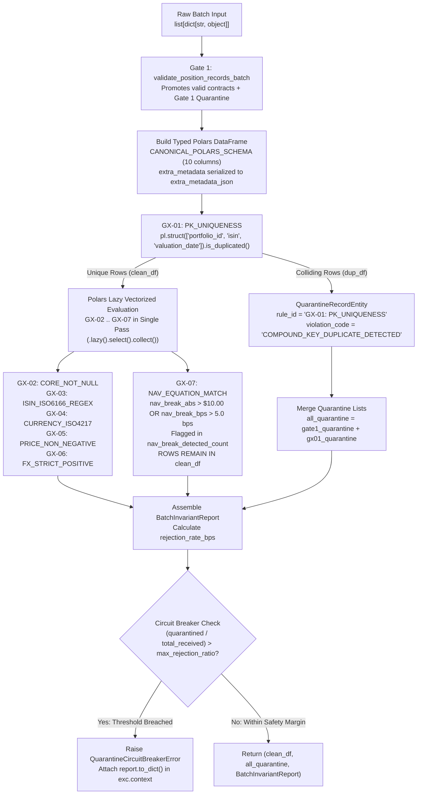

# Runbook 02: Declarative GX-01..GX-07 Accounting Invariants, Duplicate PK Isolation, and Circuit Breaker Triage

## 1. Purpose and Operational Scope

- **Operational Scope:** Second-stage vectorized Polars accounting invariant suite and batch circuit breaker (`src/domain/invariants.py`).
- **Target Audience:**
  - **On-Call Data Platform Engineers:** Responsible for investigating `QuarantineCircuitBreakerError` alerts when daily custodian feeds breach the configured rejection threshold.
  - **Fund Accounting & NAV Controllers:** Responsible for reviewing `BatchInvariantReport` manifests, resolving compound primary key collisions (`GX-01: PK_UNIQUENESS`), and analyzing pre-reconciliation NAV equation flags (`GX-07: NAV_EQUATION_MATCH`).

---

## 2. Second Customs Gate Architecture (`src/domain/invariants.py`)

While Gate 1 (`src/domain/contracts.py`) validates records individually in Pydantic v2, Gate 2 (`FinancialExpectationSuite` and `audit_and_bifurcate_batch` in `src/domain/invariants.py`) operates on the promoted `pl.DataFrame` (`CANONICAL_POLARS_SCHEMA`) using lazy vectorized Polars Rust expressions:



---

## 3. Complete Catalog of Institutional Invariants (`GX-01` to `GX-07`)

| Rule ID | Expectation Name | Vectorized Polars Formula | Disposition on Failure | Financial Root Cause & Remediation |
| :--- | :--- | :--- | :--- | :--- |
| **`GX-01: PK_UNIQUENESS`** | `expect_compound_columns_to_be_unique` | `pl.struct(["portfolio_id", "isin", "valuation_date"]).is_duplicated()` | **Removed from `clean_df`** and routed to quarantine (`COMPOUND_KEY_DUPLICATE_DETECTED`). | Custodian emitted unaggregated trade lots or split tax-lot lines for the same `(portfolio_id, isin, valuation_date)` without aggregating to position level. Request position-level aggregation or deduplicate upstream extract. |
| **`GX-02: CORE_NOT_NULL`** | `expect_column_values_to_not_be_null` | `pl.any_horizontal(pl.col(c).is_null() for c in CORE_CANONICAL_COLUMNS)` | Quarantined at Gate 1 (`CONTRACT_VIOLATION` / `IEEE754_NON_FINITE_NUMBER`). | Missing mandatory field (`position_id`, `portfolio_id`, `isin`, `valuation_date`, `currency`, `units`, `price`, `fx_rate`, `custodian_reported_nav`) or `NaN` in `units`/`nav`. Restore missing field in upstream extract. |
| **`GX-03: ISIN_ISO6166_REGEX`** | `expect_column_values_to_match_regex` | `~pl.col("isin").str.contains(r"^[A-Z]{2}[A-Z0-9]{9}[0-9]$")` | Quarantined at Gate 1 (`INVALID_ISIN_ISO6166`). | Malformed ISIN code or Luhn Mod-10 checksum mismatch. See Runbook 01 Procedure 4.1. |
| **`GX-04: CURRENCY_ISO4217`** | `expect_column_values_to_be_in_set` | `~pl.col("currency").is_in(list(ISO_4217_CURRENCIES))` | Quarantined at Gate 1 (`UNSUPPORTED_ISO4217_CURRENCY`). | Non-canonical currency symbol or minor currency subunit (`GBp`). Convert subunit to major ISO-4217 currency. |
| **`GX-05: PRICE_NON_NEGATIVE`** | `expect_column_values_to_be_between` | `(pl.col("price") < 0.0) \| (~pl.col("price").is_finite())` | Quarantined at Gate 1 (`CONTRACT_VIOLATION` / `IEEE754_NON_FINITE_NUMBER`). | Negative clean market price or `NaN`/`Inf` pricing feed failure. Apply fair-value price override. |
| **`GX-06: FX_STRICT_POSITIVE`** | `expect_column_values_to_be_between` | `(pl.col("fx_rate") <= 0.0) \| (~pl.col("fx_rate").is_finite())` | Quarantined at Gate 1 (`CONTRACT_VIOLATION` / `IEEE754_NON_FINITE_NUMBER`). | Non-positive FX rate (`<= 0.0`), non-finite FX rate, or USD position with `fx_rate != 1.0`. Correct spot FX rate table. |
| **`GX-07: NAV_EQUATION_MATCH`** | `expect_column_pair_nav_discrepancy_within_tolerance` | `(nav_break_abs > 10.0) \| (nav_break_bps > 5.0)` where `calc_nav = units * price * fx_rate` | **Retained in `clean_df`**; incremented in `report.nav_break_detected_count`. | Internal valuation (`units * price * fx_rate`) diverges from `custodian_reported_nav` by more than `$10.00` or `5.0 bps`. Position proceeds to 3-factor attribution (`QUANTITY_BREAK`, `PRICE_BREAK`, `FX_BREAK`) and appears on the `:3000` console. |

---

## 4. Step-by-Step Incident Response Procedures

### 4.1. Procedure: Inspecting a `BatchInvariantReport` and Auditing `GX-07` NAV Breaks

When a batch completes ingestion, `audit_and_bifurcate_batch` returns a `BatchInvariantReport` containing the exact telemetry for all 7 GX rules.

#### Step 1: Execute Diagnostic Inspection of `BatchInvariantReport`

Run the following command to simulate a batch containing a `$5,000` NAV discrepancy (`GX-07`) and inspect its serialized `.manifest.json` structure:

```bash
python -c "
import json
from src.domain.invariants import audit_and_bifurcate_batch

batch = [
    {
        'position_id': 'POS-AAPL-01', 'portfolio_id': 'PF-INST-01',
        'isin': 'US0378331005', 'valuation_date': '2026-11-10',
        'currency': 'USD', 'units': 1000.0, 'price': 220.0,
        'fx_rate': 1.0, 'custodian_reported_nav': 220000.0
    },
    {
        'position_id': 'POS-MSFT-BRK', 'portfolio_id': 'PF-INST-01',
        'isin': 'US5949181045', 'valuation_date': '2026-11-10',
        'currency': 'USD', 'units': 1000.0, 'price': 100.0,
        'fx_rate': 1.0, 'custodian_reported_nav': 95000.0
    }
]

clean_df, quarantined, report = audit_and_bifurcate_batch(batch, batch_id='DIAG-GX07-01')
print('[OK] Promoted Rows in clean_df:', clean_df.height)
print('[NAV-BREAK] GX-07 NAV Breaks Detected:', report.nav_break_detected_count)
print(json.dumps(report.to_dict(), indent=2))
"
```

---

### 4.2. Procedure: Triaging and Isolating Compound Primary Key Collisions (`GX-01: PK_UNIQUENESS`)

If two or more records in the same batch share `(portfolio_id, isin, valuation_date)`, `GX-01` removes the colliding rows from `clean_df` and routes them to quarantine so they cannot double-count portfolio AUM.

#### Step 1: Reproduce and Inspect `GX-01` Duplicate Key Quarantine Records

```bash
python -c "
from src.domain.invariants import audit_and_bifurcate_batch

batch = [
    {
        'position_id': 'LOT-101', 'portfolio_id': 'PF-CORE',
        'isin': 'US0378331005', 'valuation_date': '2026-11-10',
        'currency': 'USD', 'units': 400.0, 'price': 220.0,
        'fx_rate': 1.0, 'custodian_reported_nav': 88000.0
    },
    {
        'position_id': 'LOT-102', 'portfolio_id': 'PF-CORE',
        'isin': 'US0378331005', 'valuation_date': '2026-11-10',
        'currency': 'USD', 'units': 600.0, 'price': 220.0,
        'fx_rate': 1.0, 'custodian_reported_nav': 132000.0
    },
    {
        'position_id': 'POS-BAYER', 'portfolio_id': 'PF-CORE',
        'isin': 'DE000BAY0017', 'valuation_date': '2026-11-10',
        'currency': 'EUR', 'units': 500.0, 'price': 28.0,
        'fx_rate': 1.08, 'custodian_reported_nav': 15120.0
    }
]

clean_df, quarantined, report = audit_and_bifurcate_batch(batch, batch_id='DIAG-GX01-DUP')
print(f'[OK] Surviving clean_df rows: {clean_df.height} ({clean_df[\"position_id\"].to_list()})')
for q in quarantined:
    print(f'[WARN] Quarantined pos={q.position_id} | rule={q.rule_id} | code={q.violation_code}')
"
```

---

### 4.3. Procedure: Recovering a Batch After `QuarantineCircuitBreakerError` Trips

When `(quarantined_count / total_received) > max_rejection_ratio`, `audit_and_bifurcate_batch` raises `QuarantineCircuitBreakerError` to prevent an anomalously corrupted custodian feed from overwriting executive KPI baselines with partial data.

#### Step 1: Extract the Forensic Report Attached to `QuarantineCircuitBreakerError`

When the circuit breaker trips in production logs, inspect `err.context["report"]` to identify which GX rule caused the spike:

```bash
python -c "
import json
from src.domain.exceptions import QuarantineCircuitBreakerError
from src.domain.invariants import audit_and_bifurcate_batch

corrupted_batch = [
    {
        'position_id': 'POS-OK-1', 'portfolio_id': 'PF-01',
        'isin': 'US0378331005', 'valuation_date': '2026-11-10',
        'currency': 'USD', 'units': 100.0, 'price': 220.0,
        'fx_rate': 1.0, 'custodian_reported_nav': 22000.0
    },
    {'position_id': 'POS-BAD-1', 'portfolio_id': 'PF-01', 'isin': 'BAD_ISIN_1'},
    {'position_id': 'POS-BAD-2', 'portfolio_id': 'PF-01', 'isin': 'BAD_ISIN_2'},
]

try:
    audit_and_bifurcate_batch(corrupted_batch, batch_id='CB-INCIDENT-99', max_rejection_ratio=0.25)
except QuarantineCircuitBreakerError as err:
    print('[CRITICAL] Circuit Breaker Tripped:', err.message)
    print('[OK] Forensic Report Snapshot:', json.dumps(err.context['report'], indent=2))
"
```

#### Step 2: Controlled Emergency Promotion Override (Quarantine-First Recovery)

If Custody Operations confirms that the valid subset of positions must be promoted immediately while the rejected records remain isolated in `data/quarantine/`:
1. Re-invoke `audit_and_bifurcate_batch(batch, batch_id=..., max_rejection_ratio=1.0)` so the valid subset is promoted to `clean_df` while all corrupt rows are persisted as `QuarantineRecordEntity` manifests.
2. Verify that the Executive Console (`:3000`) reflects the quarantined count in the **NAV & Schema Breaks** KPI card.

---

## 5. Operational Escalation Matrix and SLA Thresholds

| Incident Severity | Trigger Condition | Maximum Response SLA | Primary Owner | Escalation Path |
| :--- | :--- | :--- | :--- | :--- |
| **SEV-1 (`[CRITICAL]`)** | `QuarantineCircuitBreakerError` tripped on daily production batch (`rejection_rate_bps > max_rejection_ratio`). | `15 minutes` | On-Call Data Platform Engineer | Head of Custody Operations & Quantitative Risk Lead |
| **SEV-2 (`[NAV-BREAK]`)** | `GX-07: NAV_EQUATION_MATCH` flags `nav_break_detected_count > 0` with variance `> $10.00` or `> 5.0 bps`. | `30 minutes` | Fund Accounting Controller | Portfolio Valuation Committee |
| **SEV-3 (`[WARN]`)** | `GX-01: PK_UNIQUENESS` isolates duplicate compound keys `(portfolio_id, isin, valuation_date)` into quarantine. | `60 minutes` | Custody Operations Specialist | Custodian Technical Account Manager |
| **SEV-4 (`[OK]` / Info)** | Single position quarantined by Gate 1 (`GX-02`..`GX-06`) below circuit breaker threshold. | `Next Business Day` | Data Operations Analyst | Static Security Master Team |

---

## 6. Canonical Polars Schema Reference (`CANONICAL_POLARS_SCHEMA`)

Every `clean_df` emitted by `audit_and_bifurcate_batch` (even when `clean_df.height == 0`) strictly guarantees the following 10-column Polars schema for downstream Zstandard Parquet persistence and DuckDB/Snowflake ingestion:

| Column Name | Polars DataType | Nullable in `clean_df` | Description |
| :--- | :--- | :--- | :--- |
| `position_id` | `pl.String` | `False` | Uppercase unique position or trade lot identifier (`2..64` chars). |
| `portfolio_id` | `pl.String` | `False` | Uppercase institutional fund or portfolio identifier (`2..48` chars). |
| `isin` | `pl.String` | `False` | Validated 12-character ISO 6166 Luhn Mod-10 security identifier. |
| `valuation_date` | `pl.String` | `False` | ISO 8601 valuation date string (`YYYY-MM-DD`). |
| `currency` | `pl.String` | `False` | Validated 3-character ISO-4217 currency code. |
| `units` | `pl.Float64` | `False` | Finite position quantity (positive for long, negative for short). |
| `price` | `pl.Float64` | `False` | Finite non-negative clean market price (`>= 0.0`). |
| `fx_rate` | `pl.Float64` | `False` | Finite strictly positive exchange rate to USD (`> 0.0`; `1.0` for `USD`). |
| `custodian_reported_nav` | `pl.Float64` | `False` | Finite ABOR Net Asset Value reported by the custodian in USD. |
| `extra_metadata_json` | `pl.String` | `False` | Deterministic sorted-key JSON string containing polymorphic client columns. |

---

## 7. Automated Verification Commands

Execute the following commands to verify the integrity of the GX-01..GX-07 suite:

```bash
python -m pytest tests/python/test_contracts_invariants_gx.py -v
python -m ruff check src/domain/invariants.py tests/python/test_contracts_invariants_gx.py
```

