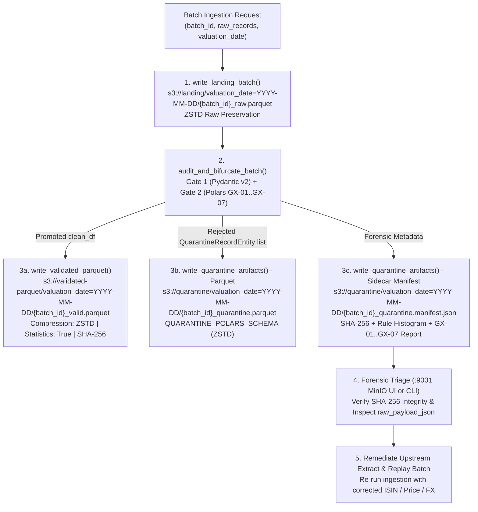

# Runbook 03: AWS S3 / MinIO Data Lake Operations, Zstandard Parquet Inspection, and Quarantine Forensics Recovery

## 1. Purpose and Operational Scope

- **Operational Scope:** Hexagonal Data Lake Port (`src/application/ports.py`), Typed Infrastructure Config (`src/infrastructure/config.py`), and Medallion S3 / MinIO Parquet ZSTD Adapter (`src/infrastructure/s3_parquet_adapter.py`).
- **Target Audience:**
  - **Data Platform & Storage Engineers:** Responsible for managing the 3-bucket S3/MinIO topology (`landing`, `validated-parquet`, `quarantine`), verifying `ZSTD` columnar compression and PyArrow zone-map statistics, and executing lake resets.
  - **Custody Operations & Forensic Auditors:** Responsible for inspecting quarantined batches via the MinIO Web Console (`http://localhost:9001`), verifying cryptographic `SHA-256` hashes in `.manifest.json`, and replaying corrected batches.

---

## 2. Medallion Data Lake Write & Forensic Recovery Workflow

The diagram below illustrates how `S3ParquetAdapter` persists raw, validated, and quarantined artifacts across the 3 buckets and how quarantined batches are audited and replayed:



---

## 3. MinIO S3 Web Console (`:9001`) & API (`:9000`) Connection Reference

| Parameter | Environment Variable | Default Local Value | Operational Description |
| :--- | :--- | :--- | :--- |
| **S3 API Endpoint** | `S3_ENDPOINT_URL` | `http://localhost:9000` | S3-compatible REST API used by `boto3` (`S3ParquetAdapter`). |
| **MinIO Web Console UI** | `S3_PUBLIC_CONSOLE_URL` | `http://localhost:9001` | Visual object browser for inspecting buckets, `.parquet` files, and `.manifest.json` artifacts. |
| **Access Key (Username)** | `S3_ACCESS_KEY` | `admin` | Default local MinIO console login username. |
| **Secret Key (Password)** | `S3_SECRET_KEY` | `assetpipe2026` | Default local MinIO console login password (injected via `.env`). |
| **Landing Bucket** | `S3_BUCKET_LANDING` | `landing` | Immutable raw batch extracts (`{batch_id}_raw.parquet`). |
| **Validated Bucket** | `S3_BUCKET_VALIDATED` | `validated-parquet` | GX-certified columnar positions (`{batch_id}_valid.parquet`). |
| **Quarantine Bucket** | `S3_BUCKET_QUARANTINE` | `quarantine` | Rejected rows (`_quarantine.parquet`) and forensic manifests (`_quarantine.manifest.json`). |

### Accessing the MinIO Visual Object Browser (`http://localhost:9001`)

1. Open `http://localhost:9001` in your browser (or click the **Open S3 / MinIO Console (:9001)** button in the `:3000` Executive Console).
2. Authenticate using **Username:** `admin` and **Password:** `assetpipe2026`.
3. Navigate to **Object Browser** in the left sidebar to inspect the three buckets:
   - `landing/valuation_date=YYYY-MM-DD/`
   - `validated-parquet/valuation_date=YYYY-MM-DD/`
   - `quarantine/valuation_date=YYYY-MM-DD/`

---

## 4. Step-by-Step Operational Procedures

### 4.1. Procedure: Inspecting Physical PyArrow Parquet Metadata (`ZSTD` Codec, Row Groups, and Zone Maps)

Every Parquet file generated by `S3ParquetAdapter` must use the `ZSTD` compression codec and include column-level `min`/`max` statistics for predicate pushdown.

#### Step 1: Run Physical PyArrow Metadata Audit

Execute the following Python command from the repository root to write a sample validated batch and inspect its physical Parquet footer via `pyarrow.parquet`:

```bash
python -c "
from pathlib import Path
import tempfile
import pyarrow.parquet as pq
from src.domain.invariants import audit_and_bifurcate_batch
from src.infrastructure.config import AssetPipeConfig
from src.infrastructure.s3_parquet_adapter import S3ParquetAdapter

with tempfile.TemporaryDirectory() as tmp:
    cfg = AssetPipeConfig.from_env(local_lake_override=Path(tmp))
    adapter = S3ParquetAdapter(cfg)
    raw = [{
        'position_id': 'POS-AAPL-01', 'portfolio_id': 'PF-ALPHA',
        'isin': 'US0378331005', 'valuation_date': '2026-11-10',
        'currency': 'USD', 'units': 1500.0, 'price': 224.50,
        'fx_rate': 1.0, 'custodian_reported_nav': 336750.0,
        'desk_code': 'NY-TECH'
    }]
    clean_df, _, _ = audit_and_bifurcate_batch(raw, batch_id='AUDIT-PQ-01')
    meta = adapter.write_validated_parquet('AUDIT-PQ-01', clean_df, '2026-11-10')
    pq_meta = pq.read_metadata(meta['local_path'])
    col_meta = pq_meta.row_group(0).column(0)
    print('[OK] S3 URI:', meta['s3_uri'])
    print('[OK] SHA-256 Digest:', meta['sha256'])
    print('[OK] Num Row Groups:', pq_meta.num_row_groups, '| Num Rows:', pq_meta.num_rows)
    print('[OK] Physical Compression Codec:', col_meta.compression)
    print('[OK] Zone Map Statistics Present:', col_meta.is_stats_set)
"
```

#### Expected Output

```text
[OK] S3 URI: s3://validated-parquet/valuation_date=2026-11-10/AUDIT-PQ-01_valid.parquet
[OK] SHA-256 Digest: <64-char hex sha256>
[OK] Num Row Groups: 1 | Num Rows: 1
[OK] Physical Compression Codec: ZSTD
[OK] Zone Map Statistics Present: True
```

---

### 4.2. Procedure: Cryptographic Verification of a Quarantine `.manifest.json` and Payload Inspection

When a batch contains rejected records, `write_quarantine_artifacts` generates both `{batch_id}_quarantine.parquet` and `{batch_id}_quarantine.manifest.json`. Before replaying or auditing a quarantined batch, verify that the binary `.parquet` file matches the cryptographic `sha256` recorded in the manifest.

#### Step 1: Verify `SHA-256` Integrity and Extract Rejected Rows

```bash
python -c "
import hashlib, json, tempfile
from pathlib import Path
import polars as pl
from src.domain.invariants import audit_and_bifurcate_batch
from src.infrastructure.config import AssetPipeConfig
from src.infrastructure.s3_parquet_adapter import S3ParquetAdapter

with tempfile.TemporaryDirectory() as tmp:
    cfg = AssetPipeConfig.from_env(local_lake_override=Path(tmp))
    adapter = S3ParquetAdapter(cfg)
    raw = [
        {
            'position_id': 'POS-OK-01', 'portfolio_id': 'PF-01',
            'isin': 'US0378331005', 'valuation_date': '2026-11-10',
            'currency': 'USD', 'units': 100.0, 'price': 220.0,
            'fx_rate': 1.0, 'custodian_reported_nav': 22000.0
        },
        {
            'position_id': 'POS-CORRUPT-ISIN', 'portfolio_id': 'PF-01',
            'isin': 'US0378331009', 'valuation_date': '2026-11-10',
            'currency': 'USD', 'units': 100.0, 'price': 220.0,
            'fx_rate': 1.0, 'custodian_reported_nav': 22000.0
        }
    ]
    landing_uri = adapter.write_landing_batch('BATCH-Q-01', raw, '2026-11-10')
    clean_df, quarantined, report = audit_and_bifurcate_batch(raw, 'BATCH-Q-01')
    q_res = adapter.write_quarantine_artifacts(
        'BATCH-Q-01', quarantined, report, '2026-11-10', landing_uri
    )

    manifest_data = json.loads(Path(q_res['manifest_local_path']).read_text(encoding='utf-8'))
    actual_sha256 = hashlib.sha256(Path(q_res['parquet_local_path']).read_bytes()).hexdigest()
    assert actual_sha256 == manifest_data['sha256'], '[CRITICAL] Quarantine SHA-256 tamper detected!'
    print('[OK] Cryptographic SHA-256 Verified:', actual_sha256)
    print('[WARN] Rule Violation Summary:', manifest_data['rule_violation_summary'])
    q_df = pl.read_parquet(q_res['parquet_local_path'])
    print('[OK] Quarantined Positions:', q_df.select(['position_id', 'rule_id', 'violation_code']).to_dicts())
"
```

---

### 4.3. Procedure: Quarantine Remediation, Batch Replay, and Honest Zero Lake Reset

| Step | Action | Verification Command / Expected State |
| :--- | :--- | :--- |
| **Step 1** | Inspect `raw_payload_json` in `{batch_id}_quarantine.parquet` to identify the broken field (`isin`, `currency`, `price`, `fx_rate`, or duplicate key). | `pl.read_parquet("..._quarantine.parquet").select("raw_payload_json")` |
| **Step 2** | Apply upstream fix (e.g., correct ISIN check digit via `compute_isin_check_digit` or remove duplicate tax lot). | All records pass `audit_and_bifurcate_batch` with `quarantined_count == 0`. |
| **Step 3** | Write remediated batch via `write_validated_parquet` and scan lazily via `scan_validated_parquet()`. | `adapter.scan_validated_parquet("2026-11-10").collect().height` matches promoted count. |
| **Step 4** | When resetting the environment back to Honest Zero Baseline (`$0.00`), invoke `adapter.reset_lake_to_zero()`. | `adapter.get_lake_storage_metrics()["total_objects"] == 0` and `total_bytes == 0`. |

---

## 5. Quarantine Parquet Schema Reference (`QUARANTINE_POLARS_SCHEMA`)

Every `{batch_id}_quarantine.parquet` file written to `s3://quarantine/valuation_date=YYYY-MM-DD/` strictly enforces the following 10-column Polars schema:

| Column Name | Polars DataType | Forensic Purpose |
| :--- | :--- | :--- |
| `batch_id` | `pl.String` | Unique ingestion batch identifier linking back to `s3://landing/`. |
| `position_id` | `pl.String` | Normalized position or trade lot ID (`UNKNOWN_POS` if missing). |
| `portfolio_id` | `pl.String` | Normalized fund or portfolio ID (`UNKNOWN_PORTFOLIO` if missing). |
| `isin` | `pl.String` | Raw or normalized ISIN string that triggered the rejection (`UNKNOWN_ISIN` if null). |
| `valuation_date` | `pl.String` | ISO 8601 date partition (`1970-01-01` fallback if missing). |
| `rule_id` | `pl.String` | Deterministic GX rule (`GX-01: PK_UNIQUENESS` through `GX-06: FX_STRICT_POSITIVE`). |
| `violation_code` | `pl.String` | Machine-readable domain error code (`INVALID_ISIN_ISO6166`, `IEEE754_NON_FINITE_NUMBER`, etc.). |
| `diagnostic_message` | `pl.String` | Human-readable forensic explanation with `[CRITICAL]` or `[WARN]` severity tag. |
| `raw_payload_json` | `pl.String` | Complete original client dictionary serialized with `allow_nan=False` (`NaN`/`Inf` as strings). |
| `quarantined_at_utc` | `pl.String` | ISO 8601 UTC timestamp (`YYYY-MM-DDTHH:MM:SSZ`) of quarantine isolation. |

---

## 6. Storage Failure Modes and Troubleshooting Matrix

| Symptom / Log Tag | Root Cause | Diagnostic Check | Resolution |
| :--- | :--- | :--- | :--- |
| `s3_online: False` in `get_lake_storage_metrics()` | MinIO container (`:9000`) is stopped or running in offline CI mode. | `docker ps` or check TCP port `:9000`. | Adapter automatically persists to `config.local_lake_root`; start MinIO container if `:9001` web console browsing is required. |
| `SHA-256 mismatch` during forensic audit | Corrupted disk block or unauthorized manual modification of `_quarantine.parquet`. | Compare `hashlib.sha256` of `.parquet` against `.manifest.json["sha256"]`. | Re-ingest original raw extract from immutable `s3://landing/` bucket. |
| `scan_validated_parquet()` returns `0` rows after ingestion | Valuation date filter mismatch or 100% of records routed to quarantine. | Check `get_lake_storage_metrics()["buckets"]` counts. | Inspect `s3://quarantine/` `.manifest.json` for `rule_violation_summary`. |

---

## 7. Automated Verification Commands

Execute the following commands to validate the S3/MinIO Parquet ZSTD adapter and hexagonal port compliance:

```bash
python -m pytest tests/python/test_s3_parquet_adapter.py -v
python -m ruff check src/application/ports.py src/infrastructure/config.py src/infrastructure/s3_parquet_adapter.py
```

