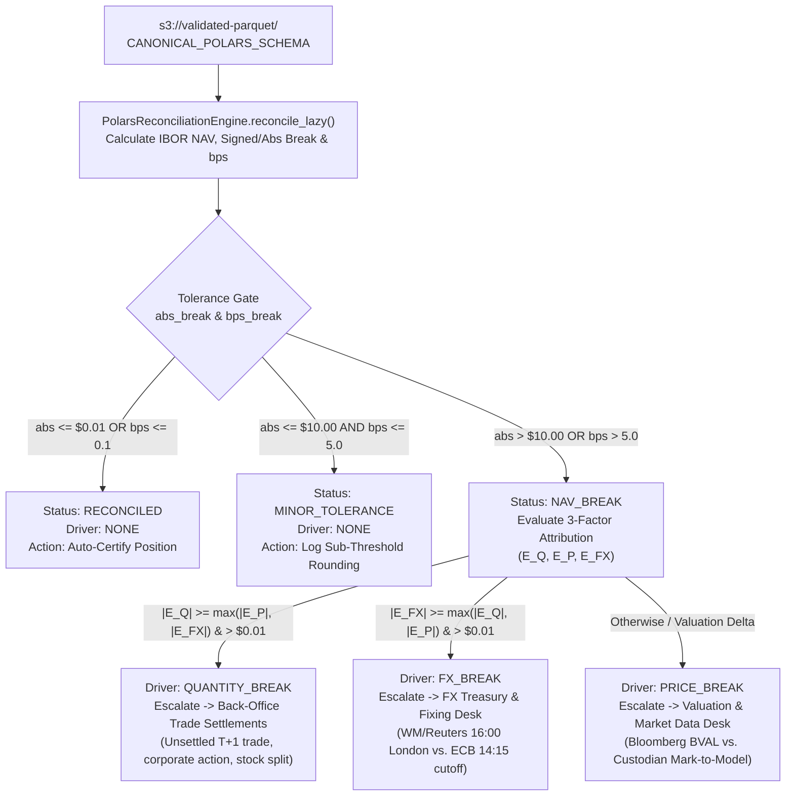

# Runbook 04: Polars Vectorized NAV Break Triage, 3-Factor Attribution Routing, and Gross vs. Net Variance Auditing

## 1. Purpose and Operational Scope

- **Operational Scope:** Vectorized Polars Reconciliation Engine (`src/application/reconciliation_engine.py`), Deterministic Synthetic Portfolio Generator (`src/application/synthetic_generator.py`), and Ingestion Pipeline Orchestrator (`src/application/ingestion_service.py`).
- **Target Audience:**
  - **Quantitative NAV Controllers:** Responsible for investigating `[NAV-BREAK]` alerts, auditing `gross_fund_break_usd` vs. `net_fund_break_usd` rollups, and signing off daily fund valuations.
  - **Back-Office Settlements, Valuation Desk & FX Treasury Teams:** Responsible for resolving breaks routed to them by `break_driver` (`QUANTITY_BREAK`, `PRICE_BREAK`, `FX_BREAK`).
  - **Data Platform Engineers:** Responsible for executing full-lake streaming reconciliations (`run_full_lake_reconciliation`) and resetting environments to the Honest Zero Baseline (`$0.00`).

---

## 2. End-to-End Vectorized Reconciliation & Escalation Flow



---

## 3. Operational Triage Matrix by `BreakDriver`

When `reconciliation_status == "NAV_BREAK"`, use `break_driver` and the three attribution columns (`qty_effect_usd`, `price_effect_usd`, `fx_effect_usd`) to route the incident immediately:

| `break_driver` | Dominant Attribution Metric | Responsible Operational Desk | Common Financial Root Causes | Step-by-Step Resolution Protocol |
| :--- | :--- | :--- | :--- | :--- |
| **`QUANTITY_BREAK`** | `abs(qty_effect_usd)` is largest (`> $0.01`) | **Back-Office Trade Settlements** | 1. Unsettled DVP/RVP trade (`T+1` / `T+2` timing difference between IBOR trade-date and Custodian settlement-date).<br>2. Unprocessed dividend reinvestment or stock split. | 1. Compare `units` (IBOR) vs. `$.abor_units` in `extra_metadata_json`.<br>2. Check SWIFT MT540–MT547 settlement confirmation messages.<br>3. Book pending trade accrual or update custodian position lot. |
| **`PRICE_BREAK`** | `abs(price_effect_usd)` is largest (or default NAV delta) | **Valuation & Market Data Desk** | 1. Bid vs. Mid vs. Close pricing snap mismatch.<br>2. Illiquid bond priced via internal yield curve vs. custodian broker quote.<br>3. Clean price vs. Dirty price (accrued coupon included). | 1. Compare `price` (IBOR) vs. `$.abor_price`.<br>2. Verify pricing source hierarchy (Bloomberg BVAL / Refinitiv) for the `isin`.<br>3. Issue Fair-Value Committee price challenge to custodian if $> 5.0\text{ bps}$. |
| **`FX_BREAK`** | `abs(fx_effect_usd)` is largest (`> $0.01`) | **FX Treasury & Fixing Desk** | 1. Custodian applied ECB `14:15 CET` fixing while IBOR applied WM/Reuters `16:00 London` fixing.<br>2. Inverse FX quote convention error on non-USD cross (`EUR`, `GBP`, `JPY`). | 1. Compare `fx_rate` vs. `$.abor_fx_rate` for non-USD `currency`.<br>2. Align fund accounting SLA on authoritative daily FX snap source. |
| **`NONE`** (`MINOR_TOLERANCE`) | `nav_break_abs <= $10.00` AND `nav_break_bps <= 5.0` | **Automated / No Escalation** | 5th-decimal FX rate or fractional share rounding variance. | Retained in audit log; no manual adjustment required. |

---

## 4. Step-by-Step Diagnostic Procedures

### 4.1. Procedure: Running Vectorized 3-Factor Attribution Diagnostics from CLI

Execute the following command from the repository root to verify how `PolarsReconciliationEngine` decomposes Quantity, Price, and FX breaks simultaneously:

```bash
python -c "
import polars as pl
from src.application.reconciliation_engine import PolarsReconciliationEngine
from src.application.synthetic_generator import SyntheticPortfolioGenerator
from src.domain.invariants import audit_and_bifurcate_batch

gen = SyntheticPortfolioGenerator()
raw_batch = gen.generate_corrupt_and_nav_break_batch(
    valid_with_breaks_count=6, schema_corrupt_count=3, valuation_date='2026-11-10'
)
clean_df, quarantined, _ = audit_and_bifurcate_batch(raw_batch, batch_id='DIAG-3FACTOR')
engine = PolarsReconciliationEngine()
reconciled_df = engine.execute_streaming_reconciliation(clean_df.lazy())

print(f'[OK] Reconciled Rows: {reconciled_df.height} | Quarantined Schema Faults: {len(quarantined)}')
for row in reconciled_df.select([
    'position_id', 'currency', 'calculated_nav', 'custodian_reported_nav',
    'nav_break_signed', 'nav_break_bps', 'reconciliation_status', 'break_driver',
    'qty_effect_usd', 'price_effect_usd', 'fx_effect_usd'
]).to_dicts():
    print('[NAV-BREAK]', row)
"
```

---

### 4.2. Procedure: Auditing Compensating Errors (`Net_Fund_Break` vs. `Gross_Fund_Break`)

Fund controllers must always inspect `gross_fund_break_usd` alongside `net_fund_break_usd`. Two offsetting breaks ($+\$5,000$ and $-\$5,000$) cancel out in `net_fund_break_usd` (`$0.00`) but expose `$10,000.00` of absolute discrepancy in `gross_fund_break_usd`.

#### Step 1: Run Offsetting Break Detection Verification

```bash
python -c "
from src.application.reconciliation_engine import PolarsReconciliationEngine
from src.domain.invariants import audit_and_bifurcate_batch

offsetting_batch = [
    {
        'position_id': 'POS-OVER-5K', 'portfolio_id': 'BLK-ALADDIN-CORE',
        'isin': 'US0378331005', 'valuation_date': '2026-11-10',
        'currency': 'USD', 'units': 1000.0, 'price': 105.0,
        'fx_rate': 1.0, 'custodian_reported_nav': 100000.0
    },
    {
        'position_id': 'POS-UNDER-5K', 'portfolio_id': 'BLK-ALADDIN-CORE',
        'isin': 'US5949181045', 'valuation_date': '2026-11-10',
        'currency': 'USD', 'units': 1000.0, 'price': 95.0,
        'fx_rate': 1.0, 'custodian_reported_nav': 100000.0
    }
]

clean_df, _, _ = audit_and_bifurcate_batch(offsetting_batch, batch_id='AUDIT-OFFSET')
engine = PolarsReconciliationEngine()
rec_df = engine.execute_streaming_reconciliation(clean_df.lazy())
rollup = engine.compute_portfolio_rollup(rec_df).to_dicts()[0]
print('[WARN] Net Fund Break USD (Masked):', rollup['net_fund_break_usd'])
print('[CRITICAL] Gross Fund Break USD (Exposed):', rollup['gross_fund_break_usd'])
print('[OK] NAV Break Count:', rollup['nav_break_count'])
"
```

#### Expected Diagnostic Output

```text
[WARN] Net Fund Break USD (Masked): 0.0
[CRITICAL] Gross Fund Break USD (Exposed): 10000.0
[OK] NAV Break Count: 2
```

---

### 4.3. Procedure: Executing Full Pipeline Orchestration and Honest Zero Reset

Use `ReconciliationPipelineService` to run end-to-end ingestion into S3 Parquet ZSTD, execute lazy streaming reconciliation, and verify `reset_entire_platform_to_zero()`:

```bash
python -c "
from pathlib import Path
import tempfile
from src.application.ingestion_service import ReconciliationPipelineService
from src.application.synthetic_generator import SyntheticPortfolioGenerator
from src.infrastructure.config import AssetPipeConfig
from src.infrastructure.s3_parquet_adapter import S3ParquetAdapter

with tempfile.TemporaryDirectory() as tmp:
    cfg = AssetPipeConfig.from_env(local_lake_override=Path(tmp))
    lake = S3ParquetAdapter(cfg)
    service = ReconciliationPipelineService(lake=lake)
    gen = SyntheticPortfolioGenerator()

    res_clean = service.ingest_and_reconcile_batch(
        gen.generate_clean_institutional_batch(count=25), batch_id='BATCH-CLEAN-25'
    )
    print('[OK] Clean Batch Summary:', {
        k: res_clean[k] for k in ('promoted_count', 'reconciled_count', 'minor_tolerance_count', 'quarantined_count')
    })

    res_reset = service.reset_entire_platform_to_zero()
    print('[OK] Reset Status:', res_reset['message'])
    print('[OK] Post-Reset Lake Objects:', res_reset['lake_metrics']['total_objects'])
"
```

---

## 5. Synthetic Institutional Portfolio & Stress Catalog Reference

`SyntheticPortfolioGenerator` (`src/application/synthetic_generator.py`) provides deterministic multi-currency feeds used by automated tests and the `:3000` Executive Console action buttons:

| Portfolio Identifier | Institutional Strategy Profile | Base Currencies | Primary Custodian BICs |
| :--- | :--- | :--- | :--- |
| `BLK-ALADDIN-CORE` | Global Multi-Asset Core Benchmark | `USD`, `EUR`, `GBP` | `IRVTUS3N` (BNY Mellon), `MIDLGB22` (HSBC) |
| `BLK-CREDIT-OPP` | Institutional Investment Grade & High Yield Credit | `USD`, `EUR` | `CEDELULL` (Clearstream), `BNPAFRPP` (BNP) |
| `SANT-IB-RATES` | European Sovereign & Corporate Rates Desk | `EUR`, `CHF` | `BBVAESMM`, `UBSWCHZH` (UBS) |
| `SANT-AM-EURO` | Eurozone Large-Cap Equity Mandate | `EUR` | `DEUTDEFF` (Deutsche Bank), `ABNANL2A` |
| `VANGUARD-INST-IDX` | Global Developed Equity Index Tracking | `USD`, `JPY`, `GBP` | `IRVTUS3N`, `BOTKJPJT` (MUFG Tokyo) |

### Seed Securities Catalog (`SEED_SECURITIES`)

| ISIN (ISO 6166 Luhn Mod-10) | Currency | Reference Clean Price | Spot FX to USD | Desk Code | Asset Class |
| :--- | :--- | :--- | :--- | :--- | :--- |
| `US0378331005` | `USD` | `224.50` | `1.0000` | `NY-EQUITY` | `EQUITY` |
| `US5949181045` | `USD` | `415.20` | `1.0000` | `NY-EQUITY` | `EQUITY` |
| `ES0113900J37` | `EUR` | `4.65` | `1.0850` | `MADRID-RATES` | `EQUITY` |
| `DE000BAY0017` | `EUR` | `28.40` | `1.0850` | `FRANKFURT-EQ` | `EQUITY` |
| `GB0002374006` | `GBP` | `25.10` | `1.2920` | `LONDON-CORE` | `EQUITY` |
| `FR0000120271` | `EUR` | `58.90` | `1.0850` | `PARIS-CREDIT` | `EQUITY` |
| `NL0000235190` | `EUR` | `138.75` | `1.0850` | `AMSTERDAM-EQ` | `EQUITY` |
| `CH0038863350` | `CHF` | `84.30` | `1.1340` | `ZURICH-WEALTH` | `EQUITY` |
| `JP3633400001` | `JPY` | `2650.00` | `0.0065` | `TOKYO-INDEX` | `EQUITY` |
| `XS2010039381` | `EUR` | `99.40` | `1.0850` | `LUX-FIXED-INC` | `CORP_BOND` |

---

## 6. Automated Verification Commands

Execute the following commands to validate the Polars reconciliation engine, synthetic generator, and ingestion orchestrator:

```bash
python -m pytest tests/python/test_polars_reconciliation_engine.py -v
python -m ruff check src/application/ tests/python/test_polars_reconciliation_engine.py
```

