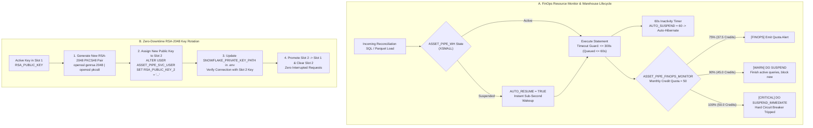

# Runbook 05: Snowflake FinOps Circuit Breaker Recovery, Zero-Downtime RSA-2048 Key Rotation, and Dynamic Masking Verification

## 1. Purpose and Operational Scope

- **Operational Scope:** Cloud FinOps Guardrails (`sql/00_finops_guardrails.sql`), Zero-Trust RBAC, RSA-2048 Auth, Dynamic Masking & RLS (`sql/01_security_rbac.sql`), and Dual-Engine ANSI Analytical Views (`sql/02_analytical_views.sql`).
- **Target Audience:**
  - **Cloud FinOps & Data Platform Engineers:** Responsible for monitoring Snowflake credit consumption under `ASSET_PIPE_FINOPS_MONITOR` and recovering `ASSET_PIPE_WH` if `SUSPEND_IMMEDIATE` trips at 100% quota.
  - **Security & IAM Operations (`[OPSEC]`):** Responsible for generating PKCS#8 `RSA-2048` key pairs via `openssl`, executing zero-downtime key rotation across `RSA_PUBLIC_KEY` and `RSA_PUBLIC_KEY_2`, and auditing `PORTFOLIO_ID_MASK` and `JURISDICTION_RLS_POLICY`.

---

## 2. FinOps Guardrails & Zero-Downtime RSA-2048 Rotation Lifecycle



---

## 3. Step-by-Step Procedure: Generating and Rotating `RSA-2048` Keys Without Downtime

`ASSET_PIPE_SVC_USER` enforces `PASSWORD = NULL` and authenticates exclusively via `RSA-2048` key-pair signatures (`sql/01_security_rbac.sql`). Snowflake provides two public key attributes (`RSA_PUBLIC_KEY` and `RSA_PUBLIC_KEY_2`) so keys can be rotated with zero service interruption.

### Step 1: Generate an Unencrypted PKCS#8 RSA-2048 Private Key and Public Key

Run the following `openssl` commands in a secure local directory OUTSIDE the git repository (or inside `/secrets/` ignored by `.gitignore`):

```bash
# 1. Generate 2048-bit PKCS#8 private key (.p8) with strict 0600 permissions
openssl genrsa 2048 | openssl pkcs8 -topk8 -inform PEM -out rsa_key_new.p8 -nocrypt
chmod 600 rsa_key_new.p8

# 2. Derive the corresponding PEM public key (.pub)
openssl rsa -in rsa_key_new.p8 -pubout -out rsa_key_new.pub

# 3. Extract the single-line Base64 public key body for Snowflake DDL
grep -v "BEGIN PUBLIC KEY" rsa_key_new.pub | grep -v "END PUBLIC KEY" | tr -d '\n'
```

### Step 2: Attach the New Public Key to Slot 2 (`RSA_PUBLIC_KEY_2`) in Snowflake

 While the pipeline continues authenticating with Slot 1 (`RSA_PUBLIC_KEY`), register the newly generated public key in Slot 2:

```sql
USE ROLE SECURITYADMIN;

ALTER USER ASSET_PIPE_SVC_USER
    SET RSA_PUBLIC_KEY_2 = 'MIIBIjANBgkqhkiG9w0BAQEFAAOCAQ8AMIIBCgKCAQEA...';

-- Verify the SHA-256 fingerprint registered by Snowflake matches openssl:
DESC USER ASSET_PIPE_SVC_USER;
```

### Step 3: Cut Over the Application Private Key and Retire the Old Slot 1 Key

1. Update `SNOWFLAKE_PRIVATE_KEY_PATH=/secrets/rsa_key_new.p8` in `.env`.
2. Once verified, promote the new key to `RSA_PUBLIC_KEY` and clear `RSA_PUBLIC_KEY_2`:

```sql
USE ROLE SECURITYADMIN;

ALTER USER ASSET_PIPE_SVC_USER
    SET RSA_PUBLIC_KEY = 'MIIBIjANBgkqhkiG9w0BAQEFAAOCAQ8AMIIBCgKCAQEA...';

ALTER USER ASSET_PIPE_SVC_USER
    UNSET RSA_PUBLIC_KEY_2;
```

---

## 4. Step-by-Step Procedure: Triaging a FinOps `SUSPEND_IMMEDIATE` Circuit Breaker Event

When `ASSET_PIPE_FINOPS_MONITOR` reaches `100%` of its `50` monthly credit quota, Snowflake executes `SUSPEND_IMMEDIATE` on `ASSET_PIPE_WH`.

| Triage Phase | Action / SQL Diagnostic Command | Operational Decision |
| :--- | :--- | :--- |
| **1. Confirm Monitor State** | `SHOW RESOURCE MONITORS LIKE 'ASSET_PIPE_FINOPS_MONITOR';` | Inspect `USED_CREDITS` vs. `CREDIT_QUOTA` (`50`). |
| **2. Identify Top Credit Queries** | Query `SNOWFLAKE.ACCOUNT_USAGE.QUERY_HISTORY` ordered by `TOTAL_ELAPSED_TIME DESC`. | Check if an ad-hoc analyst query hit the `300s` timeout repeatedly. |
| **3. Immediate Zero-Cost Failover** | Set `WAREHOUSE_ENGINE=duckdb` in `.env`. | Continues 100% of reconciliation and `:3000` console operations locally at `$0.00` cloud cost. |
| **4. Controlled Quota Extension** | `ALTER RESOURCE MONITOR ASSET_PIPE_FINOPS_MONITOR SET CREDIT_QUOTA = 65;` followed by `ALTER WAREHOUSE ASSET_PIPE_WH RESUME IF SUSPENDED;` | Execute only after FinOps Controller approval. |

---

## 5. Step-by-Step Procedure: Verifying Dynamic Data Masking (`PORTFOLIO_ID_MASK`) and Honest Zero Baseline Views

### 5.1. Verifying `PORTFOLIO_ID_MASK` and `JURISDICTION_RLS_POLICY` in Snowflake

Run the following SQL verification block in Snowflake to confirm that `ASSET_PIPE_AUDITOR_ROLE` sees deterministic `SHA-256` masked fund IDs while `ASSET_PIPE_COMPLIANCE_ROLE` sees unmasked identifiers:

```sql
-- 1. Verify masked output under Auditor Role (preserves GROUP BY cardinality)
USE ROLE ASSET_PIPE_AUDITOR_ROLE;
SELECT portfolio_id, COUNT(*) AS pos_count, SUM(calculated_nav) AS ibor_aum
FROM ASSET_PIPE_DB.RECONCILIATION.fact_reconciled_positions
GROUP BY portfolio_id;
-- Expected portfolio_id format: 'MASKED-FUND-8f434346'

-- 2. Verify unmasked output under Compliance Role
USE ROLE ASSET_PIPE_COMPLIANCE_ROLE;
SELECT portfolio_id, COUNT(*) AS pos_count, SUM(calculated_nav) AS ibor_aum
FROM ASSET_PIPE_DB.RECONCILIATION.fact_reconciled_positions
GROUP BY portfolio_id;
-- Expected portfolio_id format: 'BLK-ALADDIN-CORE'
```

### 5.2. Local DuckDB Verification of `sql/02_analytical_views.sql` (Honest Zero Baseline & Break Triage)

Execute the following command from the repository root to verify that `sql/02_analytical_views.sql` initializes cleanly in DuckDB and returns the exact **Honest Zero Baseline (`$0.00`)** on empty tables:

```bash
python -c "
from pathlib import Path
import duckdb

sql_script = Path('sql/02_analytical_views.sql').read_text(encoding='utf-8')
con = duckdb.connect(':memory:')
con.execute(sql_script)

zero_row = con.execute('SELECT * FROM v_executive_reconciliation_kpis').fetchone()
cols = [d[0] for d in con.description]
print('[OK] Honest Zero Baseline View Output:', dict(zip(cols, zero_row)))
"
```

#### Expected Diagnostic Output

```text
[OK] Honest Zero Baseline View Output: {'total_positions': 0, 'validated_ibor_aum_usd': 0.0, 'custodian_abor_aum_usd': 0.0, 'reconciled_ok_count': 0, 'minor_tolerance_count': 0, 'nav_break_count': 0, 'schema_rejected_count': 0, 'total_breaks_and_rejects': 0, 'gross_nav_variance_usd': 0.0, 'net_nav_variance_usd': 0.0, 'max_break_bps': 0.0, 'last_updated_utc': '1970-01-01T00:00:00Z'}
```

---

## 6. Reference Catalog of Analytical Tables and Views (`sql/02_analytical_views.sql`)

| SQL Object Name | Object Type | Primary Key / Grain | Operational Description |
| :--- | :--- | :--- | :--- |
| `fact_reconciled_positions` | Fact Table | `PRIMARY KEY (portfolio_id, isin, valuation_date)` | Stores GX-validated positions enriched with Polars `calculated_nav`, `nav_break_bps`, 3-factor attribution (`qty_effect_usd`, `price_effect_usd`, `fx_effect_usd`), `reconciliation_status`, and `break_driver`. |
| `fact_quarantine_audit_log` | Audit Fact Table | Append-Only Forensic Log (`batch_id, position_id`) | Stores rejected records intercepted by Gate 1 (`Pydantic v2`) and Gate 2 (`GX-01`), including `rule_id`, `violation_code`, and `raw_payload_json`. |
| `v_executive_reconciliation_kpis` | Analytical View | Single-Row Executive Summary | Guarantees `1` row in all states (`COALESCE(..., 0.0)`); powers the 5 KPI cards on `:3000`. |
| `v_nav_and_schema_breaks_triage` | Analytical View | Unified Exception Row (`UNION ALL`) | Combines `NAV_BREAK` rows from `fact_reconciled_positions` with `SCHEMA_REJECTED` rows from `fact_quarantine_audit_log`. |
| `v_portfolio_aum_rollup` | Analytical View | `(portfolio_id, valuation_date)` | Exposes compensating errors by reporting both `net_fund_break_usd` and `gross_fund_break_usd`. |

---

## 7. Security & FinOps Incident Troubleshooting Matrix

| Incident / Error Code | Root Cause | Diagnostic Verification | Remediation |
| :--- | :--- | :--- | :--- |
| `JWT token is invalid` or `Public key fingerprint mismatch` | `.env` `SNOWFLAKE_PRIVATE_KEY_PATH` does not match neither `RSA_PUBLIC_KEY` nor `RSA_PUBLIC_KEY_2`. | Compare `DESC USER ASSET_PIPE_SVC_USER;` `RSA_PUBLIC_KEY_FP` against local `openssl rsa -pubin -outform DER \| openssl dgst -sha256 -binary \| openssl enc -base64`. | Re-apply Procedure 3 Step 2 to set `RSA_PUBLIC_KEY_2` with the matching public key. |
| `Statement reached its statement or warehouse timeout of 300 second(s)` | Unbounded ad-hoc query or missing partition filter triggered Firewall 2 (`STATEMENT_TIMEOUT_IN_SECONDS = 300`). | Inspect query profile in Snowflake Query History. | Add `WHERE valuation_date = 'YYYY-MM-DD'` predicate pushdown filter. |
| Auditor sees `MASKED-FUND-...` instead of real fund name | Expected behavior under `PORTFOLIO_ID_MASK` for `ASSET_PIPE_AUDITOR_ROLE`. | `SELECT CURRENT_ROLE();` | Switch to `ASSET_PIPE_COMPLIANCE_ROLE` if unmasked regulatory inspection is authorized. |

---

## 8. Automated Verification Commands

Execute the following commands to validate all SQL FinOps guardrails, RBAC/RSA-2048 security policies, and analytical views:

```bash
python -m pytest tests/python/test_sql_finops_and_rbac_governance.py -v
python -m ruff check tests/python/test_sql_finops_and_rbac_governance.py
```

