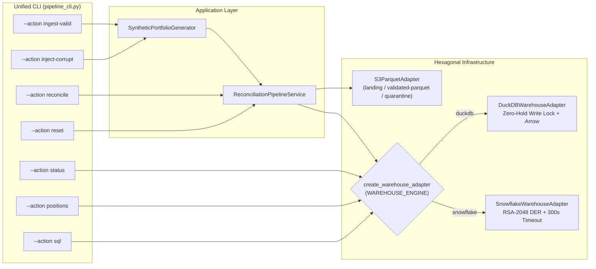

# Runbook 06: Dual Warehouse Operations (`DuckDB` / `Snowflake`), Unified CLI (`pipeline_cli.py`), and Zero-Lock SQL Workbench (`:4213`)

## 1. Purpose and Operational Scope

- **Operational Scope:** Local OLAP Adapter (`src/infrastructure/duckdb_adapter.py`), Corporate Snowflake Cloud Adapter (`src/infrastructure/snowflake_adapter.py`), Polymorphic Factory (`src/infrastructure/warehouse_factory.py`), and Unified Pipeline CLI (`src/interfaces/cli/pipeline_cli.py`).
- **Target Audience:** Data Platform SREs, Quantitative Reconciliation Engineers, FinOps Controllers, and Production Support Teams.
- **Severity Classification:**
  - `[OK]`: Honest Zero Baseline (`$0.00`) verified, Arrow Zero-Copy upserts completed with `CHECKPOINT`, and read-only SQL queries executing under `50ms`.
  - `[WARN]`: Transient Windows file checkpoint contention absorbed by the 5x15ms `read_only=True` retry loop, or Snowflake adapter queried in offline cold mode.
  - `[NAV-BREAK]`: Material valuation discrepancy (`> 5.0 bps`) or `SCHEMA_REJECTED` record surfaced in `v_nav_and_schema_breaks_triage` (`BREAKS_ONLY` filter).
  - `[OPSEC]`: Missing, corrupted, or sub-2048-bit RSA private key (`SNOWFLAKE_RSA_KEY_MISSING`, `WEAK_RSA_KEY_SIZE`).
  - `[CRITICAL]`: Attempted mutating SQL injection (`DROP`, `DELETE`, `TRUNCATE`, `ALTER`, `COPY`) blocked by `execute_readonly_sql` (`READONLY_SQL_VIOLATION`).

---

## 2. End-to-End Dual Warehouse & CLI Execution Topology



---

## 3. Operational Catalog of `pipeline_cli.py` Actions

The unified CLI (`src/interfaces/cli/pipeline_cli.py`) is the single authoritative command interface invoked by both human operators and the `:3000` Express Executive Console. Every action outputs structured, deterministic JSON to `stdout`.

| CLI `--action` | Primary Arguments | Underlying Port / Service Call | Operational Purpose |
| :--- | :--- | :--- | :--- |
| `status` | *(none)* | `warehouse.get_executive_kpis()` + `lake.get_lake_storage_metrics()` | Inspect live 5-card KPIs (`$0.00` baseline when empty), bucket footprints, and active `:3000` / `:9001` / `:4213` endpoints. |
| `ingest-valid` | `--count 50 --seq 1` | `generate_clean_institutional_batch` -> `ingest_and_reconcile_batch` | Generate and ingest clean multi-currency institutional positions (`RECONCILED` and `MINOR_TOLERANCE`). |
| `inject-corrupt` | `--breaks-count 15 --corrupt-count 8 --seq 1` | `generate_corrupt_and_nav_break_batch` -> `ingest_and_reconcile_batch` | Inject 3-factor NAV breaks (`QUANTITY_BREAK`, `PRICE_BREAK`, `FX_BREAK`) + `GX-01..GX-06` schema faults. |
| `reconcile` | `--valuation-date 2026-11-10` | `service.run_full_lake_reconciliation()` | Re-scan `validated-parquet/` lazily in Polars Rust (`engine="streaming"`) and upsert into the warehouse. |
| `positions` | `--status-filter BREAKS_ONLY --search US --page 1` | `warehouse.query_positions_paginated(...)` | Server-side filtered, searched (`ILIKE`), sorted, and paginated drill-down for the `:3000` grid. |
| `sql` | `--query "SELECT * FROM v_portfolio_aum_rollup"` | `warehouse.execute_readonly_sql(query)` | Execute guarded read-only analytical SQL (`SELECT` / `WITH` / `DESCRIBE`) for the `:4213` SQL Workbench. |
| `reset` | *(none)* | `service.reset_entire_platform_to_zero()` | Purge all 3 S3/MinIO buckets and `TRUNCATE` warehouse tables back to the Honest Zero Baseline (`$0.00`). |

---

## 4. Standard Operating Procedures (SOPs): CLI Execution

### 4.1. Auditing Honest Zero Baseline (`$0.00`) and System Status

Before running daily ingestion or after a reset, verify that the platform reports the Honest Zero Baseline (`$0.00` AUM, `0` positions, `0` breaks):

```powershell
python -m src.interfaces.cli.pipeline_cli --action status
```

Expected JSON output snippet when clean:
- `"total_positions": 0`
- `"validated_ibor_aum_usd": 0.0`
- `"custodian_abor_aum_usd": 0.0`
- `"total_breaks_and_rejects": 0`
- `"warehouse_engine": "duckdb"`

### 4.2. Running Clean Ingestion and Forensic Corrupt/Break Injection

```powershell
# Step 1: Ingest 50 clean institutional positions across 5 portfolios
python -m src.interfaces.cli.pipeline_cli --action ingest-valid --count 50 --seq 1

# Step 2: Inject 15 material 3-factor NAV breaks and 8 schema corruptions
python -m src.interfaces.cli.pipeline_cli --action inject-corrupt --breaks-count 15 --corrupt-count 8 --seq 1
```

### 4.3. Server-Side Break Triage (`BREAKS_ONLY`) and Search Filtering

When Card 4 (`NAV & Schema Breaks`) on the `:3000` console turns red (`[NAV-BREAK]`), isolate all accounting breaks and schema rejections without loading clean rows:

```powershell
# Isolate only NAV_BREAK and SCHEMA_REJECTED rows (queries v_nav_and_schema_breaks_triage)
python -m src.interfaces.cli.pipeline_cli --action positions --status-filter BREAKS_ONLY --page 1 --page-size 25

# Filter breaks by portfolio or ISIN prefix using parameterized ILIKE search
python -m src.interfaces.cli.pipeline_cli --action positions --status-filter BREAKS_ONLY --search BLK-ALADDIN-CORE
```

---

## 5. Switching Between `DuckDB` Local and `Snowflake` Cloud (1-Line Polymorphism)

### 5.1. Local Development & CI Mode (`WAREHOUSE_ENGINE=duckdb`)

By default, `WAREHOUSE_ENGINE=duckdb` routes all `WarehousePort` operations to `data/asset_pipe.duckdb` using Zero-Hold Write Locks and Apache Arrow Zero-Copy transfers.

### 5.2. Enterprise Cloud Mode (`WAREHOUSE_ENGINE=snowflake`)

To switch the pipeline to Snowflake Cloud without modifying any application or domain code, set the environment variables in `.env`:

```bash
WAREHOUSE_ENGINE=snowflake
SNOWFLAKE_ACCOUNT=xy12345.eu-west-1
SNOWFLAKE_USER=SVC_ASSET_PIPE_ETL
SNOWFLAKE_ROLE=RL_ASSET_PIPE_ETL
SNOWFLAKE_WAREHOUSE=FIN_ETL_WH
SNOWFLAKE_DATABASE=ASSET_PIPE_DB
SNOWFLAKE_SCHEMA=RECONCILIATION
SNOWFLAKE_PRIVATE_KEY_PATH=/secrets/rsa_key.p8
```

Verify the RSA-2048 key and connection parameter generation from the terminal:

```powershell
python -c "
from pathlib import Path
from src.infrastructure.snowflake_adapter import SnowflakeWarehouseAdapter
adapter = SnowflakeWarehouseAdapter()
print('[OK] Cold Snowflake KPI baseline:', adapter.get_executive_kpis().to_dict())
"
```

---

## 6. Auditing Positions via the Read-Only SQL Guard (`:4213` Workbench & CLI)

Both the `:4213` SQL Workbench server and `--action sql` enforce a two-stage regular expression firewall (`_ALLOWED_READONLY_RE` and `_FORBIDDEN_MUTATION_RE`) on top of `duckdb.connect(..., read_only=True)`:

### 6.1. Approved Analytical Queries (`[OK]`)

```powershell
# Portfolio-level Net vs. Gross NAV break rollup
python -m src.interfaces.cli.pipeline_cli --action sql --query "SELECT * FROM v_portfolio_aum_rollup"

# Unified triage of NAV_BREAK and SCHEMA_REJECTED rows ordered by basis-point severity
python -m src.interfaces.cli.pipeline_cli --action sql --query "SELECT position_id, portfolio_id, isin, reconciliation_status, break_driver, nav_break_bps, rule_id FROM v_nav_and_schema_breaks_triage ORDER BY nav_break_bps DESC LIMIT 15"
```

### 6.2. Blocked Mutating Queries (`[CRITICAL] READONLY_SQL_VIOLATION`)

Any attempt to execute `DROP`, `DELETE`, `TRUNCATE`, `UPDATE`, `INSERT`, `ALTER`, `CREATE`, `ATTACH`, or `COPY` via `--action sql` or `:4213` is immediately rejected before reaching the database engine:

```powershell
python -m src.interfaces.cli.pipeline_cli --action sql --query "DROP TABLE fact_reconciled_positions"
# Returns exit code 1 with:
# {"status": "[CRITICAL]", "code": "READONLY_SQL_VIOLATION", ...}
```

---

## 7. Incident Triage Matrix & Full Platform Reset (`Reset to 0`)

| Incident Code / Symptom | Root Cause | Immediate Remediation |
| :--- | :--- | :--- |
| `READONLY_SQL_VIOLATION` | Operator or script submitted DDL/DML (`DROP`, `DELETE`, `INSERT`) to the read-only SQL Workbench. | Use `--action ingest-valid`, `--action reconcile`, or `--action reset` for state transitions; restrict `--action sql` to `SELECT`/`WITH`/`DESCRIBE`. |
| `SNOWFLAKE_RSA_KEY_MISSING` | `SNOWFLAKE_PRIVATE_KEY_PATH` points to a non-existent `.p8` file. | Provision the PKCS#8 key following `Runbook-05` or switch to `WAREHOUSE_ENGINE=duckdb` for local execution. |
| `WEAK_RSA_KEY_SIZE` | Provided RSA private key is `< 2048` bits (e.g., legacy 1024-bit key). | Regenerate a 2048-bit or 4096-bit PKCS#8 key (`openssl genrsa 2048 \| openssl pkcs8 -topk8 -inform PEM -outform PEM -nocrypt`). |
| Stale test data in S3/MinIO or DuckDB | Previous stress batches (`inject-corrupt`) remain in `validated-parquet/`, `quarantine/`, or `fact_reconciled_positions`. | Execute `--action reset` to purge all 3 S3 buckets and truncate warehouse tables back to `$0.00`. |

### Executing a Deterministic Full Platform Reset (`$0.00`)

```powershell
python -m src.interfaces.cli.pipeline_cli --action reset
```

This command atomically purges `landing/`, `validated-parquet/`, and `quarantine/` in S3/MinIO and executes `TRUNCATE TABLE fact_reconciled_positions; TRUNCATE TABLE fact_quarantine_audit_log; CHECKPOINT;` in the warehouse, restoring the Honest Zero Baseline (`$0.00`).
