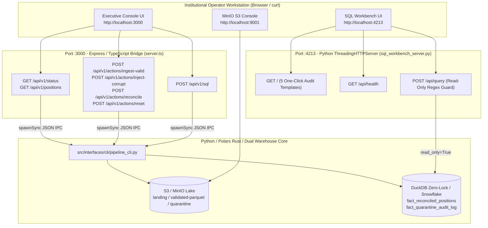

# Runbook 07: Web Control Plane API Bridge (`:3000`) and Zero-Lock Warehouse SQL Workbench (`:4213`) Operations

## 1. Purpose and Operational Scope

- **Operational Scope:** Express/TypeScript Control Plane (`src/interfaces/web/server.ts`), Executive Dashboard View Contract (`src/interfaces/web/dashboard_view.ts`), and Zero-Lock Warehouse SQL Workbench Server (`src/interfaces/web/sql_workbench_server.py`).
- **Target Audience:** Site Reliability Engineers (SRE), Quantitative Platform Operators, Front-Office Support Engineers, and Financial Data Auditors.
- **Severity Classification:**
  - `[OK]`: HTTP `200` responses across `:3000` and `:4213`, Honest Zero Baseline (`$0.00`) active on cold start/reset, and read-only SQL queries completing in `< 50ms`.
  - `[WARN]`: Non-default port override (`PORT` or `SQL_UI_PORT`) or offline S3 local mirror fallback active when Docker MinIO (`:9000/:9001`) is stopped.
  - `[NAV-BREAK]`: Material valuation break (`> 5.0 bps`) or `SCHEMA_REJECTED` record returned by `/api/v1/positions?status_filter=BREAKS_ONLY` or Template 2 in `:4213`.
  - `[CRITICAL]`: Blocked mutating SQL (`HTTP 400 READONLY_SQL_VIOLATION`) on `:4213` `/api/query` or `:3000` `/api/v1/sql`, or Python CLI bridge execution failure (`CLI_EXECUTION_ERROR`).

---

## 2. Multi-Port Web Control Plane Architecture (`:3000`, `:9001`, `:4213`)



---

## 3. Complete REST API Catalog (`:3000` & `:4213`)

### 3.1. Port `:3000` — Executive Reconciliation Console (`src/interfaces/web/server.ts`)

| HTTP Method & Route | Query / Body Parameters | Underlying CLI Action | Success / Error Codes |
| :--- | :--- | :--- | :--- |
| `GET /` | *(none)* | `--action status` | `200 OK` (`text/html` SSR Console) |
| `GET /api/v1/health` | *(none)* | In-memory health check | `200 OK` (`{"status": "[OK]", "port": 3000}`) |
| `GET /api/v1/status` | *(none)* | `--action status` | `200 OK` (KPIs `$0.00`, S3 metrics, URLs) |
| `GET /api/v1/positions` | `status_filter`, `search`, `page`, `page_size`, `sort_by` | `--action positions` | `200 OK` (Server-side paginated rows) |
| `POST /api/v1/actions/ingest-valid` | `{"count": 45, "seq": 1}` *(optional)* | `--action ingest-valid` | `200 OK` (Promoted count, rollups, KPIs) |
| `POST /api/v1/actions/inject-corrupt` | `{"breaks_count": 12, "corrupt_count": 6}` *(optional)* | `--action inject-corrupt` | `200 OK` (NAV breaks, quarantine manifest) |
| `POST /api/v1/actions/reconcile` | *(none)* | `--action reconcile` | `200 OK` (Full Polars `scan_parquet` audit) |
| `POST /api/v1/actions/reset` | *(none)* | `--action reset` | `200 OK` (Purges S3 & Warehouse to `$0.00`) |
| `POST /api/v1/sql` | `{"query": "SELECT ..."}` | `--action sql` | `200 OK` or `400 Bad Request` (`[CRITICAL]`) |

### 3.2. Port `:4213` — Warehouse SQL Workbench (`src/interfaces/web/sql_workbench_server.py`)

| HTTP Method & Route | Request Body | Behavior & Security Guardrail | Success / Error Codes |
| :--- | :--- | :--- | :--- |
| `GET /` | *(none)* | Renders dark-mode Snowsight/Shadcn SQL Workbench HTML5 UI with 5 one-click templates. | `200 OK` (`text/html`) |
| `GET /api/health` | *(none)* | Returns service health, port (`4213`), and active `warehouse_engine` (`duckdb`/`snowflake`). | `200 OK` (`application/json`) |
| `POST /api/query` | `{"sql": "SELECT ..."}` | Executes query via `warehouse.execute_readonly_sql(sql)` in `read_only=True` snapshot mode. | `200 OK` or `400 Bad Request` (`[CRITICAL]`) |

---

## 4. Standard Operating Procedures (SOPs): Starting & Auditing the Services

### 4.1. Starting the `:4213` SQL Workbench and `:3000` Executive Console

```powershell
# Terminal 1: Start the Zero-Lock Warehouse SQL Workbench on port :4213
python -m src.interfaces.web.sql_workbench_server

# Terminal 2: Start the Express / TypeScript Executive Console on port :3000
npm start
```

### 4.2. Reproducible `curl` Verification of the 4 Operational Actions on `:3000`

Execute the following commands in sequence to verify the complete lifecycle from Honest Zero Baseline (`$0.00`) through clean ingestion, corrupt/break injection, Polars re-reconciliation, break drill-down, and platform reset:

```bash
# 0. Verify Honest Zero Baseline ($0.00) before any batch ingestion
curl -s http://localhost:3000/api/v1/status | python -m json.tool

# 1. Action 1: Ingest Valid Institutional Batch (45 clean positions)
curl -s -X POST http://localhost:3000/api/v1/actions/ingest-valid \
  -H "Content-Type: application/json" \
  -d '{"count": 45}' | python -m json.tool

# 2. Action 2: Inject Corrupt Schema & 3-Factor NAV Breaks (12 breaks + 6 corruptions)
curl -s -X POST http://localhost:3000/api/v1/actions/inject-corrupt \
  -H "Content-Type: application/json" \
  -d '{"breaks_count": 12, "corrupt_count": 6}' | python -m json.tool

# 3. Drill-Down Card 4: Query ONLY NAV_BREAK and SCHEMA_REJECTED rows
curl -s "http://localhost:3000/api/v1/positions?status_filter=BREAKS_ONLY&page=1&page_size=25" | python -m json.tool

# 4. Global Search: Filter positions by portfolio or ISIN substring
curl -s "http://localhost:3000/api/v1/positions?status_filter=ALL&search=BLK-ALADDIN-CORE" | python -m json.tool

# 5. Action 3: Trigger Full Polars Lazy Streaming Reconciliation over S3 Parquet
curl -s -X POST http://localhost:3000/api/v1/actions/reconcile | python -m json.tool

# 6. Action 4: Reset Entire Platform back to Honest Zero Baseline ($0.00)
curl -s -X POST http://localhost:3000/api/v1/actions/reset | python -m json.tool
```

---

## 5. Interactive Auditing Guide for the `:4213` Warehouse SQL Workbench

Open `http://localhost:4213` in the browser. The top toolbar provides **5 Preconfigured 1-Click Institutional Queries**:

| Template Button | Target Table / Analytical View | Forensic Audit Objective |
| :--- | :--- | :--- |
| **1. Executive KPIs (Honest Zero Check)** | `v_executive_reconciliation_kpis` | Verify whether the warehouse is at `$0.00` baseline or inspect aggregate IBOR vs. ABOR AUM and total breaks. |
| **2. NAV & Schema Breaks Triage** | `v_nav_and_schema_breaks_triage` | Inspect unified `NAV_BREAK` (`> 5.0 bps`) and `SCHEMA_REJECTED` (`GX-01..GX-06`) records ordered by dollar impact. |
| **3. Portfolio AUM Rollup (Gross vs Net)** | `v_portfolio_aum_rollup` | Compare `net_fund_break_usd` vs. `gross_fund_break_usd` per portfolio to unmask offsetting positive/negative breaks. |
| **4. Reconciled Positions Fact Table** | `fact_reconciled_positions` | Audit individual position inputs (`units`, `price`, `fx_rate`) and 3-factor attribution (`qty_effect_usd`, `price_effect_usd`, `fx_effect_usd`). |
| **5. Quarantine Forensic Audit Log** | `fact_quarantine_audit_log` | Inspect rejected records, `rule_id`, `violation_code`, and `diagnostic_message` isolated at the ingestion gate. |

### Verifying the `:4213` Anti-Mutation Firewall via `curl`

```bash
# Approved read-only query (returns HTTP 200 [OK])
curl -s -X POST http://localhost:4213/api/query \
  -H "Content-Type: application/json" \
  -d '{"sql": "SELECT * FROM v_executive_reconciliation_kpis"}' | python -m json.tool

# Blocked destructive query (returns HTTP 400 [CRITICAL] READONLY_SQL_VIOLATION)
curl -s -i -X POST http://localhost:4213/api/query \
  -H "Content-Type: application/json" \
  -d '{"sql": "DROP TABLE fact_reconciled_positions"}'
```

---

## 6. Troubleshooting & Incident Resolution Matrix

| Symptom / Error Code | Root Cause | Resolution Procedure |
| :--- | :--- | :--- |
| `HTTP 400 READONLY_SQL_VIOLATION` on `:4213` or `/api/v1/sql` | Query did not begin with `SELECT`/`WITH`/`DESCRIBE` or contained mutating keywords (`DROP`, `DELETE`, `TRUNCATE`, `UPDATE`, `INSERT`, `ALTER`, `COPY`). | Rewrite the query as a pure analytical `SELECT` statement. Use `POST /api/v1/actions/reset` if table truncation is intended. |
| `CLI_EXECUTION_ERROR` on `:3000` | `PYTHON_BIN` environment variable points to a Python binary missing `polars`, `duckdb`, or `pydantic`. | Ensure the active Python environment has all dependencies installed (`pip install -e .`) or export `PYTHON_BIN=python`. |
| Port `:3000` or `:4213` already in use (`EADDRINUSE`) | A previous instance of `server.ts` or `sql_workbench_server.py` is still bound to the port. | Terminate the stale process or override `PORT` / `SQL_UI_PORT` in `.env`. |

---

## 7. Programmatic Health & Smoke Check Script (Zero-Socket Verification)

Operators and CI pipelines can verify the `:4213` SQL Workbench HTML renderer and read-only SQL execution engine without binding a network port by running the following diagnostic snippet:

```powershell
python -c "
from src.infrastructure.config import AssetPipeConfig
from src.interfaces.web.sql_workbench_server import (
    execute_workbench_query,
    render_sql_workbench_html,
)

cfg = AssetPipeConfig.from_env()
html = render_sql_workbench_html(cfg)
assert 'Back to Executive Console (:3000)' in html
code_ok, payload_ok = execute_workbench_query(
    'SELECT * FROM v_executive_reconciliation_kpis;', cfg
)
code_err, payload_err = execute_workbench_query(
    'DROP TABLE fact_reconciled_positions;', cfg
)
print(f'[OK] Workbench HTML length: {len(html)} bytes')
print(f'[OK] Honest Zero Query HTTP {code_ok}: {payload_ok[\"status\"]}')
print(f'[OK] Mutation Block HTTP {code_err}: {payload_err[\"status\"]} ({payload_err[\"code\"]})')
"
```

### Expected Diagnostic Output (`[OK]`)

```text
[OK] Workbench HTML length: 7854 bytes
[OK] Honest Zero Query HTTP 200: [OK]
[OK] Mutation Block HTTP 400: [CRITICAL] (READONLY_SQL_VIOLATION)
```

