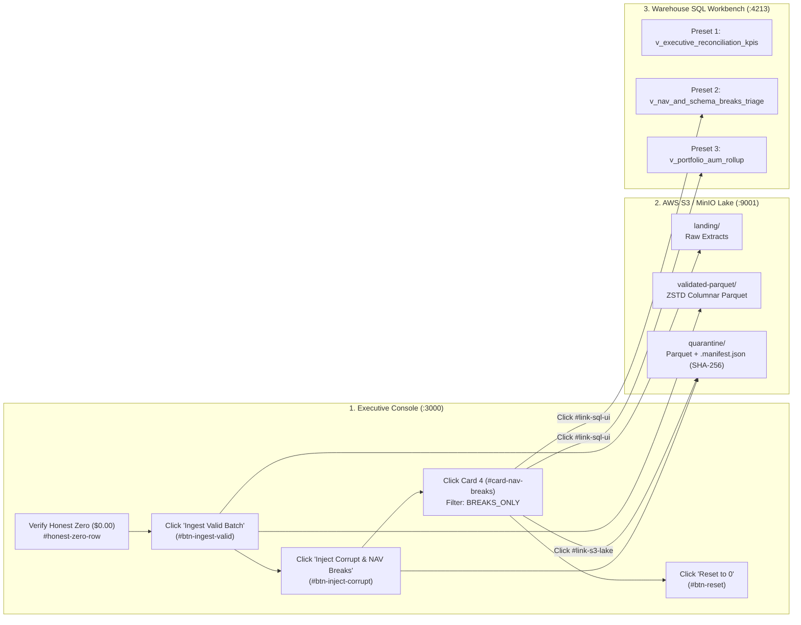

# Runbook 08: Executive Financial Console (`:3000`) 360-Degree Triage, Interactive KPI Filtering, and Frontend Verification

## 1. Purpose and Operational Scope

- **Operational Scope:** Executive Dashboard View (`src/interfaces/web/dashboard_view.ts`), Express API Control Plane (`src/interfaces/web/server.ts`), and Vitest Integrity Suite (`tests/web/dashboard_integrity.test.ts`).
- **Target Audience:** Quantitative Portfolio Operations, Fund Accounting Controllers, L2 Application Support, and Data Platform Engineers.
- **Severity Classification:**
  - `[OK]`: Honest Zero Baseline (`$0.00`) verified on startup/reset, allpositions reconciled (`<= 5.0 bps`), and V8 `<script>` compilation passing in `Vitest`.
  - `[WARN]`: Positions flagged as `MINOR_TOLERANCE` (`0.1 < bps <= 5.0` and `<= $10.00`) due to FX rounding differences.
  - `[NAV-BREAK]`: Positions exceeding institutional valuation tolerance (`> 5.0 bps`), decomposed into Quantity (`E_Q`), Price (`E_P`), or FX (`E_FX`) drivers in the 13-column grid.
  - `[CRITICAL]`: Positions rejected into S3 `quarantine/` (`SCHEMA_REJECTED`) due to ISO 6166 Luhn Mod-10 ISIN failures, non-ISO-4217 currencies, IEEE 754 `NaN`/`Inf`, or duplicate primary keys (`GX-01..GX-06`).

---

## 2. 360-Degree Multi-Port Operational Workflow (`:3000` + `:9001` + `:4213`)



---

## 3. Operator Guide: Interactive Controls on the `:3000` Console

### 3.1. Top Header Action Buttons & 360-Degree External Bridges

| Control ID | Button / Link Label | HTTP Endpoint / Target URL | Operational Effect |
| :--- | :--- | :--- | :--- |
| `btn-ingest-valid` | `Ingest Valid Batch` | `POST /api/v1/actions/ingest-valid` | Generates 45 clean multi-currency institutional positions, writes `ZSTD` Parquet to `validated-parquet/`, and upserts into the Warehouse. |
| `btn-inject-corrupt` | `Inject Corrupt & NAV Breaks` | `POST /api/v1/actions/inject-corrupt` | Generates 12 material 3-factor NAV breaks (`QUANTITY_BREAK`, `PRICE_BREAK`, `FX_BREAK`) + 6 schema corruptions (`GX-01..GX-06`). |
| `btn-reconcile` | `Reconcile Lake (Polars)` | `POST /api/v1/actions/reconcile` | Runs `Polars` lazy `scan_parquet` (`engine="streaming"`) across all validated Parquet partitions and refreshes warehouse rollups. |
| `btn-reset` | `Reset to 0` | `POST /api/v1/actions/reset` | Purges all 3 S3 buckets (`0` objects, `0 B`) and truncates warehouse tables back to Honest Zero Baseline (`$0.00`). |
| `link-s3-lake` | `Open AWS S3 Lake (:9001)` | `http://localhost:9001` | Opens the MinIO S3 Console in a new tab (credentials badge: `admin / assetpipe2026`). |
| `link-sql-ui` | `Open Warehouse SQL UI (:4213)` | `http://localhost:4213` | Opens the Zero-Lock Read-Only SQL Workbench (`:4213`) with 5 preconfigured audit queries. |

### 3.2. Using the 5 Interactive KPI Cards for 1-Click Server-Side Triage

Each of the 5 top cards acts as a server-side filter and sort trigger:

1. **Card 1 (`#card-total-positions` — `Total Audited Positions`):**
   - Sets `status_filter=ALL` and `sort_by=nav_break_abs_desc`.
   - Displays total positions in the warehouse and total Parquet/manifest objects in S3.
2. **Card 2 (`#card-validated-aum` — `Validated IBOR AUM (USD)`):**
   - Sets `status_filter=ALL` and `sort_by=calculated_nav_desc`.
   - Orders the portfolio grid from highest to lowest USD valuation (`calculated_nav`) and compares IBOR AUM against Custodian ABOR AUM.
3. **Card 3 (`#card-reconciled-ok` — `Reconciled Clean [OK]`):**
   - Sets `status_filter=RECONCILED_ONLY` and `sort_by=calculated_nav_desc`.
   - Isolates only positions in `RECONCILED` or `MINOR_TOLERANCE` state and displays the exact pass rate percentage.
4. **Card 4 (`#card-nav-breaks` — `NAV & Schema Breaks [CRITICAL]`):**
   - Sets `status_filter=BREAKS_ONLY` and `sort_by=nav_break_abs_desc`.
   - Queries `v_nav_and_schema_breaks_triage` on the server to display **only** `NAV_BREAK` and `SCHEMA_REJECTED` records, ordered by dollar impact.
5. **Card 5 (`#card-gross-variance` — `Gross NAV Variance ($ / bps)`):**
   - Sets `status_filter=BREAKS_ONLY` and `sort_by=nav_break_bps_desc`.
   - Orders all breaks by relative basis-point severity (`nav_break_bps DESC`) and displays both Gross Variance ($\sum |\Delta \text{NAV}|$) and Net Variance ($\sum \Delta \text{NAV}$).

### 3.3. Using the `(i)` Contextual Popovers Safely

Clicking any circular `(i)` button invokes `toggleTooltip(event, tooltipId)`, which executes `event.stopPropagation()` and `event.preventDefault()`. This allows operators and financial auditors to read the mathematical formula of any KPI or button without triggering the parent card filter or pipeline action. Clicking anywhere outside closes all open popovers.

---

## 4. Step-by-Step Forensic Triage Walkthrough (Isolating Breaks in `< 10` Seconds)

### Step 1: Verify Honest Zero Baseline (`$0.00`)

1. Open `http://localhost:3000` (or click `Reset to 0`).
2. Confirm that Card 1 shows `0`, Card 2 shows `$0.00`, Card 3 shows `0` (`0.0% Pass`), Card 4 shows `0`, Card 5 shows `$0.00` (`Max: 0.00 bps`), and the table displays:
   `[OK] HONEST ZERO BASELINE ACTIVE — Warehouse and S3 Lake contain 0 records ($0.00).`

### Step 2: Ingest Clean Batch & Inject Forensic Breaks

1. Click **`Ingest Valid Batch`** (`#btn-ingest-valid`). Observe Card 1 jump to `45` positions and Card 3 show `45` (`100.0% Pass`).
2. Click **`Inject Corrupt & NAV Breaks`** (`#btn-inject-corrupt`). Observe Card 4 (`NAV & Schema Breaks [CRITICAL]`) increment by `18` (`[NAV-BREAK]: 12 | Quarantine: 6`).

### Step 3: Isolate Breaks & Inspect 3-Factor Attribution

1. Click **Card 4 (`4. NAV & Schema Breaks [CRITICAL]`)**.
2. Inspect the `Primary Driver (Q / P / FX)` column in the table:
   - `QUANTITY_BREAK (Q:$... | P:$0.00 | FX:$0.00)`: Unsettled trade or share count mismatch between IBOR and Custodian.
   - `PRICE_BREAK (Q:$0.00 | P:$... | FX:$0.00)`: Stale market price feed.
   - `FX_BREAK (Q:$0.00 | P:$0.00 | FX:$...)`: WM/Reuters 4pm fix vs. intraday FX rate discrepancy.
   - `SCHEMA_CORRUPTION [GX-01..GX-06]`: Record rejected at the customs gate; hover over the driver cell to read the exact `diagnostic_message`.
3. Use the global search bar (`#search-input`) to filter by portfolio (e.g., `BLK-ALADDIN-CORE`), currency (`EUR`), or `ISIN`.

### Step 4: Cross-Verify with S3 Lake (`:9001`) and SQL Workbench (`:4213`)

1. Click **`Open AWS S3 Lake (:9001)`** (`#link-s3-lake`) in the top bar and sign in using the credentials displayed on the badge (`admin / assetpipe2026`).
   - Verify that the `quarantine/` bucket contains the rejected Parquet batch and its companion `.manifest.json` file with SHA-256 checksums.
   - Verify that `validated-parquet/` contains the `ZSTD`-compressed Parquet files partitioned by `valuation_date=YYYY-MM-DD/portfolio_id=...`.
2. Click **`Open Warehouse SQL UI (:4213)`** (`#link-sql-ui`) in the top bar.
   - Click Preset Button 1 (`1. Executive KPIs`) and verify that `validated_ibor_aum_usd`, `reconciled_count`, `nav_break_count`, and `quarantine_rejected_count` match the 5 KPI cards on `:3000` to the cent.
   - Click Preset Button 2 (`2. NAV & Schema Breaks Triage`) and verify that the rows returned by `v_nav_and_schema_breaks_triage` match the filtered `:3000` grid when Card 4 is active.

### Step 5: Execute Deterministic Reset to Honest Zero (`$0.00`)

1. Return to `http://localhost:3000` and click **`Reset to 0`** (`#btn-reset`).
2. Confirm the toast notification reads `[OK] Deterministic Reset to Honest Zero ($0.00) completed`.
3. Verify that all 3 S3 bucket counters (`landing`, `validated-parquet`, `quarantine`) drop to `0 objects (0 B)` and all 5 KPI cards return to `$0.00` and `0`.

---

## 5. Mathematical Reference for `(i)` Contextual Popovers

To assist operations analysts and auditors inspecting the `(i)` contextual popovers on `:3000`, the following table summarizes the exact accounting formulas enforced across the console:

| Tooltip ID | UI Element | Accounting Formula / Invariant | Threshold / SLA |
| :--- | :--- | :--- | :--- |
| `tip-card-total` | Card 1 (`Total Audited Positions`) | $N_{\text{total}} = N_{\text{reconciled}} + N_{\text{tolerance}} + N_{\text{nav\_break}} + N_{\text{quarantine}}$ | $100\%$ audit trace coverage |
| `tip-card-aum` | Card 2 (`Validated IBOR AUM`) | $\text{NAV}_{\text{IBOR}} = \sum (\text{Units}_{\text{IBOR}} \times \text{Price}_{\text{IBOR}} \times \text{FX}_{\text{IBOR}})$ | Exact IEEE 754 `Float64` / `DECIMAL(18,4)` |
| `tip-card-ok` | Card 3 (`Reconciled Clean [OK]`) | $\text{Pass Rate (\%)} = 100 \times \frac{N_{\text{reconciled}} + N_{\text{tolerance}}}{N_{\text{total}}}$ | $\text{bps} \le 5.0$ and $|\Delta \text{NAV}| \le \$10.00$ |
| `tip-card-breaks` | Card 4 (`NAV & Schema Breaks`) | $N_{\text{breaks}} = N_{\text{nav\_break}} (\text{bps} > 5.0) + N_{\text{quarantine}} (\text{GX-01..06})$ | Immediate L2/L3 escalation if $> 0$ |
| `tip-card-variance` | Card 5 (`Gross NAV Variance`) | $\text{Gross} = \sum |\Delta \text{NAV}|, \quad \text{bps} = \frac{|\Delta \text{NAV}|}{\max(\text{NAV}_{\text{IBOR}}, 0.01)} \times 10{,}000$ | Material break when $> 5.0\text{ bps}$ |
| `tip-col-variance` | Column 11 (`Net Variance`) | $\Delta \text{NAV} = \text{NAV}_{\text{IBOR}} - \text{NAV}_{\text{ABOR}}$ | Signed USD delta + unsigned `bps` |
| `tip-col-driver` | Column 13 (`Primary Driver`) | $\Delta \text{NAV} = E_Q + E_P + E_{FX}$ (`argmax(|E_Q|, |E_P|, |E_FX|)`) | Exact 3-factor identity (`0.00` residual) |

---

## 6. Frontend Diagnostics, TypeScript Verification, and Vitest Gate

Whenever modifying `src/interfaces/web/dashboard_view.ts` or `src/interfaces/web/server.ts`, run the automated frontend verification gates:

```powershell
# 1. Strict TypeScript Compiler Gate (0 errors required)
npm run typecheck

# 2. Vitest SSR, V8 Script Compilation (new Function), and Express API Suite
npm test

# 3. Full Python Backend & Architectural OPSEC / LOC Gate
python -m pytest -v
python -m ruff check .
```

### Troubleshooting Frontend & Test Failures

| Failure / Symptom | Root Cause | Remediation |
| :--- | :--- | :--- |
| `SyntaxError` in `compiles embedded browser <script> cleanly in V8` | Unescaped backtick or malformed JS inside the `<script>...</script>` block of `dashboard_view.ts`. | Inspect the `<script>` section in `src/interfaces/web/dashboard_view.ts`; use standard single-quoted JS strings inside the TypeScript template literal. |
| Clicking `(i)` triggers card filter or action button | Missing `event.stopPropagation()` or `event.preventDefault()` on `.info-trigger`. | Ensure every `(i)` element calls `onclick="toggleTooltip(event, 'tip-id')"` where `toggleTooltip` stops event propagation immediately. |
| Table does not update automatically | Auto-Refresh toggle (`#btn-toggle-autorefresh`) was set to `[PAUSED]`. | Click `Auto-Refresh (1.5s): [PAUSED]` in the toolbar to re-enable the 1.5s polling loop (`[ON]`). |
| Search input loses cursor or focus during auto-refresh | `refreshConsoleState` overwritten `#search-input.value` while focused. | Ensure `#search-input` remains outside `#positions-tbody` and is never overwritten during background polling ticks. |
| `:9001` or `:4213` bridge opens blank page | MinIO container or Python SQL Workbench daemon is not running. | Start MinIO via `docker compose up -d` and start the SQL Workbench via `python -m src.interfaces.web.sql_workbench_server`. |

---

## 7. Direct HTTP API Verification Commands (`curl` / `Invoke-RestMethod`)

When triaging `:3000` headless or from an automated monitoring agent, verify the underlying JSON endpoints directly:

```powershell
# 1. Inspect Executive KPIs, S3 Bucket Telemetry, and Warehouse Rollups
Invoke-RestMethod -Uri "http://localhost:3000/api/v1/status" -Method Get | ConvertTo-Json -Depth 5

# 2. Query Server-Side Filtered Breaks (Card 4 equivalent: BREAKS_ONLY sorted by USD break)
Invoke-RestMethod -Uri "http://localhost:3000/api/v1/positions?status_filter=BREAKS_ONLY&sort_by=nav_break_abs_desc&limit=25&offset=0" -Method Get | ConvertTo-Json -Depth 5

# 3. Trigger Deterministic Reset to Honest Zero ($0.00)
Invoke-RestMethod -Uri "http://localhost:3000/api/v1/actions/reset" -Method Post | ConvertTo-Json -Depth 4
```

### Expected Honest Zero Baseline JSON Invariants

- `warehouse.kpis.total_positions == 0`
- `warehouse.kpis.validated_ibor_aum_usd == 0`
- `warehouse.kpis.gross_nav_variance_usd == 0`
- `warehouse.kpis.honest_zero_baseline == true`
- `s3_buckets[*].object_count == 0` and `s3_buckets[*].total_bytes == 0`
