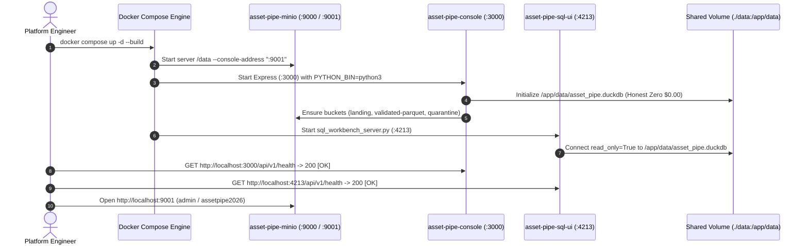

# Runbook 09: Docker Compose 360-Degree Deployment (`:3000`, `:9001`, `:4213`), Health Verification, and Container Troubleshooting

## 1. Purpose and Operational Scope

- **Operational Scope:** Multi-container orchestration (`docker-compose.yml`), Executive Console container (`docker/Dockerfile.console`), Warehouse SQL Workbench container (`docker/Dockerfile.sql-ui`), and MinIO S3 Object Storage container (`minio/minio:latest`).
- **Target Audience:** Data Platform Engineers, DevOps / Site Reliability Engineers (SRE), and Technical Evaluators.
- **Severity Classification:**
  - `[OK]`: All 3 containers (`asset-pipe-minio`, `asset-pipe-console`, `asset-pipe-sql-ui`) running and healthy on `:3000`, `:9001`, and `:4213`, starting at Honest Zero Baseline (`$0.00`).
  - `[WARN]`: MinIO S3 container unreachable during startup race condition; `S3ParquetAdapter` transparently falls back to the local columnar mirror (`/app/data/s3_lake`) and syncs when MinIO is ready.
  - `[CRITICAL]`: Host port collision on `3000`, `4213`, `9000`, or `9001`, or corrupted volume state preventing container startup.

---

## 2. End-to-End Container Startup & Health Verification Lifecycle



---

## 3. Standard Deployment Procedure (`docker compose`)

### 3.1. Pre-Flight Port Availability Check

Before starting the stack, confirm that ports `3000`, `4213`, `9000`, and `9001` are free on the host workstation:

```powershell
# Verify that ports 3000, 4213, 9000, and 9001 are not bound by orphan processes
Get-NetTCPConnection -LocalPort 3000, 4213, 9000, 9001 -ErrorAction SilentlyContinue |
    Select-Object LocalAddress, LocalPort, State, OwningProcess
```

### 3.2. Building and Starting the 3-Container Topology

```powershell
# 1. Build images from docker/Dockerfile.console and docker/Dockerfile.sql-ui and start detached
docker compose up -d --build

# 2. Verify container states and port mappings
docker compose ps
```

Expected `docker compose ps` output:

| Container Name | Image | Command | Status | Host Ports |
| :--- | :--- | :--- | :--- | :--- |
| `asset-pipe-minio` | `minio/minio:latest` | `server /data --console-address ":9001"` | `Up` | `0.0.0.0:9000->9000/tcp`, `0.0.0.0:9001->9001/tcp` |
| `asset-pipe-console` | `asset-pipe-asset-pipe-console` | `npm start` | `Up` | `0.0.0.0:3000->3000/tcp` |
| `asset-pipe-sql-ui` | `asset-pipe-asset-pipe-sql-ui` | `python3 -m src.interfaces.web.sql_workbench_server` | `Up` | `0.0.0.0:4213->4213/tcp` |

### 3.3. Automated Smoke Test Across All 3 Surfaces

Run the following PowerShell verification sequence to confirm all 3 containers respond with HTTP `200` and start at the **Honest Zero Baseline (`$0.00`)**:

```powershell
# 1. Verify Executive Console (:3000) health and Honest Zero status
Invoke-RestMethod -Uri "http://localhost:3000/api/v1/health" -Method Get
Invoke-RestMethod -Uri "http://localhost:3000/api/v1/status" -Method Get | ConvertTo-Json -Depth 4

# 2. Verify SQL Workbench (:4213) health and read-only preset query execution
Invoke-RestMethod -Uri "http://localhost:4213/api/v1/health" -Method Get
Invoke-RestMethod -Uri "http://localhost:4213/api/v1/query" -Method Post `
    -ContentType "application/json" `
    -Body '{"sql": "SELECT * FROM v_executive_reconciliation_kpis;"}' | ConvertTo-Json -Depth 4

# 3. Trigger a clean batch ingestion on :3000 and verify immediate visibility on :4213
Invoke-RestMethod -Uri "http://localhost:3000/api/v1/actions/ingest-valid" -Method Post `
    -ContentType "application/json" -Body '{"count": 45, "seq": 1}' | ConvertTo-Json -Depth 4

# 4. Reset the entire platform back to Honest Zero ($0.00)
Invoke-RestMethod -Uri "http://localhost:3000/api/v1/actions/reset" -Method Post | ConvertTo-Json -Depth 4
```

---

## 4. Switching the Container Stack to Snowflake Cloud (`WAREHOUSE_ENGINE=snowflake`)

By default, `docker-compose.yml` sets `WAREHOUSE_ENGINE=${WAREHOUSE_ENGINE:-duckdb}`. To run the containerized control plane against enterprise **Snowflake Cloud** with RSA-2048 Key-Pair authentication:

1. Mount your PKCS#8 private key (`rsa_key.p8`) read-only into `/secrets/rsa_key.p8` and provide the Snowflake environment variables in `.env`:
   ```bash
   WAREHOUSE_ENGINE=snowflake
   SNOWFLAKE_ACCOUNT=xy12345.us-east-1
   SNOWFLAKE_USER=ASSET_PIPE_SVC_USER
   SNOWFLAKE_ROLE=ASSET_PIPE_SVC_ROLE
   SNOWFLAKE_WAREHOUSE=ASSET_PIPE_WH
   SNOWFLAKE_DATABASE=ASSET_PIPE_DB
   SNOWFLAKE_SCHEMA=RECONCILIATION
   SNOWFLAKE_PRIVATE_KEY_PATH=/secrets/rsa_key.p8
   ```
2. Restart the containers so both `:3000` and `:4213` route `WarehousePort` calls to `SnowflakeWarehouseAdapter`:
   ```powershell
   docker compose up -d
   ```

---

## 5. Container Log Inspection, Diagnostics, and Incident Triage Matrix

```powershell
# Tail structured logs across all 3 containers
docker compose logs -f --tail=100

# Inspect logs for a specific service
docker compose logs asset-pipe-console --tail=50
docker compose logs asset-pipe-sql-ui --tail=50
docker compose logs minio --tail=50

# Execute the Python CLI directly inside the running console container
docker exec -it asset-pipe-console python3 -m src.interfaces.cli.pipeline_cli --action status
```

### Incident Triage & Resolution Table

| Symptom / Error Message | Affected Service | Root Cause | Remediation Command / Action |
| :--- | :--- | :--- | :--- |
| `Bind for 0.0.0.0:3000 failed: port is already allocated` | `asset-pipe-console` | A local `npm start` or Node process is already listening on port `3000`. | Stop the local Node server or kill the process owning `:3000`, then re-run `docker compose up -d`. |
| `Bind for 0.0.0.0:4213 failed: port is already allocated` | `asset-pipe-sql-ui` | A local `sql_workbench_server.py` process is listening on port `4213`. | Terminate the local Python server on `:4213` before starting Docker Compose. |
| `CLI_EXECUTION_ERROR: spawn python ENOENT` inside container | `asset-pipe-console` | Debian Linux provides `python3` binary rather than `python`. | Verify `PYTHON_BIN: "python3"` in `docker-compose.yml` and `process.platform === "win32" ? "python" : "python3"` in `server.ts`. |
| `duckdb.IOException: Could not set lock on file` | `asset-pipe-sql-ui` or `asset-pipe-console` | An external host tool (e.g., DBeaver) has `/data/asset_pipe.duckdb` open in read-write mode on the host. | Close any external IDE connection holding a write lock on `data/asset_pipe.duckdb`; internal containers use Zero-Hold Write Lock and `read_only=True`. |
| MinIO Console `:9001` shows `Invalid Login` | `asset-pipe-minio` | Browser autofilled stale credentials instead of `MINIO_ROOT_USER` / `MINIO_ROOT_PASSWORD`. | Log in using the credentials displayed on the `:3000` top badge: `admin` / `assetpipe2026`. |

---

## 6. Clean Teardown and Disk Space Reclamation

All persistent container data is stored locally inside `./data` and `./.minio_data` within the workspace directory (protecting the OS boot drive). To stop the containers and reclaim disk space:

```powershell
# 1. Stop and remove containers and the asset-pipe-net bridge network
docker compose down --remove-orphans

# 2. (Optional) Purge local DuckDB and MinIO object storage directories back to 0 bytes
Remove-Item -Path ".\data\*", ".\.minio_data\*" -Recurse -Force -ErrorAction SilentlyContinue

# 3. (Optional) Prune dangling Docker build cache layers
docker builder prune -f
```

---

## 7. Complete Container Environment Variable Reference Matrix

The following table documents every environment variable consumed across `docker-compose.yml`, `docker/Dockerfile.console`, and `docker/Dockerfile.sql-ui`:

| Environment Variable | Default in `docker-compose.yml` | Consumed By | Operational Purpose |
| :--- | :--- | :--- | :--- |
| `PORT` | `3000` | `asset-pipe-console` | TCP port where the Express / TypeScript Executive Console listens. |
| `PYTHON_BIN` | `python3` | `asset-pipe-console` | Python interpreter binary invoked by `server.ts` (`python3` on Debian Linux, `python` on Windows). |
| `S3_ENDPOINT_URL` | `http://minio:9000` | `asset-pipe-console` | Internal Docker bridge DNS endpoint for Boto3 S3 API operations (`PutObject`, `ListObjectsV2`). |
| `S3_PUBLIC_CONSOLE_URL` | `http://localhost:9001` | `asset-pipe-console` | Host-accessible URL rendered on the `Open AWS S3 Lake (:9001)` top header button. |
| `SQL_WORKBENCH_PUBLIC_URL` | `http://localhost:4213` | `asset-pipe-console` | Host-accessible URL rendered on the `Open Warehouse SQL UI (:4213)` top header button. |
| `S3_ACCESS_KEY` | `admin` | `minio`, `asset-pipe-console` | Root S3 access key (matches `MINIO_ROOT_USER`). |
| `S3_SECRET_KEY` | `assetpipe2026` | `minio`, `asset-pipe-console` | Root S3 secret key (matches `MINIO_ROOT_PASSWORD`). |
| `S3_BUCKET_LANDING` | `landing` | `asset-pipe-console` | Raw immutable JSON extracts bucket name. |
| `S3_BUCKET_VALIDATED` | `validated-parquet` | `asset-pipe-console` | Columnar Apache Parquet (`ZSTD` level 3) bucket name. |
| `S3_BUCKET_QUARANTINE` | `quarantine` | `asset-pipe-console` | Forensic quarantine bucket storing rejected rows + `.manifest.json` (`SHA-256`). |
| `WAREHOUSE_ENGINE` | `duckdb` | `asset-pipe-console`, `asset-pipe-sql-ui` | Active `WarehousePort` engine (`duckdb` or `snowflake`). |
| `DUCKDB_PATH` | `/app/data/asset_pipe.duckdb` | `asset-pipe-console`, `asset-pipe-sql-ui` | Shared volume path for the embedded DuckDB file. |
| `ASSET_PIPE_LAKE_DIR` | `/app/data/s3_lake` | `asset-pipe-console` | Local columnar mirror directory inside the shared `/app/data` volume. |
| `SQL_UI_PORT` | `4213` | `asset-pipe-sql-ui` | TCP port where `sql_workbench_server.py` serves the Read-Only SQL Explorer. |

